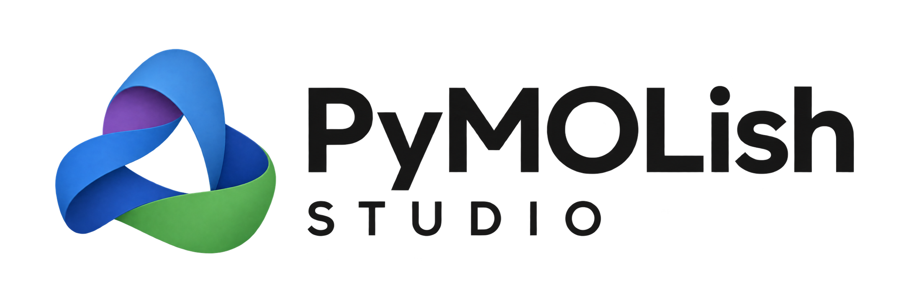
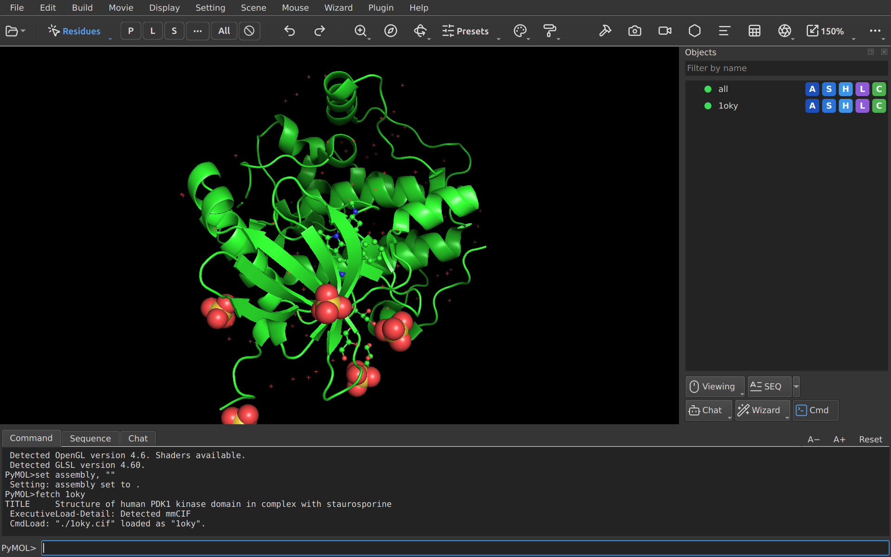

<p align="center">
  <picture>
    <source media="(prefers-color-scheme: dark)" srcset="docs/img/logo-dark.png" />
    
  </picture>
</p>

pymolish-studio. Based on PyMOL(TM) technology.

Open a molecular structure, inspect its parts, and make figures or short
movies. pymolish-studio is a desktop program for looking at molecules in
3D. It is
[Open-Source PyMOL](https://github.com/schrodinger/pymol-open-source) with a
new window, less old code and faster heavy operations.

> pymolish-studio is an independent fork. It is not a Schrodinger product and
> is not affiliated with or endorsed by Schrodinger, LLC. The official PyMOL
> is at [pymol.org](https://pymol.org).



[Download](https://github.com/adrian-jasinski/pymolish-studio/releases) ·
[Start here](docs/getting-started.md) ·
[Documentation](docs/README.md)

## What you can do with it

- **Make a figure.** Pick a ready-made look (cartoon, atoms, a glossy or
  frosted surface), a light and a background, and save a ray-traced
  picture. [Appearance](docs/appearance.md)
- **Look at a binding site.** Jump from ligand to ligand, see the residues
  around each and its contacts, and draw the same contacts flat.
  [Ligands](docs/ligands.md)
- **Compare sequences and structures.** Align sequences, see the matching
  residues in 3D, fit structures on a reference.
  [Sequences](docs/sequences.md)
- **Sort through many molecules.** Load a folder, read scores from a
  spreadsheet, step through the rows, rate them.
  [Property table](docs/properties.md)
- **Make a movie.** Store scenes, put them on a timeline, export a video.
  [Scenes and movies](docs/scenes-movies.md)
- **Script it.** The command language and the Python API of PyMOL, with
  the differences listed in
  [Compatibility](docs/reference.md#compatibility-with-pymol).

## Try it

1. Download the archive for your system from the
   [Releases page](https://github.com/adrian-jasinski/pymolish-studio/releases).
   There is one for Linux, Windows and macOS (Apple silicon). You do not need
   Python.
2. Unpack it and start `pymolish` (`pymolish.exe` on Windows).
3. Choose File > Get PDB..., type `1oky`, press Download, and drag with the
   mouse.

[Getting started](docs/getting-started.md) takes it from there.

These are preview builds and they are not signed, so Windows and macOS may
warn before the first start. `SHA256SUMS` on the Releases page lists the
checksums.

To build your own copy after cloning:

```sh
git clone https://github.com/adrian-jasinski/pymolish-studio.git
cd pymolish-studio
./install
```

On Windows, use `.\install.cmd` for the last line. The script detects your
system, offers to install missing dependencies, builds in a local Python
environment, and prints the launch command. Add `--dry-run` to preview.
[Source installation and supported systems](docs/install.md).

## Documentation

The [documentation home](docs/README.md) links every page.

| I want to | Read |
| --- | --- |
| Open a structure and make a picture | [Getting started](docs/getting-started.md) |
| Do one thing: looks, ligands, sequences, tables, movies, saving | [Task guides](docs/README.md#choose-a-task) |
| Look up a command, a key or a setting | [Commands](docs/commands.md), [Reference](docs/reference.md) |
| Solve a problem | [Troubleshooting](docs/troubleshooting.md) |
| Know what changed compared with PyMOL | [What is different](docs/features.md) |
| Build it from source | [Install from source](docs/install.md) |
| Write a plugin | [Writing a plugin](docs/plugins.md) |
| Help with the code | [Contributing](CONTRIBUTING.md) |
| See what is planned | [Roadmap](PLAN.md), [finished steps](PLAN-DONE.md), [ChangeLog](ChangeLog) |
| Know what I may do with it | [Licenses](docs/licenses.md) |

## Support the project

pymolish-studio is free and built in my spare time. If you find it useful, consider buying me a coffee ☕ — even a small contribution makes a difference!
Your support helps me spend more time on new features, bug fixes, and releases.
[Support on GitHub Sponsors](https://github.com/sponsors/adrian-jasinski) 💖

## License

pymolish-studio. Contains PyMOL(TM) source code.

Free to use, change and share, also at work. Two licenses apply, and a copy
of the software needs both files:

- Code from Open-Source PyMOL, Copyright (C) Schrodinger, LLC:
  [LICENSE](LICENSE).
- Code added by pymolish-studio: MIT, [LICENSE-MIT](LICENSE-MIT).

[Licenses](docs/licenses.md) explains this in plain words and lists the
third-party parts.

---

PyMOL is a trademark of Schrodinger, LLC.
