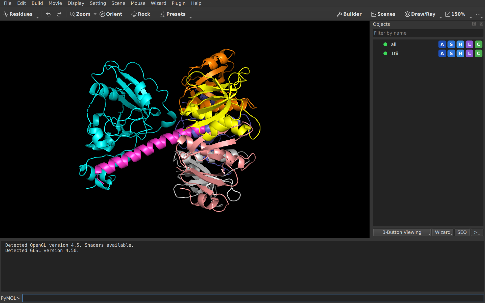

# pymolish-studio

pymolish-studio. Based on PyMOL(TM) technology.

A molecular viewer for proteins, small molecules, density, surfaces and
trajectories. It is a fork of
[Open-Source PyMOL](https://github.com/schrodinger/pymol-open-source) with one
goal: smaller, faster, simpler, prettier.

pymolish-studio is an independent fork. It is not a Schrodinger product and is
not affiliated with or endorsed by Schrodinger, LLC. The official PyMOL is at
[pymol.org](https://pymol.org).

## Features

- **One interface:** Qt 6 with a dark theme and a scale button for
  high-resolution screens. [More](docs/features.md#interface)
- **Objects panel:** click a row to show or hide an object; Action, Show,
  Hide, Label and Color menus on every row. [More](docs/features.md#interface)
- **States panel:** step, play and time trajectories and movies in one
  place. [More](docs/features.md#interface)
- **Faster:** a session loads 6.6 times faster and a large surface builds in
  about half the time. [Numbers](docs/features.md#speed)
- **Smaller:** Tk, GLUT, OpenVR, COLLADA, MMTF and the built-in web servers
  are gone. [Full list](docs/features.md#removed)
- **Runs without installing Python:** bundles for Linux, Windows and macOS.
  [More](docs/features.md#builds)
- **Plugins and scripts keep working:** the `cmd` API and the plugin loader
  stay. [Writing a plugin](docs/plugins.md)
- **Same files:** PDB, mmCIF, SDF/MOL, PSE sessions and PNG export.
  [What is kept](docs/features.md#kept)

## Download

Bundles for Linux, Windows and macOS (arm64), plus wheels, are on the
[Releases page](https://github.com/adrian-jasinski/pymolish-studio/releases).
Unpack and run `pymolish` (Linux, macOS) or `pymolish.exe` (Windows). These
are unsigned preview builds; `SHA256SUMS` lists the checksums.

To build from source, see [INSTALL](INSTALL). To contribute, see
[DEVELOPERS](DEVELOPERS) and [AGENTS.md](AGENTS.md).

## Documentation

| Document | Content |
| --- | --- |
| [docs/features.md](docs/features.md) | What is added, changed and removed compared with Open-Source PyMOL |
| [docs/plugins.md](docs/plugins.md) | How to write a plugin |
| [docs/licenses.md](docs/licenses.md) | Licenses of all parts, third parties included |
| [PLAN.md](PLAN.md), [PLAN-DONE.md](PLAN-DONE.md) | Roadmap: open and finished steps |
| [ChangeLog](ChangeLog) | Changes per version |

## License

pymolish-studio. Contains PyMOL(TM) source code.

| Part | License |
| --- | --- |
| Code from Open-Source PyMOL, Copyright (C) Schrodinger, LLC | Open-Source PyMOL license: [LICENSE](LICENSE) |
| Code added by pymolish-studio | MIT: [LICENSE-MIT](LICENSE-MIT) |
| Third-party components | [docs/licenses.md](docs/licenses.md) |

A copy of this software needs both license files. The upstream source is at
[schrodinger/pymol-open-source](https://github.com/schrodinger/pymol-open-source).

---

PyMOL is a trademark of Schrodinger, LLC.
