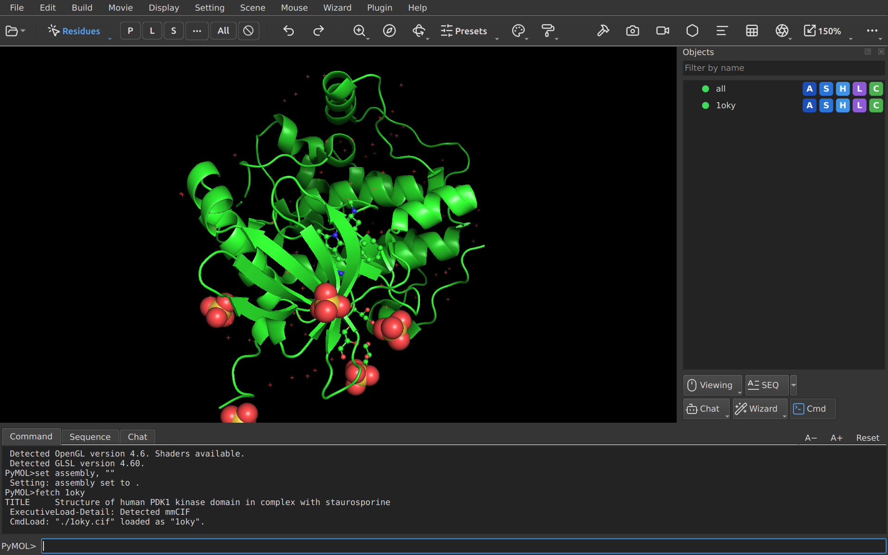
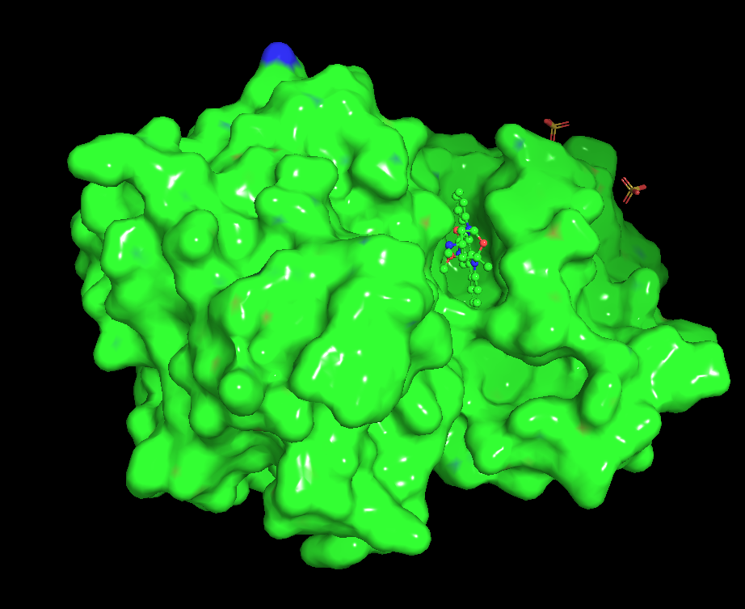
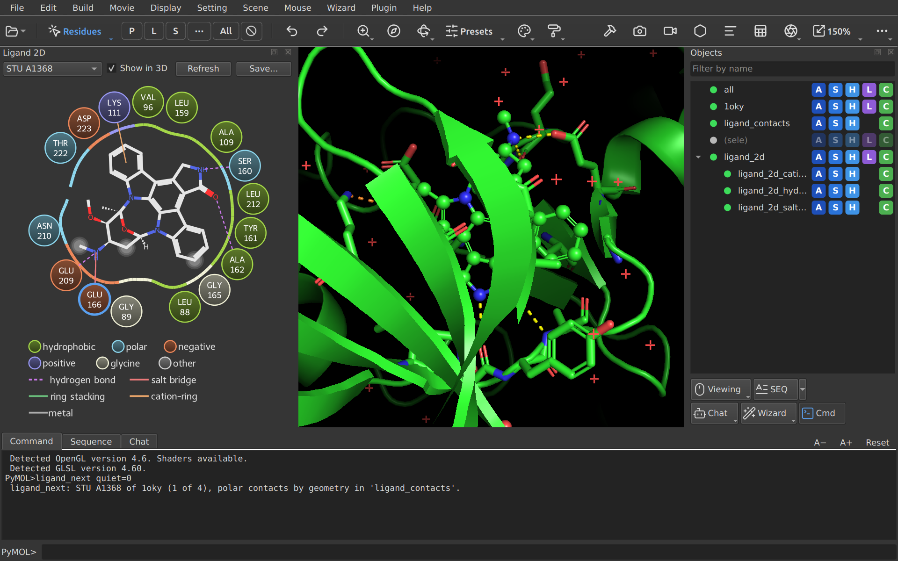
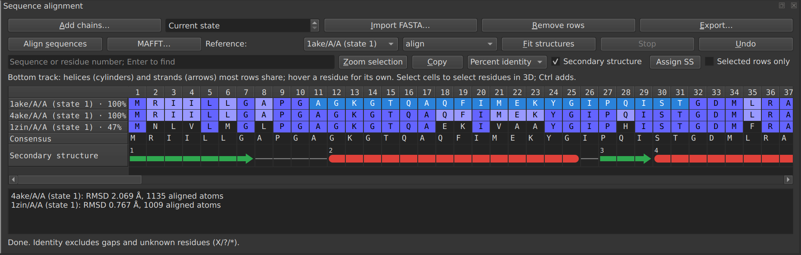

# pymolish-studio documentation

Open a molecular structure, inspect its parts, and make figures or short
movies. These pages were checked with version 4.90.0.

## Start here

- [Getting started](getting-started.md): open a structure, turn it, choose
  a look, save a picture and a session. Ten minutes.
- No program yet? [Download a build](https://github.com/adrian-jasinski/pymolish-studio/releases),
  or [install from source](install.md).
- You know PyMOL already:
  [Coming from PyMOL](getting-started.md#coming-from-pymol).

## Choose a task

| I want to | Read |
| --- | --- |
| Open files, folders, PDB entries, UniProt and predicted structures; group, select and split them | [Open and organize structures](structures.md) |
| Choose a preset, a surface, colors, transparency, light, theme or background | [Change how a structure looks](appearance.md) |
| Find a ligand, see its pocket and its contacts, draw it in 2D | [Inspect a ligand and its pocket](ligands.md) |
| Read a sequence, align sequences, fit structures on each other | [Work with sequences and alignments](sequences.md) |
| Compare many objects by numbers, rate them, import a spreadsheet | [Compare objects in the property table](properties.md) |
| Store views, build a movie and export it | [Scenes and movies](scenes-movies.md) |
| Build a molecule, clean up a structure, measure, find contacts, show a map | [Build, clean up, measure and compare](editing-analysis.md) |
| Save a session, a structure, a picture; know which file to use | [Save sessions, structures, pictures and exports](saving.md) |
| Ask an AI assistant to work in the session, or connect an agent | [Chat with an AI assistant](assistant.md) |

## Recently added

| | |
| --- | --- |
|  | **Looks.** Surface materials, transparency for whole objects, lights with outlines. [Appearance](appearance.md) |
|  | **Ligands.** The next ligand with its contacts, and the same contacts drawn in 2D. [Ligands](ligands.md) |
|  | **Sequences.** An alignment window linked to the 3D view, with fitting. [Sequences](sequences.md) |

## Look up

- [Commands](commands.md): the commands this program adds, by task, and
  every command by name.
- [Reference](reference.md): selections, mouse, keyboard, settings,
  start-up options, optional packages, compatibility with PyMOL.
- In the program: `help <command>` prints the help of a command, and the
  Tab key completes commands and names.

Your browser's Find searches one page. To search all pages, search the
repository restricted to `docs/`.

## Solve a problem

- [Troubleshooting](troubleshooting.md): what you see, the likely cause,
  what to do.

## About the project

- [What is different from PyMOL](features.md), [ChangeLog](../ChangeLog)
- [Install from source](install.md), [Writing a plugin](plugins.md),
  [Contributing](../CONTRIBUTING.md)
- [Speed measurements](benchmark.md)
- [Licenses](licenses.md)
- [Roadmap](../PLAN.md)
- How the pictures and clips on these pages were made:
  [media/README.md](media/README.md)

---

pymolish-studio. Based on PyMOL(TM) technology.

PyMOL is a trademark of Schrodinger, LLC.
