# Change how a structure looks

[Docs home](README.md) · Checked with version 4.90.0.

From a loaded structure to the picture you want: cartoon, balls and sticks,
a surface in a material, see-through parts, colors, light, background and a
floor. Nothing extra is needed; the examples use `fetch 1oky`, which needs
an internet connection once.

**On this page:** [Four ideas](#four-ideas) ·
[Representations](#show-hide-or-switch-a-representation) ·
[Presets](#pick-a-preset) · [Cartoon](#recipe-cartoon) ·
[Ball and stick](#recipe-ball-and-stick) · [Atoms](#recipe-atoms) ·
[Surface looks](#recipe-a-surface-in-a-material) ·
[Binding](#recipe-a-binding-site-or-an-interface) ·
[Transparency](#make-a-surface-transparent) ·
[Color](#color-atoms-and-chains) · [Palettes](#choose-a-palette) ·
[Light and outline](#change-the-light-and-the-outline) ·
[Themes](#apply-a-theme) · [Floor](#put-a-floor-under-the-molecule) ·
[Background](#set-the-background) ·
[Undo and reset](#undo-a-preset-and-start-over) ·
[Draw versus Ray](#draw-versus-ray) ·
[Surface type](#choose-the-surface-type) ·
[Smooth edges](#smooth-the-edges-in-the-viewport) ·
[Limits](#limits-and-common-problems)

## Four ideas

| Idea | What it is | Where |
| --- | --- | --- |
| Representation | How atoms are drawn: cartoon, spheres, surface ... | **S** and **H** of a row in the Objects panel; `show`, `hide`, `as` |
| Preset | A ready-made combination of representations and settings | **Presets** in the toolbar |
| Palette | The colors that new objects and chains take, in order | Palette button in the toolbar; `palette` |
| Scene appearance | Light, theme, floor and background of the whole scene | Lower part of **Presets**; Background button |

They do not replace each other. A representation changes what you point at.
A preset redraws whole objects and keeps their colors. A palette only
decides colors. Scene appearance changes nothing about one object: it
changes the scene all objects are in.

## Show, hide or switch a representation

1. In the Objects panel, click **S** on the row of the object.
2. Pick a row, for example surface.

The surface is added to what is already shown. **H** has the same list to
take one away, and H > everything hides all of it. To show one
representation only, right-click the row (or press the Menu key on it) and
pick Show as > cartoon.

```
fetch 1oky
hide everything
show cartoon
show ball_and_stick, organic
as surface, polymer
```

`show` adds, `hide` removes, `as` shows only that one. The second argument
is what to change; without it the whole scene changes. `organic` means the
small molecules bound to the protein, `polymer` the protein and nucleic
acid chains.

S > cartoon and S > ball and stick have a second level: a click on the row
shows the representation, and the menu that opens beside it has the cartoon
styles (default, wire, spring) or the ball size and bond thickness.

## Pick a preset

1. Switch on the objects you want to change (a click on a row of the
   Objects panel switches an object on or off).
2. Click **Presets** in the toolbar and pick a row, for example
   cartoon > publication.

The preset hides what those objects showed and draws them its own way. The
camera stays where it is, except for the ligand presets, which zoom on the
ligand.

- **What it acts on:** from the toolbar, every object that is switched on,
  as a whole. Objects that are switched off are not touched.
- **Colors stay.** No preset changes the color of a cartoon or of a
  surface: color the chains first, then try presets. A surface drawn by a
  preset has the color of the carbons under it. Some presets color ligands
  and the atoms that are no carbon by element, so that sticks and balls
  read. Only a theme recolors the protein, and the two presets for
  complexes paint the contact area orange.
- **Water is hidden** by every row except default, until you pick
  Presets > show solvent.
- **The next preset takes the last one back:** its transparency, surface
  settings, cartoon style and measured contacts. Your sphere and stick
  sizes are left alone.

At the top of the menu:

| Row | Draws | Typed name |
| --- | --- | --- |
| default | Everything as lines, water too; non-carbon atoms colored by element | `default` |
| classified | Chains as cartoon, ligands as ball and stick, ions as spheres: the look a file opens with | `classified` |

Typed, a row is `preset.from_menu("<typed name>", "<object>")`:

```
preset.from_menu("pub_solv", "1oky")
```

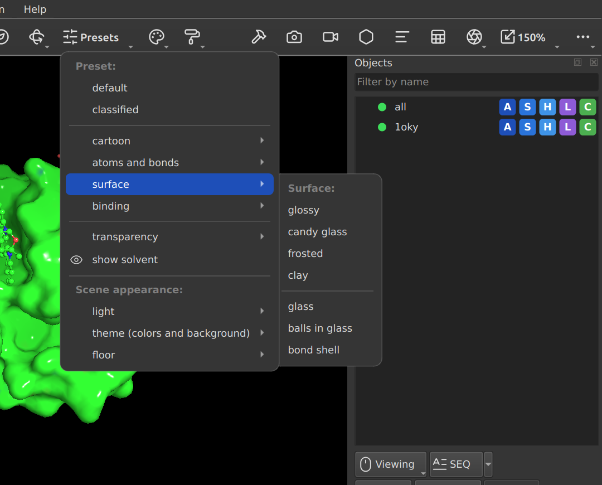

## Recipe: cartoon

Presets > cartoon has eight rows. All of them draw ligands as ball and
stick.

| Row | Draws | Typed name |
| --- | --- | --- |
| pretty | The plain cartoon | `pretty_solv` |
| publication | The same with smooth loops and fancy helices | `pub_solv` |
| technical | Cartoon, all atoms as lines, polar contacts as dashes | `technical` |
| b factor putty | A tube that is thicker where the B factor is higher | `b_factor_putty` |
| wire | The cartoon as a wire mesh | `wire` |
| spring | One thick round tube; a helix becomes a spring | `spring` |
| cylinders | publication with helices as cylinders | `cylinders` |
| contour cartoon | Cartoon inside a faint surface, with outlines | `illustration` |

By hand: S > cartoon, or S > cartoon > wire / spring for the two styles.

```
as cartoon, polymer
show ball_and_stick, organic
```

technical measures polar contacts into an object named `1oky_pol_conts`;
the next preset deletes it. contour cartoon also switches the light to
flat, and the next preset switches it back.

## Recipe: ball and stick

Ball and stick is a representation of its own: a ball on every atom and its
bonds as thin sticks that show single, double, triple and aromatic bonds.
It has its own sizes and colors, and it does not change the settings of
spheres or sticks.

1. **S** > ball and stick shows it. Presets > atoms and bonds > ball and
   stick draws whole objects that way.
2. For the size, open the menu beside the row: ball size (small 0.20 to
   large 0.50) and bond thickness (thin 0.08, standard 0.12, thick 0.18).
3. For the color of the balls and bonds only, use **C** > by rep > ball and
   stick: a color, by element, CPK (balls only), or unset to go back.

```
show ball_and_stick, organic
set ball_and_stick_scale, 0.4, organic
set ball_and_stick_bond_radius, 0.18, organic
set ball_and_stick_color, atomic, resn STU
color_cpk resn STU, ball_and_stick
unset ball_and_stick_color, resn STU
```

`ball_and_stick_scale` is the ball as a part of the atom's radius (0.25
when not set). `ball_and_stick_color` leaves the color of the atoms alone,
so the cartoon and other representations keep theirs. `color_cpk organic`
without a second argument colors the atoms themselves in the CPK colors
(carbon light grey, oxygen red, nitrogen light blue, sulfur yellow), for
all atoms of the residues you name.

More on ligands: [Ligands](ligands.md).

## Recipe: atoms

Presets > atoms and bonds:

| Row | Draws | Typed name |
| --- | --- | --- |
| space filling | Every atom as a sphere of its van der Waals radius | `space_filling` |
| illustrated atoms | The same in plain colors inside outlines | `illustrated_atoms` |
| ball and stick | Every atom as ball and stick | `ball_and_stick` |
| licorice | Every bond as a smooth stick | `licorice` |

They draw ligands the same way as the protein and keep the colors of the
atoms. illustrated atoms sets the light flat; the next preset takes that
back.

```
as spheres
as licorice
```

## Recipe: a surface in a material

Presets > surface shows the protein as a surface and the ligands as ball
and stick.

| Row | Looks like | Typed |
| --- | --- | --- |
| glossy | Polished plastic with a small, strong highlight | `preset.from_menu("surface", "1oky", "glossy")` |
| candy glass | Tinted glass: see-through in the middle, dense at the rim | `... "candy glass")` |
| frosted | Milk glass: nothing shines, the ligand is a shape behind it | `... "frosted")` |
| clay | Matte, with the pockets in shade | `... "clay")` |
| glass | Cartoon inside a transparent surface, denser at its edges | `preset.from_menu("glass", "1oky")` |
| balls in glass | Ball and stick inside a surface of which only the rim shows | `preset.from_menu("balls_in_glass", "1oky")` |
| bond shell | Bonds as thin lines inside a half see-through surface | `preset.from_menu("bond_shell", "1oky")` |

The first four set a light for the whole scene as well as the surface.
candy glass, frosted and clay are rounder than a normal surface: they use
the grid surface with a larger probe, set on their objects
(see [Choose the surface type](#choose-the-surface-type)). The next preset
takes surface, probe and light back. A row of Presets > light replaces only
the light, so clay under studio light is two clicks. balls in glass reads
best on small proteins.

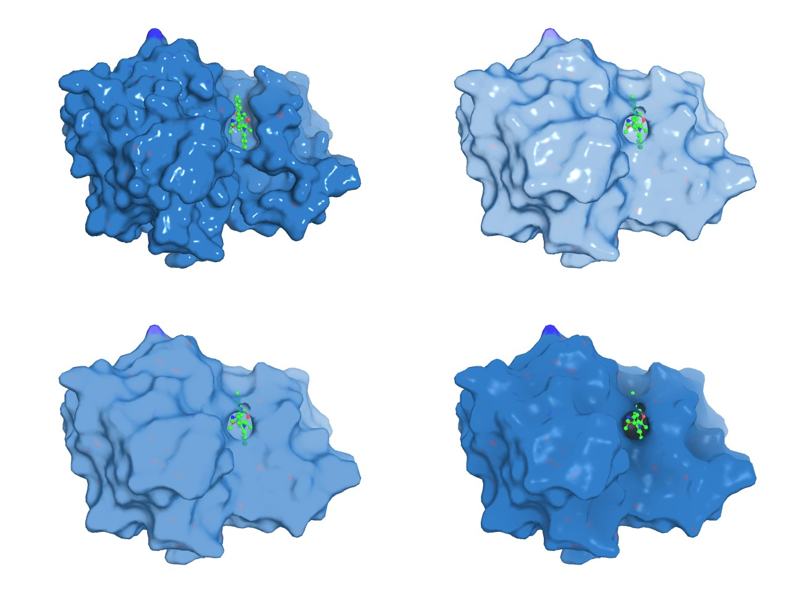

*Rendered with Ray on a white background, the carbons colored skyblue first.
Top: glossy, candy glass. Bottom: frosted, clay. The ligand shows in the
opening of its pocket.*

## Recipe: a binding site or an interface

Presets > binding:

| Row | Draws | Typed name |
| --- | --- | --- |
| ligands | Cartoon, ligand as ball and stick, residues near it as lines, polar contacts as dashes | `ligands` |
| ligand sites > cartoon | The same, for use without a surface | `ligand_cartoon` |
| ligand sites > solid surface | The same plus the surface of the pocket | `ligand_sites` |
| ligand sites > solid (better) | The same with a finer surface | `ligand_sites_hq` |
| ligand sites > transparent surface | Pocket surface see-through, pocket residues as sticks | `ligand_sites_trans` |
| ligand sites > transparent (better) | The same with a finer surface | `ligand_sites_trans_hq` |
| ligand sites > dot surface | Pocket surface as dots | `ligand_sites_dots` |
| ligand sites > mesh surface | Pocket surface as a mesh | `ligand_sites_mesh` |
| protein interface | Cartoon, residues that touch another chain as sticks | `interface` |
| protein-protein interaction | Every chain as a surface in its colors, orange where chains touch | `interaction` |
| antibody and antigen | Antibody as cartoon, antigen as a surface with the epitope in orange | `antibody` |

The ligand rows zoom on the ligand and put the polar contacts into an
object named after yours (`1oky_pol_conts`). "Touch" means within 4.5 Å of
another chain. antibody and antigen also shows the antibody residues that
touch the antigen as sticks and the polar contacts between the two as
dashes.

```
fetch 3hfm
preset.from_menu("antibody", "3hfm")
```

Antibody chains are recognized by a short conserved stretch of their
sequence; a chain named H or L fills a role the sequences left empty. When
no antibody chain is found, the log says so and you get protein-protein
interaction. That happens with real antibodies too (`fetch 1ahw` is one).
The orange is a color of the surface only: the atoms keep theirs.

## Make a surface transparent

1. Show a surface, for example Presets > surface > glossy.
2. Open **Presets** > transparency > surface and choose 50%.

The surface of every object that is switched on is half see-through. The
colors stay, nothing is shown or hidden. The rows are opaque (0%), 25%, 50%
and 75%, and there are four such submenus: cartoon, spheres, surface, ball
and stick. Each changes its own representation only.

- **Scope:** whole objects, on all of their atoms. You cannot make one
  chain of an object see-through from this menu; use the command below.
- **Reset:** the next preset makes the objects opaque again. So pick the
  preset first, then the transparency.

```
preset.transparency("surface", 0.5, "1oky")
```

The settings behind the four submenus, for typing:

| Submenu | Setting | Can be set on |
| --- | --- | --- |
| surface | `transparency` | scene, object, state, atoms |
| cartoon | `cartoon_transparency` | scene, object, state, atoms |
| spheres | `sphere_transparency` | scene, object, state, atoms |
| ball and stick | `ball_and_stick_transparency` | scene, object, state |

```
set transparency, 0.5, 1oky
set transparency, 0.3, 1oky and resi 100-150
set ball_and_stick_transparency, 0.5, 1oky
unset transparency, 1oky
```

0 is opaque, 1 is invisible. The name of an object as third argument sets
the value on the object; any other selection sets it on those atoms, and a
value on atoms wins over the object's. Setting > Transparency sets the same
settings (and the one for sticks) for the whole scene.

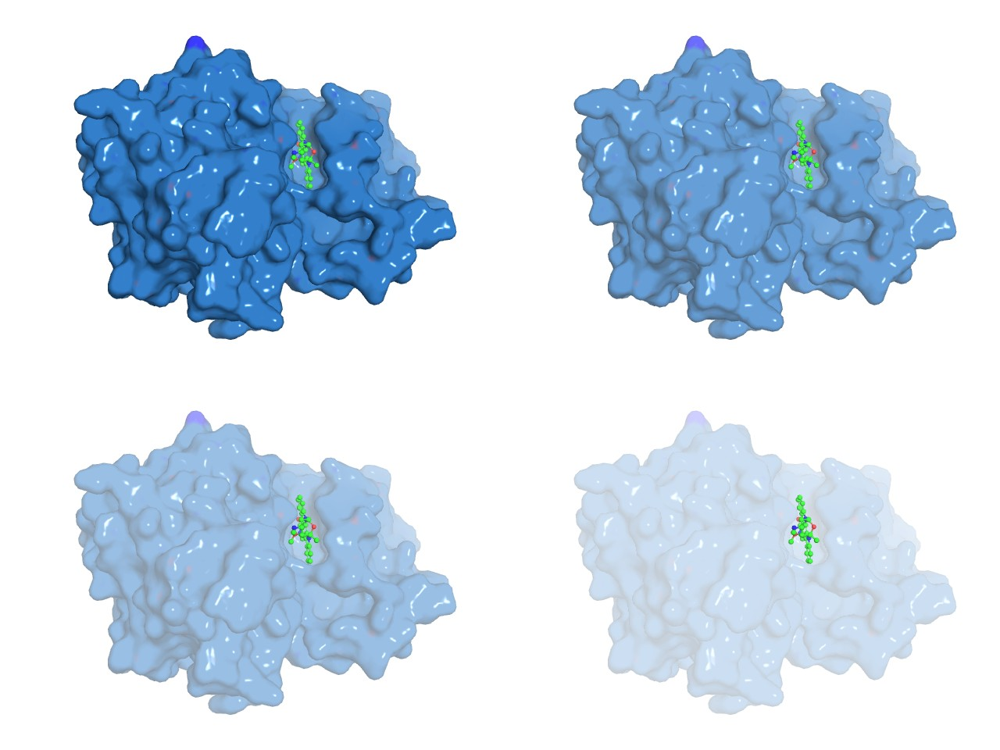

*Rendered with Ray. Top: opaque (0%), 25%. Bottom: 50%, 75%.*

[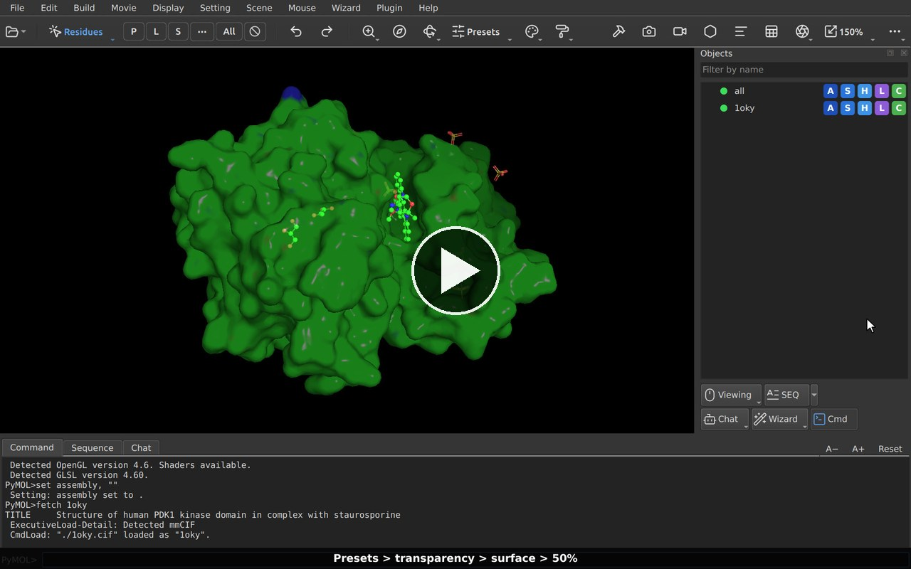](media/appearance.mp4)

*Clip, 25 seconds, no sound: Presets > surface > glossy, then transparency > surface > 50%, light > studio, and Undo twice. The steps are written out on this page.
[Open or download the clip](media/appearance.mp4).*

## Color atoms and chains

1. Click **C** on the row of the object (or right-click the row > Color).
2. Pick a row.

| Row | Colors |
| --- | --- |
| by element | Non-carbon atoms by element; CPK; or carbons in one color and the rest by element |
| by chain | Each chain in the next palette color; chainbows; shades |
| by ss | Helix, sheet and loop in three colors |
| by rep | One representation only: the atoms keep their colors |
| spectrum | Rainbow along the chain; shades; by B factor; by surface area |
| auto | The next palette color; by obj gives each object one |
| reds ... grays | One named color |

shades gives one color from light to dark: under by chain one shade per
chain, under spectrum light to dark along each chain. by rep sets a color
for lines, sticks, ribbon, cartoon, labels, dots, spheres, ball and stick,
mesh or surface; its last row, unset, goes back to the colors of the atoms.

```
color skyblue, polymer
util.cbc
util.cnc
util.cbag organic
util.chainbow 1oky
spectrum b, blue_white_red, 1oky
set cartoon_color, orange, 1oky
util.cbss("1oky", "red", "yellow", "green")
util.shades("marine", "1oky")
```

`util.cbc` colors by chain, `util.cnc` colors the non-carbon atoms by
element, `util.cbag` makes carbons green and the rest by element. The last
two lines are Python calls and need the brackets and quotes.

## Choose a palette

A palette is an ordered list of colors. Each new object takes the next one
for its carbons, and C > by chain and `util.cbc` give each chain the next
one.

1. Click the Palette button in the toolbar (the tooltip says "Palette:
   colors of objects and chains").
2. Click a row, or move with the arrow keys and press Enter.

The carbons of the loaded objects are recolored from the first palette
color on, and new objects follow the palette. The choice is remembered for
the next start. The list has eleven rows: PyMOL default, then Vivid, Deep,
Pastel, Soft, Colorblind, Nord, Dracula, Catppuccin, Chimerax and Halo,
each with the background it is made for. Every one of these ten has 30
colors; the menu shows the first ten.

```
palette
palette vivid
palette soft, 1
color soft_03, organic and elem C
palette default
```

`palette` alone lists the palettes and marks the active one. `palette
vivid` changes only what comes next; `palette soft, 1` also recolors what
is loaded. A typed palette is not remembered; put the line into your
pymolrc to have it at every start. The colors have names (`soft_01`,
`soft_02` ...) and work like any color.

| Palette | Made for | Colors |
| --- | --- | --- |
| `vivid` | dark background | 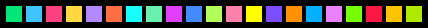 |
| `deep` | white background, print | 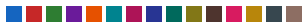 |
| `pastel` | dark background | 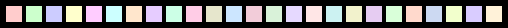 |
| `soft` | white background | 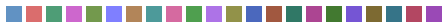 |
| `colorblind` | any background |  |
| `nord` | dark background |  |
| `dracula` | dark background |  |
| `catppuccin` | dark background |  |
| `chimerax` | any background | 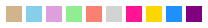 |
| `halo` | any background |  |

The pictures show the colors a palette was made with; the colors after
them, up to 30, were computed in the same tone and belong to no published
set.

`colorblind` is Okabe-Ito followed by Paul Tol's bright and muted sets, with
the published values. Only the first seven colors are designed as one set.
`nord`, `dracula` and `catppuccin` are the accent colors of the editor themes
of those names (Nord frost and aurora, Dracula, Catppuccin Mocha).
`chimerax` is the ten colors UCSF ChimeraX gives to models 1 to 10 (tan, sky
blue, plum, light green, salmon, light gray, deep pink, gold, dodger blue,
purple), for those who move between the two programs.
`halo` is five colors of a brand book (turquoise, blue, cyan, indigo, deep
purple) with seven strong colors between them for the other hues. The indigo
and the purple are dark on a black background.

**Your own palette:** Palette button > New palette... asks for a name
(lowercase letters, digits, `_`) and at least two colors. Add..., Change...
and Remove edit the list; drag a color, or use Up and Down, to change the
order in which the colors are given out. Your palettes are listed with the
others and kept between starts. Edit palette... and Delete palette work
while one of your own palettes is the active one. Deleting a palette leaves
the colors on the objects that have them.

## Change the light and the outline

1. Open **Presets** > light.
2. Pick a row.

The light changes for the whole scene, whatever is switched on. A light
never changes the background, representations or colors.

| Row | Light | Outline |
| --- | --- | --- |
| standard light | The light the program starts with | no |
| figure | Matte | yes |
| soft | Even light from all sides, pockets of a surface in shade | yes |
| flat | Plain colors without shading | yes |
| comic | Colors in a few steps | yes |
| sketch | Lines only, no colors | yes |
| x-ray | Bright where a shape faces you, dark toward its edges | no |
| studio | Key light, fill light and a rim light from behind | no |
| top light | One light from above: a strong shadow on a floor | no |
| soft shadow | The same with a soft edge of the shadow; slower to ray trace | no |
| glossy (light only) | The highlight of the glossy surface on whatever is shown | no |

The last two rows of the menu read no fog or fog, and no glow or glow.
Fog switches the fading of what is far away; the rows with an outline
switch fog off. Glow lays a soft halo in the colors of what is drawn
around it, on top of any light. It is off at the start. It shows in the
viewport and in every picture drawn without ray tracing (Draw (fast),
`png` at any size), as the same share of the picture; a ray-traced
picture and stereo have no halo.

**The outline** is a line around every shape, black on a light background
and white on a dark one. A ray-traced picture has it, and so has the
viewport. To take it out of the viewport only, clear Setting > Rendering >
"Outline of a Look (Real Time)":

```
preset.look("flat")
set viewport_outline, 0
preset.look("default")
```

The viewport draws no outline in stereo, with Setting > Rendering > OpenGL
2.0 Shaders off, or in a picture drawn at another size than the window.
Labels get no outline. With soft, a surface is built again when the light
changes, which takes a moment on a large structure.

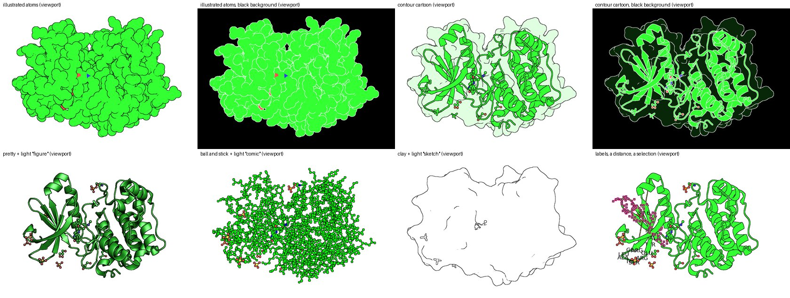

*Viewport pictures of version 4.87.0, when the outline came to the
viewport: illustrated atoms and contour cartoon on white and on black;
figure, comic and sketch; and labels, which get no outline.*

## Apply a theme

1. Open **Presets** > theme (colors and background).
2. Pick clay, blue, sage, mint or night.

The protein of the objects that are switched on gets one soft color, the
carbons of the ligands one that stands out, and the scene a two-color
background that goes with them. night is dark, the other four are light. A
theme sets colors and background and nothing else, so it combines with any
preset and any light. It overwrites the colors you gave the chains.

```
preset.theme("night", "1oky")
```

## Put a floor under the molecule

1. Turn the molecule the way you want to see it.
2. Open **Presets** > floor > floor.

A floor appears under what is shown, and the view tilts down so that you
see it. The floor fades into the background with distance. A ray-traced
picture has the shadow of the molecule on it; the viewport shows no shadow.
floor with mirror image adds a reflected copy seen through the floor, in
the viewport too. no floor removes both and turns the view back.

```
stage
preset.look("top light")
ray
stage mirror
stage off
```

- "Down" is the bottom of the screen at the moment you pick the row.
  Nothing follows by itself: pick the row again after turning the molecule
  a lot or changing what is shown.
- Presets > light > top light, soft shadow and studio are made for it.
- `zoom` and `orient` without arguments count the floor. Use the Zoom
  button of the toolbar, or `zoom visible`.

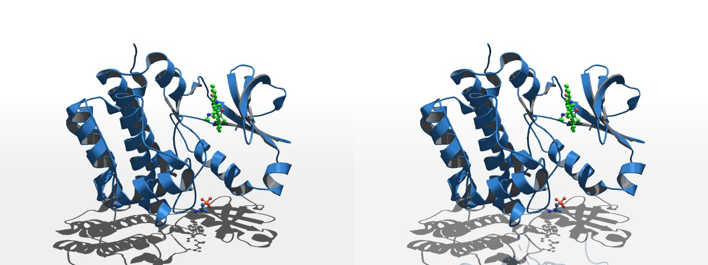

*Rendered with Ray under top light. Left: floor. Right: floor with mirror
image.*

## Set the background

1. Click the Background button in the toolbar (after the Palette button;
   the tooltip says "Background color").
2. Pick a row.

There are plain colors (Black, Charcoal, Gray, Light gray, White, Night
blue, Slate) and gradients from top to bottom (PyMOL blue, Night, Graphite,
Steel, Studio, Sky). The one in use has a frame.

- **Ray trace with this background:** when it is off, a ray-traced picture
  has a transparent background.
- **Remember after restart:** off at first. When it is on, the background
  is saved with each pick and set again at the next start.

```
bg_color white
set bg_rgb_top, 0xDCEBFA
set bg_rgb_bottom, 0xFFFFFF
set bg_gradient, 1
set opaque_background, 0
```

## Undo a preset and start over

**Undo.** Every row of the Presets menu is one step: a preset, a
transparency, the solvent row, a light, a theme, a floor. Click the Undo
button in the toolbar, press Ctrl-Z (Edit > Undo) or type `undo`. Redo is
the button beside it, Ctrl-Y or `redo`.

- Undo puts the whole session back as it was before the row: colors,
  representations, settings, light, background, view and the contacts a
  preset measured.
- It also takes back **everything you did after that row**, including
  objects loaded or deleted since. Redo brings it back.
- Five steps are kept, and at most 600,000 atoms over all of them. Above
  that the row runs without a step and the log says so.
- The steps are dropped by File > Reinitialize > Everything and when a
  session file is opened.
- The Palette and Background buttons and the S, H and C menus are not
  steps of their own.

**Solvent.** Presets > show solvent shows the water at once, and the
presets picked afterwards keep it. The row then reads hide solvent.

**Start over.** Presets > default shows everything as lines again, and
Presets > classified gives the look the file opened with (without the
water, unless show solvent is on). Both take back
what a preset set, but not what belongs to the scene: use light > standard
light, floor > no floor and the Background button for those, and the **C**
menu for colors.

## Draw versus Ray

The viewport is drawn by the graphics card, fast enough to turn the
molecule. Ray tracing computes a picture once, slowly, with shadows and
clean transparency. The Draw button of the toolbar offers both: set Width
and Height, then click **Draw (fast)** or **Ray (slow)**, then Save Image
to File or Copy Image to Clipboard.

| | Draw (fast) | Ray (slow) |
| --- | --- | --- |
| Outline of a light | no | yes |
| Shadows, also on the floor | no | yes |
| Check box "transparent background" | not used | used |

```
png look.png, width=1600, height=1200, dpi=300, ray=1
```

So a light with an outline shows its line in the viewport and in a
ray-traced picture, but not in a picture made with Draw (fast). Sizes,
formats and batch export: [Saving](saving.md).

## Choose the surface type

Setting > Surface has two solid surfaces. **Solid** is the default.
**Solid (grid)** computes the same molecular surface on a grid.

| | Solid | Solid (grid) |
| --- | --- | --- |
| Setting `surface_type` | 0 | 7 |
| Large structures, default probe | slower to build | faster to build |
| Close up | smoother borders between colors | borders a little jagged, narrow grooves a little shallower |
| Larger probe (`solvent_radius`) | gets coarser | stays smooth and round |
| Sessions opened in other PyMOL versions | surface shown | no surface shown |

```
set surface_type, 7
set surface_type, 7, 1oky
set solvent_radius, 3, 1oky
unset surface_type, 1oky
```

The menu sets it for the whole scene; with an object name it holds for
that object. Small closed cavities can differ between the two.

In the same menu, Cavities and Pockets Only and Cavities and Pockets
(Culled) draw the surface of cavities and pockets in place of the outside;
Exterior (Normal) goes back. Cavity Detection Radius and Cavity Detection
Cutoff tune what counts as a cavity. Dot and Wireframe draw the surface as
dots or as a mesh.

**Large surfaces.** In the window, a surface of 5000 atoms or more is built
in the background: you can keep turning the view and using menus, the log
says that it is being built, and it appears when it is ready. Ray tracing,
`png`, Draw and movie frames wait for it, so pictures are complete.
`set async_surface, 0` builds in the foreground again.

## Smooth the edges in the viewport

Check Setting > Rendering > Antialias (Real Time), or type:

```
set antialias_shader, 1
```

Edges in the viewport lose their steps; labels and thin lines get a little
softer. It is off at first and is not saved in a session. It does not work
in stereo or for a picture drawn at another size than the window.
Ray-traced pictures have their own smoothing and do not need it.

## Limits and common problems

- **A preset did nothing to one object.** It was switched off. Presets
  from the toolbar act on the objects that are switched on.
- **The transparency is gone.** The next preset resets it. Pick the preset
  first.
- **The water disappeared.** Presets hide it; pick Presets > show solvent.
- **The light stays after another preset.** A light you picked from
  Presets > light stays until you pick standard light. Only a light that a
  preset set (the surface looks, illustrated atoms, contour cartoon) is
  taken back by the next preset.
- **A theme or a color menu changed my colors.** Presets keep colors, but
  they do not bring old ones back. Use Undo right after a theme.
- **Undo took back more than the preset.** It restores the whole session
  from before that row.
- **A patch of the surface has another color.** A preset colors the
  surface over a residue like its carbons. A residue without any carbon in
  the file, such as a cut-off chain end, keeps the colors of its atoms.
- **antibody and antigen looks like protein-protein interaction.** No
  antibody chain was recognized from the sequences; the log says so.
  Renaming the chains to H and L helps.
- **protein-protein interaction shows no orange.** The contact area needs
  two chains; 1oky has one.
- **No outline in an exported picture.** Use Ray, or `png` with `ray=1`.
- **Zoom shows a tiny molecule after adding a floor.** `zoom` counts the
  floor; use the Zoom button or `zoom visible`.
- **A session with Solid (grid) or ball and stick opened elsewhere.** Other
  PyMOL versions do not draw them.

## Next

- [Ligands](ligands.md): find a ligand, its pocket and contacts.
- [Scenes and movies](scenes-movies.md): store a view with its appearance.
- [Saving](saving.md): pictures, sessions and files.
- [Commands](commands.md) and [Reference](reference.md): every command and
  setting named here.
