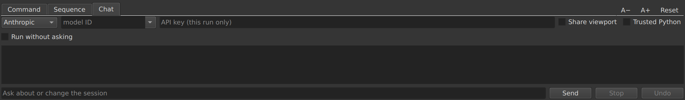

# Chat with an AI assistant, or connect an agent

[Docs home](README.md) · Checked with version 4.90.0.

Ask in plain words for a change or an answer about the open session; a
language model of a provider you choose runs reviewed pymolish commands for
you. You need your own account with a provider and an internet connection.
Three of the four providers also need the optional `ai` packages. Accounts
and costs are yours; pymolish includes none.

**On this page:** [Open Chat](#open-chat) ·
[Choose a provider](#choose-a-provider) · [Model](#choose-a-model) ·
[A turn](#a-turn-send-stop-undo) ·
[Reviewed commands](#what-the-model-can-run-reviewed-commands) ·
[Switches](#three-switches) ·
[What leaves your computer](#what-leaves-your-computer) ·
[Agent connector](#connect-an-agent-claude-code-codex) ·
[Limits](#limits-and-common-problems)

## Open Chat

Any of these opens the **Chat** tab, which sits beside **Command** and
**Sequence** under the viewport:

- Click the tab **Chat**.
- Click the **Chat** button under the object list, then Chat. The same menu
  has Agent connector, Copy setup line for Claude Code and Copy setup line
  for Codex ([below](#connect-an-agent-claude-code-codex)).
- Choose **Display** > Panels > AI chat.
- Type `ask`, or `ask color the ligand by element`: the text becomes a
  draft in the message field. Nothing is sent until you press **Send**.



*The set-up row of the Chat tab, with no key and no account.*

The buttons A−, A+ and Reset at the right of the tabs change the text size
of the tab.

## Choose a provider

The first list of the tab names who receives the conversation.

| Provider | You need | `ai` packages |
| --- | --- | --- |
| Anthropic | an API key | yes |
| OpenAI | an API key, or a ChatGPT plan and **Continue with ChatGPT** | yes |
| OpenRouter | an OpenRouter account and **Continue with OpenRouter** | yes |
| Claude Code | Claude Code installed and signed in on this computer | no |

### With an API key (Anthropic, OpenAI)

1. Choose Anthropic or OpenAI.
2. Paste the key into the field **API key (this run only)**. It is kept in
   memory until pymolish closes and written nowhere.
3. Type a model ID into the model field.

Leave the key field empty to use the environment variable
`ANTHROPIC_API_KEY` or `OPENAI_API_KEY`, set before pymolish starts.
OpenRouter has no key field; without a sign-in it reads
`OPENROUTER_API_KEY`.

### With a sign-in in the browser (OpenAI, OpenRouter)

1. Choose OpenAI or OpenRouter.
2. Click **Continue with ChatGPT** or **Continue with OpenRouter**. The
   browser opens; the address is also written into the chat, in case it
   does not.
3. Sign in and allow pymolish there. The page then says "Signed in. Close
   this page."

The button now reads **Sign out**, the row beside it names the account, and
the model field lists the models of that account. While the browser is
open the button reads **Cancel sign-in**.

- ChatGPT: requests are paid from your ChatGPT plan. While signed in, the
  key field is hidden. **Sign out** also ends the session at OpenAI.
- OpenRouter: the sign-in makes a key named pymolish in your OpenRouter
  account; requests are paid from your OpenRouter credits and pass through
  OpenRouter. **Sign out** forgets the key here; it still exists at
  OpenRouter, and the chat prints the address where you delete it.
- **Stay signed in** keeps the sign-in in the keychain of the operating
  system. Off, the sign-in ends with this run, and an OpenRouter key is
  asked to expire after a day. Without a usable keychain the chat says so
  and the sign-in lasts for this run.

### With the installed Claude Code

Choose Claude Code. The conversation runs through the Claude Code program
installed on this computer (`claude` must be found on the PATH), with the
Claude account it is signed in to. No API key, no `ai` packages.

- The row under the provider shows the account in use.
- If Claude Code is signed out, **Continue with Claude Code** starts its own
  sign-in in the browser. There is no Sign out here: run
  `claude auth logout` in a terminal.
- If it is not installed, the row shows the link "Install Claude Code".
- pymolish reads no token of that account. For each turn Claude Code gets
  the pymolish tool only: its shell, file and web tools, its other
  connections and your settings files are off.
- Claude Code keeps a transcript of the conversation in its own folder
  (`~/.claude/projects`).

### The `ai` packages

```
pip install 'pymolish[ai]'
```

This installs the packages openai, anthropic and keyring (for **Stay
signed in**). The downloadable builds do not include them. Without them
Anthropic, OpenAI and OpenRouter answer "Install the optional AI packages";
Claude Code and the agent connector do not need them.

## Choose a model

The second field is a list you can also type into.

- With an API key the list is empty: type the ID of a model of your
  provider that can call tools.
- After a sign-in it lists the models of your account; for OpenRouter, the
  ones that can call tools.
- For Claude Code it lists Default of Claude Code, Fable, Opus, Sonnet and
  Haiku; another model name can be typed.

The provider, and the model chosen for each provider, are remembered
between starts. Changing either starts a new conversation.

## A turn: Send, Stop, Undo

1. Type into the field "Ask about or change the session", for example
   `show the ligand as sticks and zoom on it`.
2. Press Enter or click **Send**.
3. Read the history. Lines start with `[you]`, `[assistant]`, `[tool]` (one
   per call, with its result), `[usage]` (tokens, seconds, calls) or
   `[error]`. Every call is also written to the log of the Command tab,
   after `Chat:`.

- **Stop** cancels the turn. A command that is already running finishes
  first.
- **Undo** ("Restore the session from before this turn's changes") is
  active after a turn that changed something. It puts the whole session
  back to where it was before the first change of that turn. Files that
  were written and downloads are not taken back. It is the same Undo as the
  toolbar button and Ctrl-Z: it takes back the newest kept step. Use it
  before you pick a preset, which makes a newer step.

A message can have 16,000 characters. A turn ends after 24 tool calls;
send another message to go on. The history is not saved in session files.

## What the model can run: reviewed commands

The model can look up every installed command, setting and preset and
read its help. It can run only the commands on lists that were reviewed
one by one, with named arguments, never as a typed command line.

| Kind | Examples | Asks first |
| --- | --- | --- |
| Questions | `count_atoms`, `get_names`, `get_chains`, `get_distance`, `get_fastastr` | no |
| What is shown | `show`, `hide`, `color`, `zoom`, `select`, `label`, `distance`, presets, recalling a scene, `isomesh` | no |
| Structure | `delete`, `remove`, `create`, `align`, `super`, `fit`, `h_add`, `bond`, `load_smiles`, `clean`, `fix_structure`, `minimize`, `symexp`, `morph` | yes |
| Files | `load`, `save`, `png`, `load_traj`, `export_objects`, `save_table` | yes |
| Downloads | `fetch`, `fetch_by_uniprot`, `fetch_uniprot_ligands`, `fetch_fold` | yes |
| Scenes | storing, updating, renaming or deleting a scene | yes |
| Never | `do`, `alter`, `iterate`, `run`, `get_pdbstr`, sessions and scripts, `quit`, `undo` | refused |

A question is the dialog **Allow this action?** with the command and its
arguments; answer Yes or No. After No the model is told that you declined.
A refused command answers "Command is not reviewed for execution; its help
remains available": type it yourself in the Command tab.

Some reviewed commands are narrowed further: `load` reads PDB, mmCIF, SDF
and MOL files only; `fetch` takes at most ten codes per call; `set` changes
settings of the picture only; a label is made of atom properties and text.

Every turn that changes something first keeps a copy of the session for
Undo. With more than 600,000 atoms loaded that copy is not made, and the
chat refuses changes.

## Three switches

All three are off at every start.

| Switch | When on |
| --- | --- |
| **Share viewport** | the model may ask for a picture of the view; a 640x480 image is sent to the provider |
| **Trusted Python** | the model may propose Python code; it runs after your Yes |
| **Run without asking** | nothing asks **Allow this action?**: deleting, structure changes, files and downloads run at once, and with Trusted Python also Python |

Python is not sandboxed: it can read and write your files and use the
network, with your rights. With **Trusted Python** and **Run without
asking** both on, text that the model reads (a file, a title, a label) can
make it run code on this computer. Turn them on only for work you would
let a script do unseen.

## What leaves your computer

Nothing of a conversation is sent before the first **Send**. A sign-in
talks to the provider earlier, and opening the tab with **Stay signed in**
on checks the kept sign-in and fetches the list of models.

Each turn sends to the chosen provider:

- your message and the conversation so far, with the calls and results of
  earlier turns;
- a fixed instruction text, the pymolish version, the number of commands
  and which optional packages are installed;
- the result of every call the model makes: names, signatures and help of
  commands; settings and their values; the names and types of objects, the
  names of selections and scenes, atom counts; for atoms it asks about,
  their object, chain, residue, atom name, element, B factor, occupancy,
  secondary structure and coordinates (200 atoms per call at most); what a
  command returns and prints, for example a sequence or a distance;
- with **Share viewport** on, each image the model asks for.

Object names, file names and titles are part of this. Do not use the chat
on data you may not share with the provider.

| Provider | Goes to |
| --- | --- |
| Anthropic | api.anthropic.com |
| OpenAI, key or ChatGPT plan | api.openai.com |
| OpenRouter | openrouter.ai, which passes it to the company of the model |
| Claude Code | the Claude Code program here, which sends it on under its account |

What is held back: your key, and keys in the three environment variables,
are replaced by "[credential removed]" in text that goes out. Commands that
return a whole structure as text (`get_pdbstr`, `get_cifstr`, `get_coords`,
`get_session`) are not on the lists. Python, when trusted, can read
anything.

## Connect an agent (Claude Code, Codex)

The agent connector lets an AI agent that runs in a terminal on this
computer work in the open session. It speaks MCP, the protocol such agents
use for tools, and offers the same reviewed operations as the Chat tab.
It needs no `ai` packages.

1. Click the **Chat** button under the object list, then Agent connector.
   The button turns blue while the connector listens.
2. Open the menu again and choose Copy setup line for Claude Code, or Copy
   setup line for Codex.
3. Paste the line into a terminal and run it once. Then start the agent
   there and ask it to work in pymolish.

```
agent_server on
agent_server on, 9300
agent_server
agent_server off
```

`on` starts the connector and prints its address and both setup lines;
with a number it uses that port instead of 9257. Without an argument the
command says whether the connector is on. The lines look like this:

```
claude mcp add --transport http pymolish http://127.0.0.1:9257/mcp --header "Authorization: Bearer <token>"
export PYMOLISH_AGENT_TOKEN=<token> && codex mcp add pymolish --url http://127.0.0.1:9257/mcp --bearer-token-env-var PYMOLISH_AGENT_TOKEN
```

- Nothing listens before `on`. The connector answers on 127.0.0.1 only,
  so not to other computers, and only to requests that carry the token.
- The token is the environment variable `PYMOLISH_AGENT_TOKEN` when it is
  set before pymolish starts; otherwise a new one is made at every start,
  and the setup line of an earlier run no longer fits.
- The three switches of the Chat tab hold here too. Questions appear in
  the pymolish window, not in the terminal.
- Every call shows in the Chat tab and in the log. Each call that changes
  something is one Undo step: the toolbar button **Undo** or Ctrl-Z.
- What the agent sends on to its own provider is up to the agent: count on
  everything it reads from the session.
- If the port is in use the log says "port 9257 cannot be used"; give
  another one.

## Limits and common problems

What has been tried with a real account, and what has not:

| Way in | Tried |
| --- | --- |
| Chat with Claude Code | yes, on Linux under WSL |
| Chat with OpenAI and the ChatGPT sign-in | reported working by the project's author; no details recorded |
| Chat with an API key (Anthropic, OpenAI) | no |
| Chat with OpenRouter | no |
| **Continue with Claude Code** when Claude Code is signed out | no |
| Connector with Claude Code | yes, on Linux under WSL |
| Connector with Codex | no; Codex accepted the setup line, no call was made |
| Anything on Windows or macOS | no |
| Claude Code from a downloadable build | no |

The untried rows are covered by tests with stand-ins for the provider,
not by a real conversation. Expect rough edges there.

- **A model can be wrong.** It can pick the wrong residues or report a
  result it did not check. Look at the `[tool]` lines and at the viewport.
- **"Install the optional AI packages"**: see
  [the `ai` packages](#the-ai-packages), or use Claude Code.
- **"Enter a session-only API key or set ANTHROPIC_API_KEY"**: the key
  field and the variable are both empty.
- **"Enter a tool-capable model ID from your provider"**: the model field
  is empty.
- **"Tool-call limit reached"**: the turn used its 24 calls. Send a new
  message.
- **"This change exceeds the session Undo limit"**: more than 600,000
  atoms are loaded. Use the Command tab.
- **Undo does not reach outside the session.** A saved file stays, a
  download stays on disk.
- **`ask` and `agent_server on` need the window.** Started without one
  (`pymolish -c`), they answer "requires the Qt interface".
- **Two running pymolish with Stay signed in:** the second one renews the
  ChatGPT sign-in and the first one is signed out.
- **A limit of your plan** ends a ChatGPT turn with an error that names
  chatgpt.com/settings/usage.

## Next

- [Commands](commands.md): `ask`, `agent_server` and the commands the
  model uses
- [Build, clean up, measure and compare](editing-analysis.md)
- [Solve a problem](troubleshooting.md)
- [Install from source](install.md), for the optional packages
