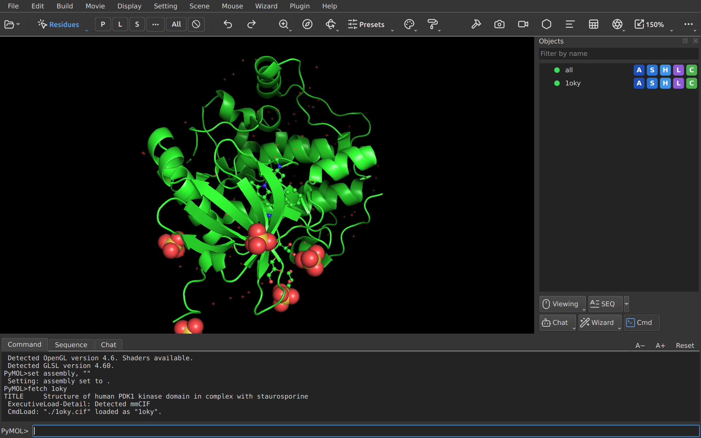

# Getting started

[Docs home](README.md) · Checked with version 4.90.0.

From the first start to a saved picture and a saved session, in about ten
minutes. You need a running pymolish-studio (the
[README](../README.md#try-it) says how to get one) and, for step 1, an
internet connection.

If you already know PyMOL(TM), read [Coming from PyMOL](#coming-from-pymol)
first.

**On this page:** [Open a structure](#1-open-a-structure) ·
[Know the window](#2-know-the-window) ·
[Move the molecule](#3-move-the-molecule) ·
[Select a part](#4-select-a-part) ·
[Change how it looks](#5-change-how-it-looks) ·
[Save a picture](#6-save-a-picture) · [Save your work](#7-save-your-work) ·
[Where to go next](#where-to-go-next)

## 1. Open a structure

1. Choose File > Get PDB....
2. Type `1oky` in the field **PDB ID**.
3. Press **Download**.

The structure appears in the middle of the window: a protein (a kinase)
drawn as a green cartoon, the small molecule bound to it as balls and
sticks, waters as small red crosses and four sulfate ions as spheres. The
Objects panel on the right gets a row `1oky`.

The same with a command: `fetch 1oky`.

No internet? File > Open... opens a file from your computer: PDB, mmCIF,
SDF, MOL and more. [Structures](structures.md) has the other ways to load:
a whole folder, by UniProt accession, predicted structures.

## 2. Know the window



| Area | Where | What it is for |
| --- | --- | --- |
| Menu bar | top | Everything, by topic. |
| Toolbar | under the menu bar | The common actions as buttons; the name of a button shows under the mouse. |
| Viewport | middle | The molecule. The mouse turns and selects here. |
| Objects panel | right | One row per object and per selection, with the buttons A, S, H, L and C. Click a row to hide or show it; double-click to zoom on it. |
| Buttons under the Objects panel | right, below the list | One row, spread over the width: icons for the mouse mode, Chat, Wizard and Cmd, and SEQ (sequence) with its name. The tooltip names each icon. |
| Tabs Command, Sequence, Chat | bottom | Command shows the log: what the program answers. |
| Command line | last line, after `PyMOL>` | Type a command and press Enter. |

The toolbar, from left to right:

| Button | Does |
| --- | --- |
| Open | Open a file, a folder, a recent file, or an entry by its code |
| Residues | What a click in the viewport selects: atoms, residues, chains ... |
| P, L, S, ⋯, All | Select the protein, the ligands, the water, more kinds, everything |
| The crossed circle | Select nothing |
| Undo, Redo | Take back a row of the Presets menu, and go forward again |
| Zoom, Orient, Rock | Fit the view to what is shown; turn it to its long axis; rock or spin |
| Presets | Ready-made looks, transparency, light, theme and floor |
| Palette | The colors of objects and chains |
| Background | The color behind the molecule |
| Builder, Scenes, Movie, 2D, Sequence alignment, Table | Open the panel of that name |
| Draw | Make a picture |
| 150% | The size of text and controls |
| ⋯ at the end | More view actions |

## 3. Move the molecule

| Mouse | Does |
| --- | --- |
| Left button, drag | Rotate |
| Middle button, drag | Move |
| Right button, drag | Zoom |
| Wheel | Cut away the front and the back |
| Right-click | Menu for what is under the pointer |

Lost the molecule? Press **Zoom** in the toolbar. All mouse actions and
keys are in the [Reference](reference.md#mouse).

## 4. Select a part

1. Click on the small molecule in the middle.

Its atoms get pink marks, the log says `selection "sele" defined with 35
atoms`, and the Objects panel gets a row `(sele)`. The click selected the
whole residue, because the toolbar button says **Residues**.

2. Click on the empty background.

The marks go away. The selection is still there, switched off; a click on
its row shows it again.

3. Press **L** in the toolbar.

All ligands are selected. **P** selects the protein and **S** the water;
with Shift a button adds to the selection, with Ctrl it takes away. The
crossed circle selects nothing.

Commands act on a selection when you name it at the end:
`color yellow, sele`. `organic` is the word for the ligands and `chain A`
for a chain; the [Reference](reference.md#selections) lists the words.

## 5. Change how it looks

1. Press **Presets** and choose cartoon > publication.

The protein is drawn as a smoother cartoon and the waters are hidden. A
preset is a ready-made combination of how things are drawn; it acts on the
objects that are switched on and keeps their colors.

2. Press the **Palette** button (the painter's palette) and click "Vivid
   (dark background)".

The object takes the first color of that palette.

3. Press the **Background** button next to it and choose White.

**Undo** in the toolbar takes back a row of the Presets menu.

For one object, or for a selection, use the five buttons on its row:

| Button | Menu | Example |
| --- | --- | --- |
| **A** | Action | rename, delete, clean, select, find polar contacts, align |
| **S** | Show | cartoon, licorice, ball and stick, surface |
| **H** | Hide | the same list, to remove one |
| **L** | Label | residues, atom name |
| **C** | Color | by chain, by element, one color |

The same with commands:

```
hide everything
show cartoon
color skyblue, chain A
show ball_and_stick, organic
zoom organic
```

`help show` explains a command; the Tab key completes names.
[Appearance](appearance.md) has all presets, surfaces, transparency,
lights and themes.

## 6. Save a picture

1. Press **Draw** in the toolbar (the round shutter).
2. Set **Width** and **Height**, or keep the size of the viewport.
3. Press **Ray (slow)** for a picture with shadows and smooth edges, or
   **Draw (fast)** for what the viewport shows.
4. Press **Save Image to File** and give a name.

You get a PNG file. With the box "transparent background" ticked, a
ray-traced picture has no background.

The same with a command:

```
png picture.png, width=1200, dpi=300, ray=1
```

`ray=1` asks for the ray-traced picture. It takes longer and is what you
want for a publication.

## 7. Save your work

1. Choose File > Save Session (Ctrl-S).
2. Give a name. The file type is `.psex`.

A session keeps everything: the molecules, how they look, the view, the
scenes. File > Open... (or Open Recent...) brings it back, and so does
`load work.psex`.

| To keep | Do | Command |
| --- | --- | --- |
| Everything, to continue later | File > Save Session | `save work.psex` |
| The same, for PyMOL | File > Save Session As..., type `.pse` | `save work.pse` |
| A picture | **Draw**, or File > Export Image As > PNG... | `png picture.png, dpi=300, ray=1` |
| The molecule itself | File > Export Molecule... | `save model.pdb` |

[Saving](saving.md) explains the file types.

## Where to go next

- [Open and organize structures](structures.md)
- [Change how a structure looks](appearance.md)
- [Inspect a ligand and its pocket](ligands.md), which continues with
  `1oky`
- [All guides](README.md)

## Coming from PyMOL

The commands, scripts, `.pymolrc` and sessions of Open-Source PyMOL work,
and so do plugins that use `cmd` and Qt. The window is arranged
differently:

| In PyMOL | Here |
| --- | --- |
| Object list drawn inside the viewport | Objects panel on the right |
| Command line at the top | Command line at the bottom |
| Grid of buttons at the top right | Toolbar; the rest is under its last button |
| Movie buttons at the bottom right | A strip under the object list, shown when there is more than one state or frame |
| Sequence over the viewport | The Sequence tab at the bottom; SEQ > "Show in viewport" for the old place |
| Presets in the A menu | The Presets button of the toolbar |
| Plugins with Tk windows | No longer run; Qt plugins do. See [Writing a plugin](plugins.md). |

What was removed, and what is not the same, is in
[Compatibility with PyMOL](reference.md#compatibility-with-pymol) and in
[What is different](features.md#removed).

---

PyMOL is a trademark of Schrodinger, LLC.
