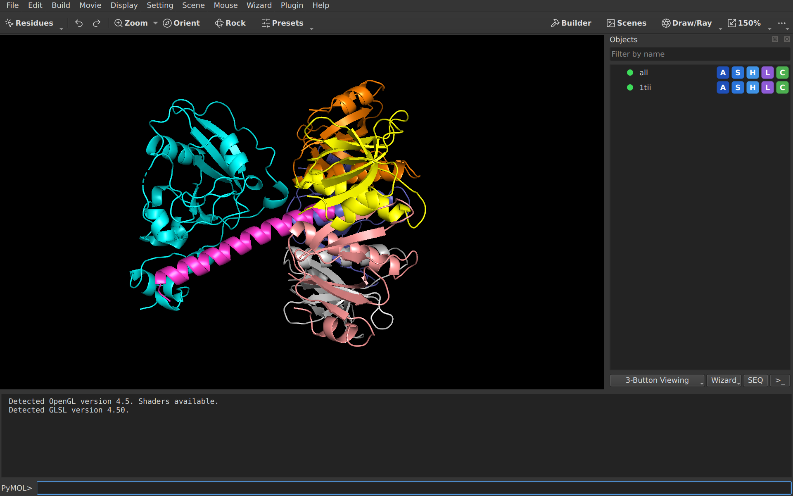

# Getting started

Ten minutes from the first start to a saved picture. You need a running
pymolish-studio: the [README](../README.md#try-it) says how to get one.

If you already know PyMOL(TM), read only
[Coming from PyMOL](#coming-from-pymol): everything else works the way you
expect.

## 1. Open a structure

- **From the Protein Data Bank:** File > Get PDB, type an ID such as `1ubq`.
  This needs an internet connection.
- **From a file:** File > Open. PDB, mmCIF, SDF, MOL and many other formats
  work.

The molecule appears in the middle of the window and gets a row in the
Objects panel on the right.

## 2. Know the window



| Area | Where | What it is for |
| --- | --- | --- |
| Toolbar | top | Undo, Zoom, Orient, ready-made looks (Presets), the Builder, Scenes, and Draw/Ray for pictures. The percent button changes the size of text and controls. |
| Viewport | middle | The molecule. Everything you do with the mouse happens here. |
| Objects panel | right | One row per molecule. Click a row to hide or show it; double-click to zoom on it. |
| Command line | bottom | Type a command and press Enter. The log above it shows the answer. |

## 3. Move the molecule

| Mouse | Does |
| --- | --- |
| Left button, drag | Rotate |
| Middle button, drag | Move |
| Right button, drag | Zoom |
| Click on an atom | Select its residue |
| Right-click | Menu for what is under the pointer |

Lost the molecule? Press **Zoom** in the toolbar.

## 4. Change how it looks

Each row in the Objects panel has five small buttons:

| Button | Menu | Example |
| --- | --- | --- |
| **A** | Action | zoom, rename, delete, find polar contacts |
| **S** | Show | cartoon, sticks, surface |
| **H** | Hide | the same list, to remove one |
| **L** | Label | residue names, atom names |
| **C** | Color | by chain, by element, one color |

A good first look for a protein: **S** > cartoon, then **C** > by chain.

The same with commands, which is faster once you know them:

```
hide everything
show cartoon
color skyblue, chain A
show sticks, organic
zoom chain A
```

`organic` means the small molecules bound to the protein. `help show` explains
a command; the Tab key completes names.

## 5. Save your work

| To keep | Do | Command |
| --- | --- | --- |
| Everything, to continue later | File > Save Session | `save work.pse` |
| A picture | File > Export Image As > PNG | `png picture.png, dpi=300, ray=1` |
| The molecule itself | File > Export Molecule | `save model.pdb` |

`ray=1` draws the picture with shadows and smooth edges. It takes longer and
is what you want for a publication.

## Coming from PyMOL

Commands, scripts, `.pymolrc`, sessions and plugins that use `cmd` work
unchanged. The window is arranged differently:

| In PyMOL | Here |
| --- | --- |
| Object list drawn inside the viewport | Objects panel on the right. `set internal_gui` brings the old list back. |
| Command line at the top | Command line at the bottom |
| Grid of buttons at the top right | Toolbar; the rest is under its last button |
| Movie buttons at the bottom right | States panel, shown when there is more than one state or frame |
| Plugins with Tk windows | No longer run; Qt plugins do. See [Writing a plugin](plugins.md). |

Removed features and their replacements are listed in
[What is different](features.md#removed).

---

PyMOL is a trademark of Schrodinger, LLC.
