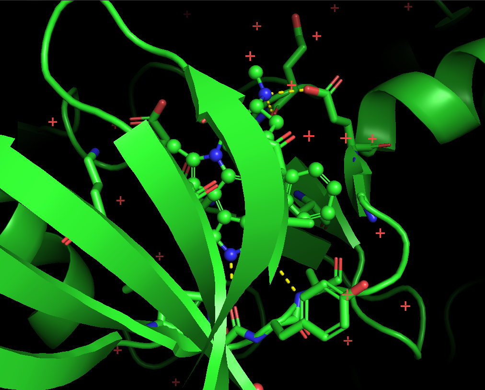
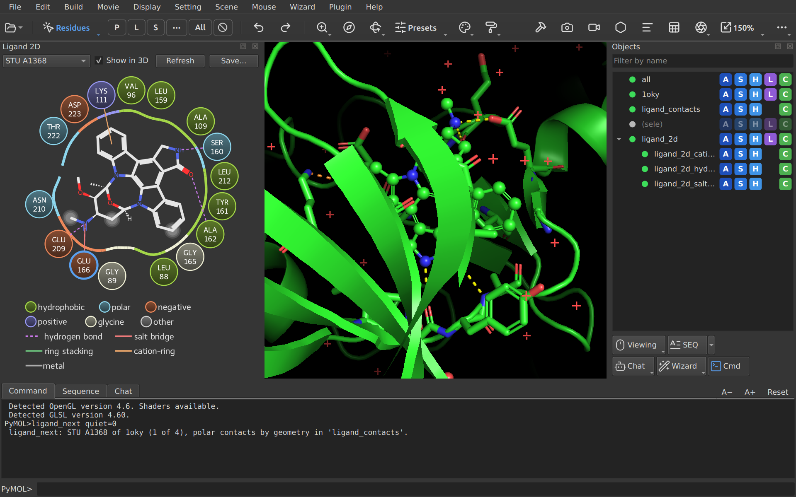
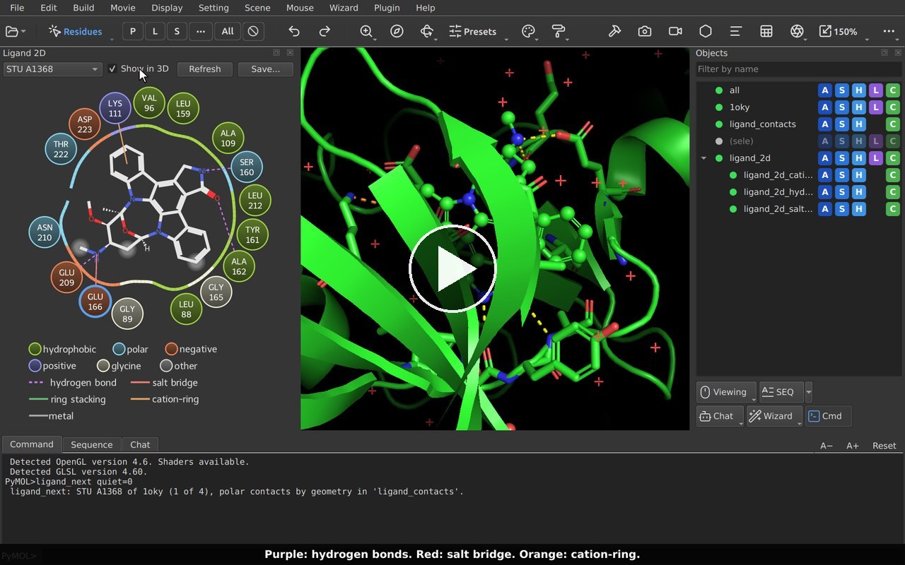

# Inspect a ligand and its pocket

[Docs home](README.md) · Checked with version 4.90.0.

Go from one ligand to the next, see the residues and contacts that hold
it, and get a flat picture of the pocket that you can save. Walking the
ligands needs nothing extra. The flat (2D) picture needs the package rdkit,
which the downloadable builds include.

**On this page:** [Load the example](#load-the-example) ·
[Find the next ligand](#find-the-next-ligand) ·
[What counts as a ligand](#what-counts-as-a-ligand) ·
[Ball size and color](#change-the-ball-size-and-color-of-the-ligand-only) ·
[The 2D panel](#see-the-ligand-and-its-contacts-in-2d) ·
[ligand_2d](#write-the-picture-with-a-command-ligand_2d) ·
[rdkit](#the-2d-picture-needs-rdkit) ·
[Presets](#presets-for-binding-sites) ·
[Other contact searches](#other-contact-searches-polar-and-pi) ·
[Limits](#limits-and-common-problems)

## Load the example

Every example on this page uses 1OKY: a kinase with the inhibitor
staurosporine (residue name `STU`) in its pocket.

```
fetch 1oky
```

`fetch` downloads the entry and needs an internet connection. The same
structure is in the source tree as `testing/data/1oky.pdb.gz`; open that
file with `load` if you work offline.

A structure opens with its ligands drawn as ball and stick. A
*representation* is how atoms are drawn; ball and stick is one, cartoon and
sticks are others.

## Find the next ligand

1. Choose **Display** > Zoom > Next Ligand with Contacts, or press
   Ctrl-Shift-M.
2. Repeat to go to the next ligand. After the last one comes the first.
3. Press Ctrl-Shift-H, or choose **Display** > Zoom > Previous Ligand with
   Contacts, to go back.
4. Choose **Display** > Zoom > Clear Ligand Contacts when you are done.

Each visit does four things:

- shows the ligand as ball and stick;
- shows the residues of its protein within 4 Å as sticks;
- draws the polar contacts between the two as dashes, in the object
  `ligand_contacts`;
- zooms on the site.

The next visit takes back what the one before turned on: its dashes, its
sticks and its balls. Everything that was shown before stays. The protein
keeps its colors and its cartoon. Clear Ligand Contacts takes the last
visit back without going on.



The command does the same:

```
ligand_next
ligand_next enabled, -1
ligand_next step=0
```

The usage is `ligand_next [selection [, step]]`. `step` is 1 for the next
ligand, -1 for the previous one and 0 to clear. The log names the ligand
and its place in the walk, for example `STU A1368 of 1oky (1 of 4)`, and
says `no polar contacts` when there are none.

The first argument says where to look. It is `enabled` by default: the
objects that are switched on.

```
ligand_next resn STU
ligand_next inorganic
```

The first line visits only staurosporine. The second walks the five
sulfate ions of 1OKY: when a selection that you name holds no ligand by the
rule below, its residues are visited one by one instead.

Scope and limits:

- The contacts are made with the protein of the ligand's own object, in
  the state that is shown. For a ligand in an object of its own, such as a
  docked pose, name both objects: `ligand_next pose or 1oky`. The protein
  atoms of that selection are then the partner.
- If you already have an object named `ligand_contacts`, it is left alone
  and the walk uses `ligand_contacts_01`.
- The place in the walk is saved with the session.
- Both keys can be changed under **Setting** > Keyboard Shortcuts...
- Ctrl-L is the older key: it only zooms on the next ligand and changes
  nothing else.

## What counts as a ligand

A ligand is one residue that the selector `organic` matches (a molecule
with carbon that is not part of a protein or nucleic acid chain) and that
has at least six atoms other than hydrogen.

- **Order.** The ligand with the most protein atoms within 4 Å comes
  first: the one in its pocket, before molecules on the surface.
- **Additives count.** In 1OKY the walk has four stops: staurosporine,
  then three glycerol molecules (`GOL`) from the crystallization buffer.
- **Ions do not count.** The sulfate ions of 1OKY have no carbon; the
  selector `inorganic` matches them. Water never counts.
- **Small molecules under six heavy atoms** are left out.
- **One residue is one ligand.** A molecule made of several residues,
  such as a sugar chain, is visited residue by residue.

To get additives out of the way, use A > clean > remove crystallization
additives in the Objects panel. This deletes atoms; see
[Edit and analyze](editing-analysis.md). The **L** button of the toolbar
selects everything `organic` in the objects that are switched on, whatever
its size.

## Change the ball size and color of the ligand only

Ball and stick has its own size and color settings. They change nothing
about sticks, spheres or lines, and nothing about the colors of the atoms.

In the Objects panel, on the row of the object or of a selection:

1. Click S > ball and stick to show it. Rest the pointer on the same row
   to open its menu.
2. Choose ball size (small 0.20, standard 0.25, 0.31, 0.40, large 0.50)
   or bond thickness (thin 0.08, standard 0.12, thick 0.18).
3. Choose C > by rep > ball and stick for a color: any color of the list,
   by element, CPK (balls only), or unset to go back.

H > ball and stick hides only this representation.

To change only the ligand and not the whole object, select it first: click
the ligand in the viewport, or click **L** in the toolbar. Then use the S
and C buttons of the row `(sele)`.

The commands:

```
show ball_and_stick, resn STU
set ball_and_stick_scale, 0.4, resn STU
set ball_and_stick_bond_radius, 0.18, resn STU
set ball_and_stick_color, orange, resn STU
set ball_and_stick_color, atomic, resn STU
unset ball_and_stick_color, resn STU
```

The ball size is a share of the atom's radius (default 0.25), the bond
radius is in Å (default 0.12), and the color `atomic` means by element.
`unset` goes back to the default; for the color that is the atom's own.

`color_cpk` colors by element in the CPK colors known from RasMol: carbon
light grey, oxygen red, nitrogen light blue, sulfur yellow.

```
color_cpk resn STU
color_cpk resn STU, ball_and_stick
```

The first line colors the atoms, so every representation follows. The
second colors only the balls and bonds; the atoms keep their colors for
everything else. `color_cpk` always colors whole residues: one atom in the
selection is enough to color its residue. In the menus: C > by element >
CPK, and C > by rep > ball and stick > CPK (balls only).

## See the ligand and its contacts in 2D

1. Click the **2D** button of the toolbar (a hexagon; its tooltip reads
   "Ligand in 2D with its contacts").

The panel **Ligand 2D** docks at the left. It shows the ligand drawn flat,
the residues around it as circles on a ring, and a line for each contact.

The button is disabled while no object that is switched on has a ligand;
its tooltip then reads "No ligand in the visible objects". **Display** >
Panels > Ligand 2D shows and hides the same panel, but does not draw by
itself: click **Refresh** after opening it that way.



[](media/ligand.mp4)

*Clip, 19 seconds, no sound: Display > Zoom > Next Ligand with Contacts, the 2D button, a click on GLU 166 in the picture, Show in 3D. The steps are written out on this page.
[Open or download the clip](media/ligand.mp4).*

### Read the picture

A residue is drawn when one of its heavy atoms is within 4.0 Å of a
heavy atom of the ligand. Its circle has the color of its kind:

| Kind | Residues | Color |
| --- | --- | --- |
| hydrophobic | Ala Val Leu Ile Met Phe Trp Tyr Pro Cys | green |
| polar | Ser Thr Asn Gln His | light blue |
| negative | Asp Glu | orange-red |
| positive | Lys Arg | violet |
| glycine | Gly | cream |
| other | anything else, such as a metal ion | grey |

A line from a residue to a ligand atom or ring is a contact:

| Contact | Line | Found when |
| --- | --- | --- |
| hydrogen bond | purple, dashed | donor and acceptor within 3.5 Å, at a fitting angle |
| salt bridge | red | opposite charges within 5.5 Å |
| ring stacking | green | two aromatic ring centers within 5.5 Å |
| cation-ring | orange | a positive charge within 6.0 Å of a ring center |
| metal | grey | a ligand atom within 3.0 Å of a metal |

A residue without a line is only near. The legend under the picture names
every kind and every contact. Two more marks:

- **Pocket outline.** A thick line runs between the ligand and the
  residues, in the color of the nearest residue. It is open where no
  residue is near: there the pocket is open.
- **Solvent halo.** A soft grey halo lies under each ligand atom that the
  protein leaves open to the solvent.

For 1OKY and staurosporine the picture has 16 residues: hydrogen bonds to
Ser 160, Ala 162, Glu 166 and Glu 209, a salt bridge to Glu 166 and a
cation-ring contact to Lys 111.

### Link the picture and the viewport

- Rest the pointer on a residue: the tooltip gives its kind, each contact
  with its distance, and the distance of the nearest atoms.
- Click a residue: it becomes the selection `sele` in the viewport and is
  shown as sticks. Ctrl+click adds it to the selection.
- Double-click a residue: the view zooms on it.
- Select residues in the viewport: they get a blue ring in the picture.
- Keyboard: click the picture or tab into it, then press Tab to walk the
  residues around the ring (Shift+Tab walks back). The current residue gets
  a ring and its tooltip. Enter selects it; Ctrl+Enter adds it. After the
  last residue, Tab moves on to the next control.

The list at the top picks among several ligands, in the order described
[above](#what-counts-as-a-ligand). While the panel is open it also follows
the ligand walk: after Ctrl-Shift-M it draws the ligand you went to.

**Refresh** finds the ligands and the contacts again. Use it after you
load, delete or change something: the picture does not update by itself.

### Show the same contacts in 3D

1. Tick **Show in 3D**.

The contacts of the picture appear as dashes in the viewport, in the
colors of the picture: one object per kind of contact
(`ligand_2d_hydrogen_bond`, `ligand_2d_salt_bridge`, ...) in the group
`ligand_2d`. They are removed when you untick the box or close the panel,
and come back when you open the panel with the box ticked.

### Save the picture

1. Click **Save...**.
2. Choose SVG or PNG and a file name.

The file has a white background, also when the window is dark, and no
selection rings. SVG scales to any size and keeps the shaded circles; the
PNG has the fixed pixel size of the drawing and plain fills.

## Write the picture with a command: ligand_2d

```
ligand_2d
ligand_2d resn STU, filename=staurosporine.svg
ligand_2d resn STU, 5.0, staurosporine.png
```

The usage is `ligand_2d [ligand [, cutoff [, filename]]]`.

- `ligand` is a selection of one ligand. Without it the command takes the
  first ligand of the objects that are switched on, as the panel does.
- `cutoff` is the distance in Å within which a residue is drawn; the
  default is 4.0. It does not change the contact criteria.
- `filename` ends in `.svg` or `.png`. A relative name is written into the
  current directory (`pwd` shows it).

Typed in the command line, it prints one line per residue with its kind
and contacts, with or without a file name:

```
 LYS 111 (positive): cation-ring
 SER 160 (polar): hydrogen bond
 GLU 166 (negative): hydrogen bond, salt bridge
 LEU 212 (hydrophobic): near
```

From Python, `cmd.ligand_2d("resn STU")` returns the residues as a list
and prints nothing.

## The 2D picture needs rdkit

rdkit is an optional chemistry package. It lays the ligand out flat and
draws the picture.

- The downloadable builds include it.
- For an installation with pip: `pip install 'pymolish[chem]'`. See
  [Install](install.md).

Without rdkit, `ligand_2d` stops with "this command needs rdkit: pip
install 'pymolish[chem]'", and the panel shows that sentence in place of
the picture. Walking the ligands (`ligand_next`), ball and stick and
`color_cpk` do not need it.

## Presets for binding sites

A preset is a ready-made look. Two groups are made for ligands:

- **Presets** > binding > ligands: protein as cartoon, the ligand as ball
  and stick, the residues around it as lines, polar contacts as dashes.
- **Presets** > binding > ligand sites: seven rows. cartoon draws the
  site without a surface. solid surface, transparent surface, dot surface
  and mesh surface add the surface of the pocket; solid (better) and
  transparent (better) draw it at a higher quality.

A preset replaces the look of the objects it acts on, where the ligand
walk only adds to it. [Appearance](appearance.md) explains presets, their
target and how to undo one.

## Other contact searches: polar and pi

The A menu of an object or selection in the Objects panel finds contacts
as dashes in a new object:

1. Click **L** in the toolbar to select the ligands.
2. On the row `(sele)`, choose A > find > polar contacts > to any atoms.
3. Or choose A > find > pi interactions > pi-pi or pi-cation.

The commands:

```
distance polar, resn STU, polymer, mode=2
pi_interactions pi, resn STU, polymer
```

`pi_interactions name [, selection1 [, selection2]]` draws ring-to-ring
and ring-to-cation contacts together. The A menu has more searches under
find: any contacts, halogen-bond interactions and salt-bridge
interactions. [Edit and analyze](editing-analysis.md) covers
measurements.

## Limits and common problems

- **Contacts are geometry, not energy.** Every contact here is found from
  distances, for hydrogen bonds also an angle. A dash is a candidate for an
  interaction, not a measured one, and says nothing about its strength.
- **Hydrogens.** Most deposited structures have none. Hydrogen bonds are
  therefore judged from donor to acceptor atom, and the 2D picture ignores
  hydrogens that are present.
- **Charges are set by rule.** In the 2D picture Asp and Glu are negative
  and Lys, Arg and His positive; on the ligand, amines, amidines and
  guanidines are positive and acids negative. The real protonation state
  is not known.
- **Two methods, two answers.** The ligand walk uses the polar contact
  search of `distance` (mode 2). The 2D picture uses its own cutoffs, listed
  [above](#read-the-picture). The two can differ for the same ligand.
- **No water.** The 2D picture leaves water out: a hydrogen bond through a
  water molecule is not shown. Other ligands are not drawn as neighbors
  either.
- **"No ligand in the visible objects".** The objects that are switched
  on have no small molecule of six or more heavy atoms. Switch the object
  on, or name the residue: `ligand_next resn ...`, `ligand_2d resn ...`.
- **"rdkit cannot read the ligand".** The ligand has bonds or valences
  that rdkit refuses. The walk and the 3D contact searches still work.
- **The wrong molecule opens.** Buffer molecules count as ligands. Pick
  the right one in the list of the panel, or name it.
- **A docked pose shows no polar contacts.** The ligand is in another
  object than the protein: name both, as described under
  [Find the next ligand](#find-the-next-ligand). The 2D picture finds the
  protein across objects by itself.

## Next

- [Appearance](appearance.md): presets, colors and transparency for the
  pocket.
- [Edit and analyze](editing-analysis.md): measure distances, add
  hydrogens, remove additives.
- [Compare objects in the property table](properties.md): rate and sort a
  set of ligands or poses.
- [Save your work](saving.md): pictures and sessions.
- [Commands](commands.md) and [Reference](reference.md): every command
  and setting named here.
