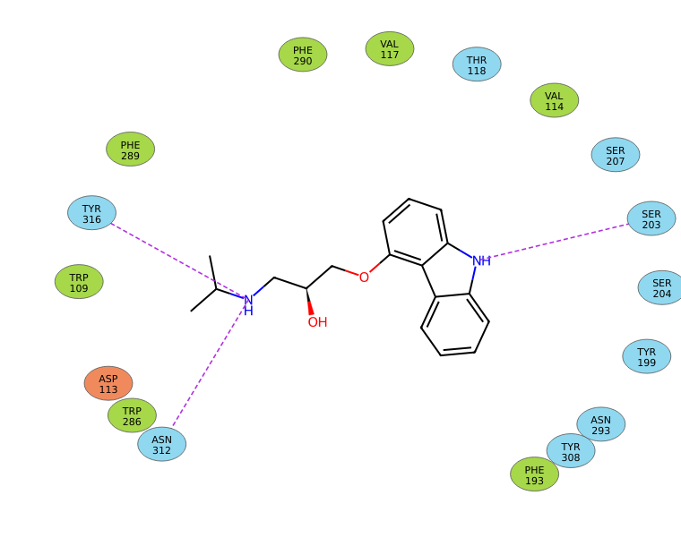

# 24 — Ligand in 2D with its contacts

[Roadmap](../../PLAN.md) · Request 2026-11-20 · Planned, not built. A
62-line prototype ran; its picture is below.

**A flat drawing of the ligand with the residues around it and the contacts
between them, in the style of Maestro's ligand interaction diagram. A button
in the action toolbar, enabled when a visible object has a ligand. Clicking a
residue in the drawing selects it in 3D.**

`plan_images/ligand_2D_effects.png` is the look to aim at: residue drops
colored by kind, arrows for hydrogen bonds, a line for ring stacking, a
contour around the pocket, grey halos on atoms open to the solvent.

## What exists

| Thing | State |
| --- | --- |
| rdkit | Approved optional dependency, extra `chem`, shipped in the bundles ([step 12](12-native-commands.md)). It gives 2D coordinates (`Compute2DCoords`), keeps wedges for stereo centers, and draws to SVG (`MolDraw2DSVG`) with the pixel position of every atom (`GetDrawCoords`). |
| Qt | `QtSvg` is part of PySide6: it renders that SVG. `QPainter` draws the rest. |
| Contacts in the core | `cmd.find_pairs(mode=1)` for hydrogen bonds by distance and angle; `distance` modes 5 to 7 and `pi_interactions` for ring stacking and cation-ring since 4.19.35 ([21c](21-commercial-features.md)); selections `organic`, `polymer`, `solvent`, `inorganic`, `donor`, `acceptor`. |
| Solvent exposure | `get_sasa_relative`, fast since 4.19.8. |

## The prototype (2026-11-20)

2RH1 with its ligand carazolol: the ligand's mol block from `cmd.get_str`,
flat coordinates from rdkit, residues within 4 Å, hydrogen bonds from
`find_pairs`, residues on a ring around the ligand at the angle of the atom
they touch, SVG rendered by Qt. 0.06 s. Three hydrogen bonds found (Ser203,
Asn312, Tyr316), 17 residues.

What it shows: the approach works with what is installed, and the hard part
is not finding contacts but the layout (residues overlap; Asp113's salt
bridge is not drawn because the prototype only looks for hydrogen bonds).

## PandaMap and the others (read 2026-11-20)

| Project | License | What it needs | Verdict |
| --- | --- | --- | --- |
| [PandaMap](https://github.com/pritampanda15/PandaMap) | MIT | numpy, matplotlib, biopython, requests; rdkit used if present. About 313 KB of Python, `core.py` 2,567 lines. Draws with matplotlib only. | Not a dependency: matplotlib and biopython are two new packages and it reads the PDB file again with its own parser. **Its layout idea is taken** (allowed by MIT, credited in the source): residue boxes on a ring, each at the angle of the ligand atoms it touches, then pushed apart to a minimum gap; and its cutoffs were compared. |
| [ProLIF](https://github.com/chemosim-lab/ProLIF) LigNetwork | Apache-2.0 | pandas, scipy, MDAnalysis, networkx; output is HTML with a JavaScript library from a CDN | No: needs a web view (`AGENTS.md` §2.4). |
| rdkit alone | BSD | nothing new | A [recipe](https://greglandrum.github.io/rdkit-blog/posts/2025-09-26-drawing-interactions-1.html) of about 30 lines: dummy atoms with labels and zero-order bonds. Plain look, no residue shapes; rdkit decides the layout. A fallback, not the goal. |
| [PLIP](https://github.com/pharmai/plip) | GPL-2.0 | openbabel | No (license and dependency). Its published cutoffs are the reference below. |
| LigPlot+, PoseView | closed | | Not usable. |

## Design

New command `ligand_2d [ligand [, cutoff [, filename ]]]` in a new
`modules/pymol/ligand2d.py` (finding and layout, no Qt), and a panel in
`modules/pmg_qt/ligand_panel.py` (painting, clicks). Without rdkit the
command says how to install the extra, as `load_smiles` does.

### Which ligand

`organic` and not `polymer`, at least 6 heavy atoms, in the enabled objects.
One: it is taken. Several: a list in the panel's header (residue name, chain,
number), the first one chosen; an atom selection named `sele` that lies in a
ligand chooses that one. None: the toolbar button is disabled, with the
tooltip "No ligand in the visible objects". Peptide ligands are polymer and
are not found: the `ligand` argument takes any selection.

### Contacts

Heavy atoms only where no hydrogens are present. Cutoffs as PLIP publishes
them, each one constant at the top of the file:

| Contact | Rule | Drawn as |
| --- | --- | --- |
| Hydrogen bond | donor to acceptor 3.5 Å (PLIP uses 4.1 to the hydrogen's donor), angle from `find_pairs` mode 1 | violet arrow from donor to acceptor; dashed when the residue's side is a side chain, solid for backbone, as in the picture |
| Salt bridge | charged groups (Asp, Glu against Lys, Arg, His; ligand charges from rdkit's formal charges) within 5.5 Å | line in red to blue |
| Ring stacking | `pi_interactions` of the core (ring centers 5.5 Å) | green line between ring centers, a dot at each end |
| Cation to ring | same finder, 6.0 Å | red line |
| Metal | ligand atom to a metal within 3.0 Å | grey line; the metal is a small circle |
| Hydrophobic and other near residues | any heavy atom within 4.0 Å | no line: the residue is only placed |
| Water bridge | Skipped in the first version | |

### Layout

1. Ligand: rdkit flat coordinates, drawn by rdkit into the SVG (bond orders,
   wedges, atom colors). Explicit hydrogens off except on hetero atoms.
2. Residue anchors: each residue goes to the mean position of the ligand
   atoms it touches, pushed outward from the ligand's center to a ring at
   1.6 bond lengths outside the ligand's outline.
3. Push apart: residues that overlap move along the ring until none do;
   more residues than fit make a second ring. Neighbors in sequence stay
   next to each other and are joined by a black line, as in the picture.
4. Pocket contour: a closed smooth line (a `QPainterPath` through points
   halfway between ligand and residue ring), colored piecewise by the
   nearest residue's kind; open where the ligand is exposed.
5. Solvent halo: a grey blurred circle behind a ligand atom whose relative
   accessible area in the complex is over 30 %.

### Residue shapes and colors

A drop pointing at the ligand, the residue name over its number. One table:

| Kind | Residues | Color |
| --- | --- | --- |
| Hydrophobic | Ala, Val, Leu, Ile, Met, Phe, Trp, Tyr, Pro, Cys | green |
| Polar | Ser, Thr, Asn, Gln, His | cyan |
| Negative | Asp, Glu | orange-red |
| Positive | Lys, Arg | violet-blue |
| Glycine | Gly | cream |
| Other (water, metal, nucleotide) | | grey |

The colors come from the object palette in use where it has them, else from
this table; a legend is drawn under the picture. The background follows the
theme: the drawing is black on white in the light theme and light on dark in
the dark one (the SVG's colors are set, not inverted), and an export is
always on white unless "transparent" is chosen.

### The panel

| Part | Decision |
| --- | --- |
| Where | A dock `dock_ligand`, floating at first, that can be docked; opened by the toolbar button "2D" (icon `hexagon` of the Lucide set, already shipped; [step 26](26-toolbar-buttons.md) has the place). Display > Panels lists it. |
| Click on a residue | `select sele, <that residue>` and the residue is shown as sticks; Ctrl+click adds. Double click zooms on it. |
| Click on a ligand atom | Selects the atom. |
| Hover | The contact's distance in a tooltip. |
| Selection, both ways | A residue or ligand atom selected in the drawing is selected in 3D (the two rows above). The other way too: residues that are in `sele` are drawn with a blue ring, so a click in the viewport or on a quick-select chip shows in the drawing. Read from `sele` in the window's 0.5 s poll while the panel is shown. |
| Contacts in 3D | "Show in 3D" check box: the drawn contacts appear as dashes in the viewport (`distance` objects in a group `ligand_2d`), removed when the panel closes. |
| Update | A Refresh button, and by itself when the ligand choice changes. Not on every frame or state change. |
| Export | Save as SVG or PNG (the command's `filename`), Copy to the clipboard. |
| Keyboard | Tab walks the residues, Enter selects the current one; the buttons are ordinary buttons. |

## Options

**How it is drawn** (question 23, answered 2026-11-20: A, "our own code, it could use rdkit; try to make it interactive, e.g. selecting a residue in 2D selects it in 3D as well"). The interactive part is the panel of 24b; the answer makes the selection go both ways, see below.

| | Option | Note |
| --- | --- | --- |
| A | **Own layout and painting: rdkit for the ligand, `QPainter` for the rest. Recommended.** | About 300 lines in two files. No new dependency. The Maestro-like look is reachable (drops, arrows, contour). |
| B | PandaMap as an optional dependency. | Its look, done today; matplotlib, biopython and requests come with it (tens of MB in the bundles), and it works on a file, not on the loaded object. |
| C | The rdkit recipe only. | About 40 lines; a plain picture: labels around the ligand, lines for contacts, no shapes, no contour, no clicks on residues. Could ship first as 24a and stay if it is enough. |

## Slices

| Slice | What | Check |
| --- | --- | --- |
| 24a | `ligand_2d`: finder and layout, SVG and PNG from the command line (no panel). Hydrogen bonds, salt bridges, stacking, near residues. | `testing/tests/api/ligand2d.py` (needs rdkit): on 2RH1 the contact list has Ser203, Asn312, Tyr316 as hydrogen bonds and Asp113 as a salt bridge; no two residue shapes overlap; the SVG parses. Pictures of 2RH1, 1OKY, 3IIS in the plan. |
| 24b | The panel and the toolbar button: clicks, hover, ligand list, export, theme. | Simulated click selects the residue; the button is disabled without a ligand; real window at 150 %, dark and light. |
| 24c | Pocket contour, solvent halos, metal contacts, "Show in 3D". | Picture next to the reference; the dashes go when the panel closes. |

## Skipped

- Water bridges, halogen bonds, covalent links: add when asked, each is one
  rule in the finder.
- Editing the layout by dragging residues.
- Several ligands in one picture; protein-protein interfaces.
- Recomputing during a trajectory.

## Sources

- PandaMap, MIT, version 4.4.1: `core.py` (contact rules), `ligand2d.py`,
  `diagram.py` (ring layout).
- PLIP defaults: <https://github.com/pharmai/plip/blob/master/plip/basic/config.py>.
- rdkit drawing recipe: Greg Landrum's blog, 2025-09-26.
