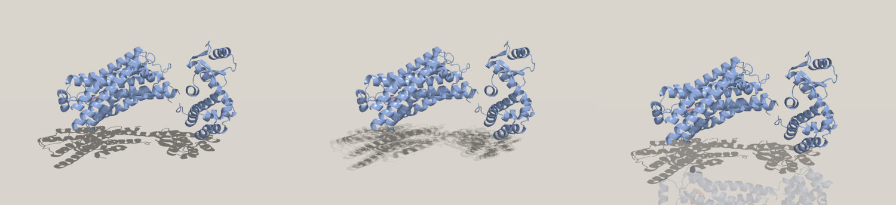
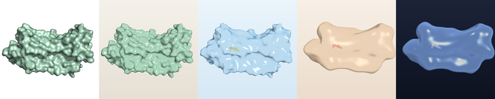

# 25 — Studio effects: floor, lights, surface looks

[Roadmap](../../PLAN.md) · Request 2026-11-20 · Planned, not built. Eight
trial pictures were ray traced; two sheets are below.

**Answers of 2026-11-20.** Question 24: shadows are ray traced only at
first. Question 25: "start with 1b, then plan further; do not add to
settings yet": the surface looks (glossy, candy glass, frosted, clay) and
the blob are **not built now**. The grid surface of
[1b](01-performance-gpu.md) is tried first, with a smoothness value; with
its times and pictures this part of the plan is written again. No preset
that only sets surface settings and no new setting is added before that.
Question 32: the color themes are built, as a group of their own.

**Two things from 3D programs like Blender: a floor under the molecule that
takes its shadow or its mirror image (25a), and surfaces that look like
glossy plastic, tinted glass or soft clay (25b). Both become rows of the
Presets menu in the toolbar.**

`plan_images/shadow1.png`, `shadow2.jpg` and `VV.mp4` are the inspiration.
They were made with a path tracer (minutes per picture) or a separate
program; the plan below gets the same idea from the renderers pymolish has.
The film shows a second thing worth taking: five named color themes (clay,
blue, sage, mint, night), each one a pastel protein color, a matching
background and one accent color for the ligand.

## What exists

| Thing | State |
| --- | --- |
| Shadows | Only the ray tracer casts them (`ray_shadow`). The viewport has no shadow pass. |
| Lights | Up to 9 directed lights (`light_count`, `light`, `light2` to `light9`) plus `ambient`, `direct`, `reflect`, `specular`, `shininess`, `spec_reflect`, `spec_power`. The seven looks of [step 15](15-presets.md) set some of these. |
| Geometry of one's own | `cmd.load_cgo`: a floor is two triangles. |
| Rim transparency | `ray_transparency_oblique`: a transparent surface gets denser where it turns away from the eye. In the ray tracer and, since the shaders have the same term (`compute_color_for_light.fs`), in the viewport. |
| A smooth blob | `map_new name, gaussian` and `isosurface`: a rounded shape without the creases of the molecular surface. A separate object, not a representation. |
| Depth by shading | `ambient_occlusion_mode` 1 on surfaces (planned for the soft look in 15e). |
| Open in the roadmap | [15e](15-presets.md) five effects, [15b](15-presets.md) outline in the viewport, [21f](21-commercial-features.md) FXAA pass, [1b](01-performance-gpu.md) a grid surface as a second `surface_type`. 25 builds on them; nothing here replaces them. |

## What others do (read 2026-11-20)

| Program | Floor | Soft shading and material |
| --- | --- | --- |
| Mol* | none | Screen-space ambient occlusion, screen-space shadow, outline; a material is metalness, roughness, bumpiness. |
| ChimeraX | none | Light presets simple, full, soft, gentle, flat; "soft" is 64 shadow maps from all sides; materials shiny and dull; silhouette edges. |
| VMD | none in the viewport | Named materials (Glossy, Glass1 to 3, AOChalky, AOShiny, BlownGlass, Goodsell ...), most of them for its ray tracers. |
| Blender Molecular Nodes | by hand, in Blender | "Squishy": roughness 1, subsurface 1, coat 1, the clay and candy look of the film. |

No molecular viewer that was checked has a floor in its real-time view: it
would be something pymolish has that the others do not.

## 25a — Floor, shadow, mirror, lights

### Trial (2RH1, cartoon, 640 x 440, ray traced)

Left: a floor and one light from above, 6 s. Middle: four lights close to
each other, so the shadow has a soft edge, 18 s. Right: a see-through floor
with a mirrored copy of the molecule under it, 10 s. All three use only
settings and commands that exist; the trial script is 50 lines.

### Design

New `modules/pymol/stage.py`, command `stage [mode [, selection]]`, modes
`off`, `shadow`, `soft`, `mirror`.

| Part | Decision |
| --- | --- |
| The floor | A CGO object `_floor`: a square 12 times the size of what is visible, at the lowest visible atom minus 2 Å, facing the camera's "up" of the moment the command runs. It has the background color, a little darker (so it reads as ground, not as a plate), on any background. It is left out of `zoom`, `orient` and the object list of the panels (the leading underscore hides it). |
| Horizon | With the floor the background becomes a gradient that meets the floor color at the far edge, so there is no hard line (fog toward the background color does the same in the viewport). |
| Camera | The command tilts the view 20° down once, so the floor is seen; "off" turns it back. |
| shadow | `ray_shadow` on, key light from above and a little behind the viewer. |
| soft | The same with four lights 10° apart: a soft edge. Costs three to four times the ray time; the menu row says "slow". |
| mirror | A copy of the visible objects, reflected in the floor plane, in a hidden group `_mirror`; the floor gets 25 % transparency. Works in the viewport too, since it is plain geometry. The copy is remade by `stage mirror` again, not by itself: a still picture, not a live reflection. |
| In the viewport | The floor and the mirror show. A shadow shows only after Draw/Ray: see the options. |
| Lights | Three new looks in the looks group of the Presets menu. **studio**: key light high on the left, a weak fill from the right, a rim light from behind that brightens the outline (three directed lights, as photographers and Blender's default setups do). **top light**: one light straight from above, strong shadows, for the floor. **soft box**: six weak lights around the viewer, almost no shadow, low specular. |
| Menu | Presets menu, a new group "stage" above the looks: floor with shadow, floor with soft shadow (slow), floor with mirror image, no floor. |
| Session | The floor and the mirror are objects, so a session keeps them as it keeps any object. |

### Options: a shadow in the viewport (question 24, answered: A)

| | Option | Note |
| --- | --- | --- |
| A | **Shadows in ray-traced pictures only; the viewport shows the floor and the mirror. Recommended as the first slice.** | No shader work. What you get after Draw/Ray differs from the viewport by the shadow, and the menu says so. |
| B | A flat dark copy of the molecule projected onto the floor along the light. | Geometry only, so it shows in the viewport and in every renderer: a hard-edged shadow of the right shape. About 30 lines more. A second slice if A reads as unfinished. |
| C | A real shadow pass in the viewport (depth picture from the light, compared in every shader). | The proper answer and the largest: a new render pass through `layer1/` and every fragment shader, to check on three drivers. Only after [21f](21-commercial-features.md) and [15b](15-presets.md) have added the first two passes over the picture, and only with frame times before and after. |

## 25b — Surface looks and color themes

The looks and the blob below wait for 1b (see the answers at the top); the
trial and the tables are kept as the starting point for that second round.
The color themes do not wait.

### Trial (2RH1 without the fused lysozyme, 520 x 520, ray traced, under 1 s each)

From the left: today's surface; **glossy** (small strong highlight, no
shadow); **candy glass** (rounder surface, see-through in the middle, dense
at the rim, the ligand shows inside); **clay** (a blob from a gaussian map,
matte); **night** (the same blob, dark background). The ligand is small in
these pictures because the whole receptor is in the frame.

### The looks

Each is a handful of settings on what is shown, in `preset.py` next to the
looks of step 15, undone by the next look or by "default".

| Look | Settings (as tried) | Viewport |
| --- | --- | --- |
| glossy | `spec_reflect` 2, `spec_power` 300, `shininess` 90, `ambient` 0.3, `ray_shadow` 0 | Yes, the same settings drive the shaders |
| candy glass | `solvent_radius` 3 (rounder), `transparency` 0.55, `ray_transparency_oblique` 1 with power 3, `two_sided_lighting` 1, `ambient` 0.45, `spec_reflect` 1.5, `spec_power` 200 | Yes |
| clay | matte: `specular` 0.15, `ambient` 0.5, `direct` 0.5, no shadow, `ambient_occlusion_mode` 1; on the blob surface below | Yes |
| frosted | candy glass with `transparency` 0.3 and no highlight: the ligand is a shape behind milk glass | Yes |

[15e](15-presets.md)'s "balls in glass" preset and its ambient occlusion in
the soft look are the same family and are built with these, in one change.

### The blob surface

A rounded shape that follows the protein without its creases: what the film
and Molecular Nodes show.

| | Option | Note |
| --- | --- | --- |
| A | **Now: `solvent_radius` 3 for candy glass, and the gaussian map with `isosurface` for clay, made by the preset as a second object. Then: when the grid surface of [1b](01-performance-gpu.md) (order 7 of the old roadmap) is tried, give it a "smoothness" value. If it stays, the blob becomes a `surface_type` and the presets switch to it. Recommended.** | Works today (the pictures). The second object does not follow atom colors or `hide`, which is the reason to move to a real surface type once one exists. No second smooth-surface code is written. |
| B | A new `surface_type` for the blob right away, own code. | Same goal, but written before 1b's experiment says whether the grid surface is kept: possibly twice. |
| C | Looks only, no blob. | Smallest; clay and night are then matte versions of today's surface. |

### Color themes

New group "themes" in the Presets menu, five rows after the film: **clay**
(sand protein, brick-red ligand, cream background), **blue** (sky blue,
yellow, pale blue), **sage** (grey-green, pale blue, off-white), **mint**
(mint, white, near white), **night** (cornflower, orange, dark blue). A
theme sets the protein color, the ligand color and a two-color background,
and nothing else: it is combined with any preset and any look.

This contradicts two decisions of step 15 (15g: a look leaves the background
alone; 15h: a preset keeps the protein colors). The new request wins for the
themes only: they are a separate group whose caption says "colors and
background", and looks and presets keep their rule. The themes are also
offered as palettes and backgrounds of their own (five rows in each menu),
so the pieces can be mixed.

### Options: how far to go in the shaders (question 25, answered: none yet, 1b first)

| | Option | Note |
| --- | --- | --- |
| A | **Settings only, as above. Recommended.** | Everything in the table works in viewport and ray tracer today. |
| B | Add a soft "wrap" light term and a rim light to `compute_color_for_light.fs`, behind one new setting. | The waxy look of the film's clay (light seems to go through the edges). About 10 lines of shader and the same term in `Ray.cpp`, so both renderers agree; pictures on three drivers. Worth it only if A's clay looks flat next to the film. |
| C | A material model with roughness and an environment picture (what Mol* has). | Real reflections of a surrounding. A large change through all shaders and the ray tracer. Not planned. |

## Slices

| Slice | What | Check |
| --- | --- | --- |
| 25b-1 | Waits for 1b. Looks glossy, candy glass, frosted. | `testing/tests/api/preset.py`: each look sets and the next one undoes its settings; a picture each on black and on white. |
| 25b-2 | Themes: five rows, five palettes, five backgrounds. Built with 15e's five effects. | The palette and background tests list them; pictures. |
| 25a-1 | `stage`: floor, shadow, soft, mirror, off; looks studio, top light, soft box. | `testing/tests/api/stage.py`: the floor lies under every visible atom; `off` leaves no object and the old view; `zoom` ignores the floor; a ray-traced picture has darker floor pixels under the molecule. Ray times in the plan. |
| 25b-3 | Waits for 1b. Clay on the blob surface, as a surface type if the grid surface stays. | Blob built in under 1 s for 1AON; picture. |
| 25a-2 | Not planned now (question 24: ray traced only at first). A viewport shadow is asked again after 25a-1 is seen. | |

## Skipped

- Path tracing, soft global light, depth of field beyond `focal_blur`.
- A live mirror image and live shadows while the molecule turns (option C
  of 25a would give the second).
- An environment picture, real reflections, refraction.
- Textures on the floor (wood, grid, checker).
- Export of the stage to Blender: `save x.usdz` already takes the scene there.
