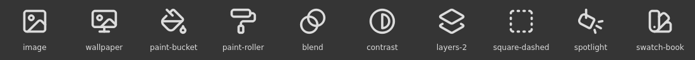

# 26 — Action toolbar: Bg, Open, quick select, and room for all of it

[Roadmap](../../PLAN.md) · Request 2026-11-20 · Planned, not built. The
widths below were measured in the real window at 150 %.

**Three additions to the action toolbar: "Background" becomes "Bg" with a
better icon (26a), an Open button stands before Residues (26b), and a row of
letters selects protein, ligand or solvent in one click (26c). With the
buttons of steps 22 and 24 the bar outgrows the window, so its layout is
decided once, here (26d).**

The bar is [action_toolbar.py](../../modules/pmg_qt/action_toolbar.py); icons
are Lucide drawings in `data/pmg_qt/icons/lucide/`, named in `icons.py`.

## 26a — Bg and its icon

| Part | Decision |
| --- | --- |
| Text | "Bg". The tooltip and the accessible name stay "Background color"; the menu's caption stays "Background:". |
| Icon | Today `image`, the same drawing the menus use for "scene". Candidates from the Lucide set (all checked to exist in release 1.77, ISC like the others): |



**Which icon** (question 27, answered 2026-11-20: A, the paint roller. Built in 4.20.0):

| | Option | Note |
| --- | --- | --- |
| A | **`paint-roller`. Recommended.** | Says "paint what is behind". Cannot be mistaken for Palette (the painter's palette), Scenes (the camera) or a picture file. |
| B | `contrast` | A half-dark circle: reads as dark or light background. Also reads as "contrast setting". |
| C | `wallpaper` | Literally a background picture; close to today's `image`. |
| D | `square-dashed` or `layers-2` | An empty frame, or the layer behind. Quiet, but vague. |

This reverses "Palette and Background carry their names" of
[step 20](20-toolbar-look.md): the new request wins. It frees 56 px.

Files: `action_toolbar.py` (one string), `icons.py` (one row), one SVG and
its line in the icon `LICENSE` listing. Check: the toolbar test's label; the
real window.

## 26b — Open

A button with a menu, the first in the bar, before Residues. Icon
`folder-open`, no text; tooltip "Open a file".

| Row | Runs (all exist in File today, [`_gui.py`](../../modules/pymol/_gui.py) lines 87 to 92) |
| --- | --- |
| Click on the button itself | Open file... (`file_open`, Ctrl+O) |
| Open file... | `file_open` |
| Open folder... | `file_open_folder` (`load_files` with a count of the files) |
| Recent | the Open Recent submenu, the same `QMenu` object as in File |
| Get PDB entry... | `file_fetch_pdb` |
| Get by UniProt... | `file_fetch_uniprot` |
| Get predicted structure... | `file_fetch_fold` (AlphaFold DB or ESMFold) |
| Import table... | step 22's `load_table`, when 22c exists |

The File menu keeps every row: the button is a shortcut, not a move. No new
dialog and no new command. Check: the toolbar test (rows present, the first
action is Open); the real window, keyboard: Tab reaches it, Space opens the
menu.

Skipped: drag and drop hints (dropping a file on the window already loads
it), a start page, a file browser panel.

## 26c — Quick select

After `plan_images/quick_select.png`: letters that select a kind of molecule.

```
 P   L   S   ...v    All   (/)
```

| Button | Selects into `sele` | Tooltip |
| --- | --- | --- |
| P | `polymer.protein` | Select protein |
| L | `organic` | Select ligands |
| S | `solvent` | Select water |
| ... (menu) | Nucleic acid (`polymer.nucleic`); Ions and metals (`inorganic`); a row per chain of the enabled objects ("Chain A", "Chain B" ...; filled when the menu opens, at most 20 rows, then "more in the Objects panel"); Backbone, Side chains; Hydrogens; Near the selection, 5 Å (`byres (sele around 5)`); Invert | |
| All | `all` in the enabled objects | Select everything |
| (/) | `deselect` | Select nothing |

| Part | Decision |
| --- | --- |
| Scope | The enabled objects: `(...) and enabled`, as the toolbar's presets do since 15i. |
| What a click does | It replaces `sele`. Shift+click adds (`sele or ...`), Ctrl+click takes away (`sele and not ...`): the modifiers of the viewport. The selection is shown (pink dots) and stays active. |
| Nothing found | The status line says "No ligand in the visible objects"; `sele` is left as it was. |
| Look | The six are one segmented control: square chips like A S H L C of the Objects panel, 26 px each, letters in the weight of the bar, the "All" chip a little wider. The (/) is the Lucide `ban` drawing. |
| Relation to "Residues" | That button says what a click in the viewport picks (atoms, residues, chains ...); it stays. Quick select stands right after it, both under one tooltip group "selection". |
| Command | `cmd.select_kind(kind, mode)` is not added: each chip runs `cmd.select("sele", ...)`. One table of (letter, expression, tooltip). |
| Keyboard | Tab reaches each chip; no new shortcuts in the first version. |

Check: `testing/tests/api/action_toolbar.py`: on 2RH1 each chip gives the
atom count of its expression; Shift adds; with an empty scene nothing is
selected and nothing raises. The "more" menu lists the chains of the enabled
objects only.

Skipped: selecting by residue name or number from the bar (the command line
and the sequence viewer do it), saved named selections in the bar.

## 26d — Layout: where everything goes

Measured 2026-11-20, real window, 150 % (the screen is 1707 px wide at that
scale; a 1920 px screen is 1280):

| State of the bar | Width |
| --- | --- |
| Today (4.19.43) | 1096 px; the default window is made as wide as the bar |
| "Background" becomes "Bg" | 1040 |
| + Open | 1081 |
| + six quick-select buttons as ordinary text buttons | 1309 (as 26 px chips: about 1240) |
| + 2D and Table, icon only | about 1320 |
| Builder, Scenes and Draw/Ray icon only | about 1140 to 1210 |
| **4.20.0, measured:** "Bg", Builder and Scenes as icons, "Draw" | **904** |

The first three rows and the text-button row are measured; the rows with
chips are worked out from them, since the chips do not exist yet.

**Options** (question 26, answered 2026-11-20: A, with one change asked the same day: Builder and Scenes show only their icon, the name on mouse-over; "Draw/Ray" keeps a text, shortened to "Draw". Those two changes are built in 4.20.0 with 26a):

| | Option | Note |
| --- | --- | --- |
| A | **One row. Icon only for everything but Residues and Presets; names in tooltips. About 1140 to 1210 px at 150 %. Recommended.** | The default window grows from 1104 px by 40 to 110 px. On a 1920 px screen at 150 % (1280) it fits; on a smaller screen the user lowers the scale, which step 27 makes a matter of one click. Order: Open, Residues, P L S ... All (/), Undo, Redo, Zoom, Orient, Rock, Presets, Palette, Bg, then on the right 2D, Table, Builder, Scenes, Draw/Ray, scale, More. |
| B | Two rows: the bar as today, and a slim second bar "Select" with Residues and quick select. | Keeps all names. Costs 34 px of viewport height; Display > Panels can hide the second bar. |
| C | Quick select goes to the foot of the Objects panel, next to the mouse mode. | No room problem in the bar; but the panel can be closed and the chips are then gone, and the request asks for the action bar. |

Whatever is chosen, the rule of 4.19.0 stays: no button starts in the
overflow menu of the default window at 150 %. The toolbar test measures it.

## Order

26a (one line) and 26b ship first, each alone. 26d is applied with 26c,
because 26c is what makes the bar too wide; the buttons of steps 22 and 24
take their places when those steps ship.
