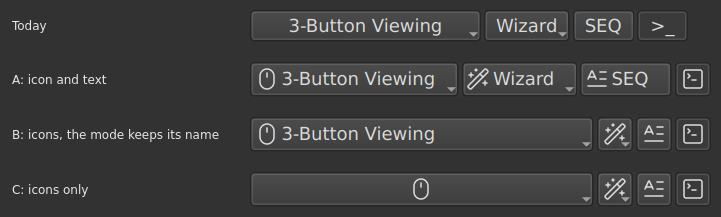
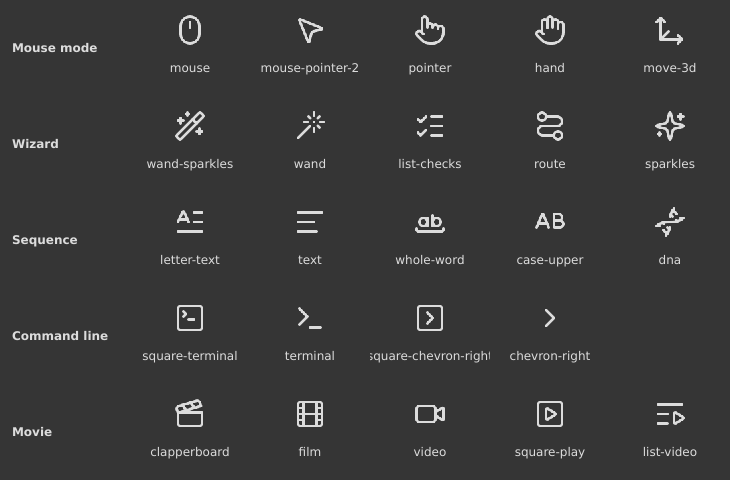
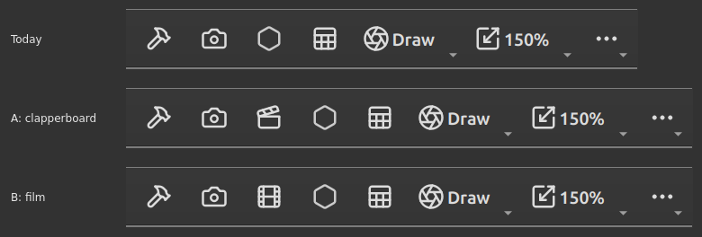

# 32 — Icons in the row under the object list, and a Movie button

**2026-11-24, 4.67.0, from a request and not from this plan:** the row has
five buttons: mouse mode, SEQ, AI assistant (moved here from the action
toolbar, Lucide's `bot`), Wizard, command line. SEQ opens the Sequence tab
and has an arrow with "Show in viewport" and "Sequence alignment"; it no
longer shows a state. Measured in the real window on WSLg at 150 %, dark
theme: the buttons are 139, 73, 24, 24 and 24 px wide in a panel of 300 px;
the row needs 234 px, since the mouse mode button now shrinks to the width
of SEQ and Qt shortens its name; the toolbar needs 1254 px in a window of
1262 px, no button in the overflow menu. Left out: the light theme, a live
change of the UI scale, Windows and macOS.

**2026-11-23 follow-up:** step 32 stays finished. The separate sequence
window of [step 33](33-sequence-window.md) has an open choice (question 60)
about the SEQ entry point; no change to its shipped icon/label is assumed.
Step 31's assistant entry must use this file's measured toolbar baseline
and remeasure with the new window, not its older pre-Movie estimate.

[Roadmap](../../PLAN.md) · Request 2026-11-20 · **Planned 2026-11-20 at
4.41.0. Done the same day: 32a in 4.42.0, 32b in 4.43.0.**

As built, after the answers to questions 49 to 52. The text below is the
plan as it was written, with its options.

| Slice | Built | Measured in the real window, 150 %, dark theme |
| --- | --- | --- |
| 32a, 4.42.0 | Layout B with two changes from answer 50: the order is mouse mode, SEQ, Wizard, command line, and SEQ keeps its letters beside its icon. The drawings are the four recommended ones. | The buttons are 177, 61, 24 and 24 px wide and 23 px high; the row needs 254 px of its 292. SEQ keeps its tooltip after a click. Also looked at in the light theme and after a live change of the UI scale to 200 %: the icons are sharp. |
| 32b, 4.43.0 | The icon is `video` (answer 51). A click opens the Timeline panel and a second click closes it (answer 52). | The bar needs 1236 px and the window opens 1244 px wide; no button is in the overflow menu. Click, second click and Space on the focused button were tried. |

Not in the plan: the "movie" rows of the menus show `video` too, since a
label has one icon, and `clapperboard.svg` is deleted. Left out: the Movie
button was not looked at in the light theme; the Tab order was not walked
by hand (every button takes the Tab key, read from the widgets); Windows
and macOS were not seen.

**The row under the object list has four buttons with text: the mouse mode,
Wizard, SEQ and `>_`. 32a gives them icons, beside the text or in its place.
32b puts a Movie button into the action toolbar, right after Scenes; it opens
the Timeline panel.**

Every width below was measured on 2026-11-20 in the real window of 4.41.0:
UI scale 150 %, dark theme, the Objects panel at its default width of 300 px.
The three layouts and the Movie button were put into the running window by a
script, so the pictures show the real widgets. A number that is an estimate
says so.

## 32a — icons in the row under the object list

The row is built in
[pymol_qt_gui.py](../../modules/pmg_qt/pymol_qt_gui.py), lines 396 to 421,
and sits in `object_panel.footer`
([object_panel.py](../../modules/pmg_qt/object_panel.py), line 518). It has
292 px. Today the buttons are 21 px high and none has an icon.

**Which layout** (question 49):

| | Layout | Mouse mode | Wizard | SEQ | Command | The row needs |
| --- | --- | --- | --- | --- | --- | --- |
| | Today | 154 px (needs 119) | 57 | 41 | 34 | 257 px |
| A | An icon beside every text; the command button is its icon alone, the drawing is `>_` already. | 139 | 77 | 61 | 24 | 307 px: 15 more than the row has. In the trial the panel grew to fit. |
| B | **Icons for Wizard, SEQ and the command line; the mouse mode keeps its name beside its icon. Recommended.** | 229 (needs 139) | 24 | 24 | 24 | 217 px |
| C | Icons only; the mouse mode is in the tooltip. | 229 (needs 24) | 24 | 24 | 24 | 102 px |

Why B: the name of the mouse mode is a state, not a label. "Viewing" or
"Editing" decides what a drag does, and the user reads it there; C hides it
in a tooltip. The other three are fixed names, and a tooltip is enough for
them. A does not fit the panel at its default width.

In A, B and C the buttons are 23 px high, 2 more than today: the icon is
16 px.

**Which drawings** (question 50). All are Lucide, release 1.77.0, the release
of the newest file in `data/pmg_qt/icons/lucide/`, ISC like the others:

| Button | Recommended | Why, and what else |
| --- | --- | --- |
| Mouse mode | `mouse` | The device itself. `mouse-pointer-2` and `pointer` read as "select", and the bar has `mouse-pointer-click` for that already. |
| Wizard | `wand-sparkles` | The usual sign for a wizard. `sparkles` alone is "clean" in the menus. |
| SEQ | `letter-text` | Letters in rows. `dna` is "ss" (secondary structure) in the menus. This is the weakest of the four: if it does not read as "sequence", the letters "SEQ" stay beside it. That button is then 61 px and the row needs 254 px of its 292 (added up from the measured widths). |
| Command line | `square-terminal` | The same `>_` as today's text, in a frame like the other three. `terminal` is the bare one. |

| Part | Decision |
| --- | --- |
| Size | 16 px, line width 1.5: the icons of the States panel directly above (`object_panel.py`, line 413). The toolbar's 20 px would make the row higher than the States row. |
| Color | Tinted with the text color, like every other icon. SEQ and the command line are switches: their icon is blue while on, as Rock in the toolbar (`menu_icon(..., accent=...)` exists). |
| Dark theme, UI scale | The icons are made again on `PaletteChange`. The dark theme and the live UI scale both send it (`theme.py`, line 126). |
| Tooltips | "Mouse mode", "Sequence viewer" and "Command line and log" exist. Wizard gets "Wizard". |
| Screen reader | A button that shows only its icon keeps its text as its name. `>_` becomes "Command line". |
| Keyboard | Nothing changes: an icon does not change how a button takes the keys. Looked at in the real window when it is built: Tab reaches each button, Space opens its menu or switches it. |

Files: `pymol_qt_gui.py` (the block above); `icons.py`, four rows in
`LABELS`; four files in `data/pmg_qt/icons/lucide/` (`mouse`,
`wand-sparkles`, `letter-text`, `square-terminal`).

Check: `testing/tests/api/object_panel.py` already loads the icon of every
row of `LABELS`, so the four files are covered. New: each of the four
buttons has an icon, and with layout B three of them show no text. Real
window at 150 %: the row fits 292 px, in the dark and in the light theme,
and the icons are sharp after a live change of the UI scale.

Skipped: a setting to choose between text and icons; other icons for the
other mouse modes; moving a button out of the row.

## 32b — a Movie button in the action toolbar

The buttons on the right of the bar are the `panels` list in
`pymol_qt_gui.py`, lines 367 to 376: Builder, Scenes, 2D, Table, Draw. One
row `('Movie', ...)` after Scenes adds the button. A panel button shows only
its icon; its label is the tooltip and the name for a screen reader.

**Which icon** (question 51):

| | Option | Note |
| --- | --- | --- |
| A | **`clapperboard`. Recommended.** | The menus use it for "movie" already (`icons.py`, the row `"movie"`), and the file is in the program. No new file, no new row. |
| B | `film` | A strip of film; closer to a timeline. One new file. Next to Table (`sheet`) it is a second square with a grid. |
| C | `video`, `square-play`, `list-video` | In the picture of 32a, last row. `square-play` reads as "play", which the States panel has. |

**What a click does** (question 52):

| | Option | Note |
| --- | --- | --- |
| A | **It opens the Timeline panel and brings it to the front. Recommended.** | What Movie > Timeline runs (`timeline_panel_dialog`, `pymol_qt_gui.py`, line 983), and what the Scenes button next to it does for its panel. No new code. The panel closes with its own close button. |
| B | It opens the panel, and a second click closes it. | What the Table button does. A few lines more. |

| Part | Decision |
| --- | --- |
| Name | "Movie", as asked. The panel's title stays "Timeline", and so do the rows Movie > Timeline and Display > Panels > Timeline. |
| Width | The bar needs 1195 px today and 1236 px with the button, 41 more. The window opens 8 px wider than the bar needs: 1203 px today, so about 1244 px with the button (estimate). A 1920 px screen at 150 % has 1280 px. |
| Step 31a | It plans one more icon in this bar. By the same 41 px the window would then need about 1285 px (estimate), 5 more than that screen has. 31a decides what gives way; this slice changes nothing else in the bar. |

Files: `pymol_qt_gui.py`, one row.

Check: `test_icons` in `testing/tests/api/action_toolbar.py` gets a Movie
row in its `panels`: 21 buttons, "Movie" among those that show only an icon.
Real window at 150 %: the width of the bar, no button starts in the overflow
menu, Tab reaches the button, Enter opens the panel.

Skipped: a pressed look while the panel is open; a shortcut key; a new name
for the panel; taking "Clear movie" out of the More menu.
