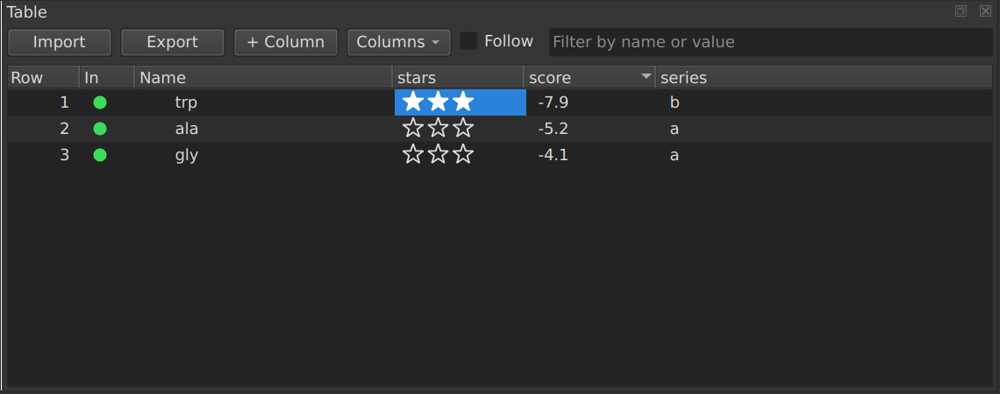

# Compare objects in the property table

[Docs home](README.md) · Checked with version 4.90.0.

Keep scores, notes and ratings beside your molecules: one row per object,
one column per value, sorted and filtered like a spreadsheet, filled from a
CSV or Excel file. No extra package and no network is needed.

**On this page:**
[A worked example](#a-worked-example-three-molecules-and-a-score) ·
[Open the table](#open-the-table) ·
[Rows](#rows-one-per-object) ·
[Columns](#add-hide-and-count-columns) ·
[Edit](#edit-a-cell) ·
[Sort and filter](#sort-and-filter) ·
[Stars](#rate-with-stars) ·
[Follow](#step-through-objects-with-follow) ·
[Import](#import-a-csv-tsv-or-excel-file) ·
[Export](#export-as-csv) ·
[Commands](#set-and-read-properties-with-commands) ·
[One atom](#look-at-one-atom-more--properties) ·
[Sessions](#what-a-session-keeps) ·
[Keyboard](#keyboard-shortcuts-of-the-table) ·
[Limits](#limits-and-common-problems)

A *property* is a named value that belongs to an object: a docking score, a
measured activity, a comment. The data fields of an SDF file become
properties when the file is loaded. The table shows them; it stores nothing
itself.

## A worked example: three molecules and a score

1. Make three small objects. Type in the command line:

   ```
   fragment ala
   fragment gly
   fragment trp
   ```

2. In a text editor, save this as `scores.csv`:

   ```
   name,score,series
   ala,-5.2,a
   gly,-4.1,a
   trp,-7.9,b
   his,-6.0,b
   ```

3. Click the **Table** button of the toolbar (a sheet with a grid; its
   tooltip reads "Table").
4. Click **Import** and choose `scores.csv`.

   A message says: 3 rows matched an object, 1 row named no object (`his`,
   which is not loaded), new columns `score` and `series`.

5. Click the header **score**. The rows sort from the lowest value: `trp`
   is on top.
6. In the row of `trp`, click the third star of the column **stars**. All
   three stars fill: the object has the rating 3.
7. Click **Export** and choose a file name to write what you see as CSV.



The same with commands (`cd` first to the folder that holds the file):

```
load_table scores.csv
set_property stars, 3, trp
save_table ranked.csv
```

`ranked.csv` then holds:

```
name,score,series,stars
ala,-5.2,a,
gly,-4.1,a,
trp,-7.9,b,3
```

## Open the table

1. Click the **Table** button of the toolbar, or choose **Display** >
   Panels > Table.

The table is a window of its own. It opens over the viewport with its
right edge at the Objects panel and follows the main window. Click the
button again, or close the window, to hide it.

You can resize it; the size is remembered for the next start. Once you
drag it somewhere else it stays there. **Display** > Panels > Reset Layout
puts it back over the viewport.

While it is open, the table follows what commands and other panels change,
within a moment.

## Rows: one per object

Each object has a row with three fixed cells, then the properties:

| Column | Shows | Mouse |
| --- | --- | --- |
| Row | the number of the row as shown | double-click: switch on and zoom |
| In | a dot, lit when the object is switched on | click: show or hide |
| Name | the name of the object | double-click: rename |

- Ctrl+click on a dot shows only that object, with the groups it is in,
  and switches all others off.
- The members of a group nest under their group, as in the Objects panel.
- A right click on a row opens the menus of that object: Show as, Color,
  rename, duplicate, delete, then Action, Show, Hide and Label.
- Selections have no rows.

The table has no rows for atoms. When you click or pick an atom in the
viewport, the row of its object becomes the current row, and the table
scrolls to it. For the data of one atom see
[Look at one atom](#look-at-one-atom-more--properties).

## Add, hide and count columns

Every property that any object has gets a column. The column **stars** is
always there.

- **+ Column** asks for a name and adds an empty column. It becomes a
  property when the first value is typed into it.
- A right click on a column header offers Add column..., Rename
  column... and Delete column. Delete column removes that property from
  every object. It asks first and cannot be undone.
- Drag a header to move its column.

The **Columns** button opens a menu:

- A check mark per column. Clear it to hide the column; the values stay.
- Add counted > atoms, residues, chains, states, weight, charge, or
  all of them.
- Refresh counted.

A counted column is written as an ordinary property, so it is sorted,
exported and saved like the others. It is counted at that moment and does
not follow later changes: choose Refresh counted after you edit a
structure.

| Counted column | Value |
| --- | --- |
| atoms | number of atoms |
| residues | number of residues |
| chains | number of chain identifiers |
| states | number of states |
| weight | mass of the atoms present, two decimals |
| charge | sum of the formal charges |

## Edit a cell

1. Double-click a cell, or move to it and press F2, or just start typing.
2. Press Enter to apply, Esc to give up.

- The value becomes a whole number, a decimal number or text, by what you
  typed. `007` becomes the number 7.
- Emptying a cell deletes that property from the object.
- With several cells of one column selected, the edit goes to all of
  them.
- Delete empties the selected cells.
- Ctrl+C copies the selected cells as tab-separated text. Ctrl+V pastes
  such text, for instance from a spreadsheet, from the first selected cell
  to the right and down. A paste changes property cells only, never a name.
- Editing the **Name** cell renames the object. Spaces become underscores;
  a name that is taken is refused with a message in the log.
- The cells Row and In are not edited.

Only molecules have properties. Groups, maps and measurements have rows,
but their cells stay empty.

## Sort and filter

- Click a column header to sort by its values; click again to reverse.
  Numbers come before text, empty cells last. Numbers sort by value, not by
  their digits.
- Click the header **Row** to get the order of the Objects panel back.
- Type in the box **Filter by name or value**: only rows whose name or any
  value contains the text stay, upper or lower case alike. A group stays
  while one of its members matches. Hidden columns are searched too.

Sorting and filtering change what is shown, not the objects. The row
numbers always count the rows shown, from 1.

## Rate with stars

The column **stars** shows three stars per molecule.

- Click an empty star to rate up to it.
- Click a filled star to rate down to the one before it. On three stars,
  a click on the third leaves two; a click on the first leaves none.
- By keyboard: move to the cell and type 0, 1, 2 or 3, then Enter. Delete
  removes the rating.

The rating is the property `stars` of the object, a whole number from 0 to
3. So it sorts, exports and saves like any column, and a command sets it:

```
set_property stars, 2, gly
```

Typed, pasted and imported values that are not 0, 1, 2 or 3 are refused.
Groups and maps have no stars.

## Step through objects with Follow

1. Click a row.
2. Tick **Follow**.
3. Press Down or Up.

Only the object of the current row is shown, together with the groups it
is in. Every other object is switched off. Each step shows the next object
alone: a quick way to page through docking poses or a set of ligands in the
order of the sort.

Untick **Follow** to stop. The objects stay as the last step left them:
switch the others on again with their dots, or in the Objects panel.
Picking an atom in the viewport moves the current row without switching
anything off.

## Import a CSV, TSV or Excel file

1. Click **Import** in the table. Or open the menu of the **Open** button
   of the toolbar (the first button; its tooltip reads "Open a file") and
   choose Import table...; this also opens the table.
2. Choose a `.csv`, `.tsv`, `.txt` or `.xlsx` file.

A message reports how many rows matched an object, which rows named none
(the first five), and the new columns.

The command:

```
load_table scores.csv
load_table results.xlsx, object_column=Ligand
```

The usage is `load_table filename [, object_column]`.

### How rows find their object

1. The first row that is not empty holds the headers.
2. One column holds the object names. It is the column you name with
   `object_column`; else the first header found of `name`, `title`,
   `object`, `id`, `entry`, in that order; else the first column. Upper and
   lower case of these headers do not matter.
3. A row goes to the object whose name equals the cell of that column.
   Spaces around the name are ignored. Otherwise the match is exact: `ALA`
   does not match the object `ala`, and there are no wildcards.
4. A row that names no loaded object is skipped and reported. Import never
   creates an object.
5. Objects that are switched off are matched too.

### What is set

- Every other column with a header sets the property of that name,
  spelled as in the header. A header that is new becomes a new column.
- An empty cell leaves the property as it is. Import never deletes a
  value.
- A value becomes a whole number, a decimal number, true or false (`true`,
  `false`, `yes`, `no`), or text. Use a decimal point: `5,2` is text.
- In a column `stars` only 0, 1, 2 and 3 are taken. Other values are left
  out, and the log says how many.
- Rows are applied from top to bottom. If two rows name the same object,
  the later one wins.

### File formats

- Text files: the separator is detected (comma, semicolon, tab or `|`).
  Save them as UTF-8.
- Excel `.xlsx`: the first sheet only. A formula gives its stored result.
  A date arrives as Excel's day number.
- The old Excel format `.xls` is not read: save as `.xlsx` or `.csv`.

## Export as CSV

1. Click **Export** and choose a file name.

The button writes what the table shows: the rows that pass the filter, in
the sorted order, and the columns that are not hidden, in their order from
left to right. Group rows are left out. The first column is `name`.
Decimal numbers are written as shown, with six significant digits.

The command writes from the objects instead, without looking at the table:

```
save_table ranked.csv
save_table hits.csv, trp or ala
```

The usage is `save_table filename [, selection]`. It writes a column
`name` and one column per property, for every molecule with atoms in the
selection (default: all), with the full values. A file written by either
way can be imported again.

## Set and read properties with commands

```
set_property score, -7.9, trp
set_property comment, best pose, trp
set_property batch, 7
get_property score, trp
get_property_list trp
```

- `set_property name, value [, object [, state [, proptype]]]` sets a
  property of one object. Without an object it is set on all of them; a
  pattern such as `lig*` sets it on every object that matches.
- An empty value deletes the property: `set_property comment, , trp`.
- The type is detected as in the table. To force one, give `proptype`:
  1 true/false, 2 whole number, 3 decimal number, 5 color, 6 text. For
  example `set_property code, 007, trp, proptype=6` keeps the text `007`.
- `get_property name, object` prints the value. `get_property_list
  object` prints the names of all properties of an object.

In a Python script the same functions return values:

```python
from pymol import cmd

cmd.set_property("score", -7.9, "trp")
print(cmd.get_property("score", "trp"))    # -7.9
print(cmd.get_property_list("trp"))        # ['score', ...]
cmd.set_property("score", None, "trp")     # delete it
```

Atoms can carry properties too. The table does not show them; `iterate`,
`label` and selections do:

```
set_atom_property note, anchor, trp and name CA
iterate trp and name CA, print(name, p.note)
iterate trp, print(name, p.all)
label trp and name CA, p.note
alter trp, p.note = None
```

`set_atom_property name, value [, selection [, state [, proptype]]]` sets
the value on every atom of the selection. Inside `iterate`, `alter` and
`label`, `p.note` is the property `note` of the atom and `p.all` a
dictionary of all its properties. Setting it to `None` with `alter` deletes
it.

## Look at one atom: More > Properties

1. Click an atom in the viewport, if you want to start from it.
2. Click **More** (the last button of the toolbar; its tooltip reads
   "More view actions") and choose Properties.

The window **Properties Inspector** opens. **Object:**, **State:** and
**Atom:** (the index of the atom) at the top choose what is shown;
choosing an atom there also picks it in the viewport. The button beside
them (tooltip "Refresh") reads the list of objects again. The tree below
has two columns, Key and Value:

| Section | Holds |
| --- | --- |
| Object-Level | TTT Matrix, Settings of the object |
| Object-State-Level | Title, State Matrix, Settings of the state |
| Atom-Level | Identifiers, Properties (built-in), Settings of the atom |
| Atom-State-Level | state and x, y, z, Settings |

Double-click a value to change it. The atom's `model`, `index`, `state`
and `oneletter` are read-only. Delete on a row unsets a setting, clears a
title or resets a matrix.

This window shows what an atom is made of: name, residue, element,
B-factor, charge, color, coordinates. It does not list the properties of
the table, neither of objects nor of atoms. Use the table for objects and
`iterate` with `p.all` for atoms.

## What a session keeps

A *session* saves your work to continue later (**File** > Save Session).

- **Values.** Properties of objects and of atoms are part of the objects.
  A session keeps them, ratings included.
- **Column layout.** The order of the columns, the hidden ones and the
  empty ones added by hand are kept in the session, in `.pse` and `.psex`
  files. They come back when the session is loaded, also in a table that is
  open.
- **Not kept.** The sort order, the filter text and **Follow**. The size
  of the table window is remembered per computer, not per session.

The layout is stored under one extra key of the session, `pymolish`, in
its entry `table`. The entry is written once the table has been opened.
PyMOL does not know the key and ignores it: a `.pse` file loads there
without the column layout. Entries written by a newer pymolish-studio are
kept and written back unchanged. [Save your work](saving.md) compares the
session formats.

## Keyboard shortcuts of the table

The keys work while the table has the keyboard: click a cell first.

| Key | Action |
| --- | --- |
| Up, Down | move the current row; with **Follow**, show that object alone |
| Tab, Shift+Tab | move to the next or previous cell |
| Space | show or hide the object of the current row |
| F2, or typing | edit the current cell |
| Enter / Esc | apply / give up an edit |
| Delete | empty the selected cells |
| Ctrl+C / Ctrl+V | copy / paste cells as tab-separated text |

## Limits and common problems

- **"rows named no object".** The name in the file is not the name of a
  loaded object. Check upper and lower case, and which column holds the
  names; name it with `object_column`.
- **A number arrived as text.** It has a decimal comma, a unit or a
  space inside. Text sorts after all numbers.
- **A code lost its leading zeros.** The value was read as a number. Set
  it with `set_property ..., proptype=6`.
- **A counted value is wrong.** It was counted before an edit. Choose
  **Columns** > Refresh counted.
- **`get_property` prints "not found" for 0.** The printed message
  treats the values 0 and false like a missing property. In Python,
  `cmd.get_property` returns the real value.
- **Several objects in one `set_property`.** A list of names separated by
  spaces is not accepted. Use a pattern with `*`, or one command per
  object.
- **Export rounds.** The **Export** button writes decimal numbers with six
  significant digits. `save_table` writes them in full.

## Next

- [Inspect a ligand and its pocket](ligands.md): look at each rated
  molecule in its site.
- [Open and organize structures](structures.md): load many files, groups,
  SMILES.
- [Save your work](saving.md): sessions and what other programs read.
- [Commands](commands.md) and [Reference](reference.md): `load_table`,
  `save_table`, `set_property` and the selection language.
