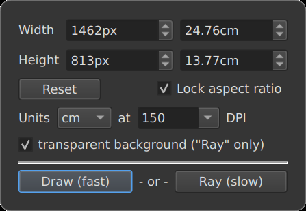

# Save sessions, structures, pictures and exports

[Docs home](README.md) · Checked with version 4.90.0.

Keep your work to continue later, write molecules for other programs, and
make pictures and 3D models. Nothing extra is needed, except for glTF and GLB
export, which needs a build that includes it (the release bundles do).

**On this page:** [What to save](#what-to-save) ·
[Session](#save-a-session) · [.psex or .pse](#psex-or-pse) ·
[Structure file](#save-a-structure-file) ·
[Many objects](#save-many-objects-at-once) ·
[Picture](#save-a-picture) · [Background](#picture-background) ·
[3D models](#export-a-3d-model) ·
[Maps and alignments](#save-maps-and-alignments) · [Movies](#movies) ·
[Formats](#file-formats-that-are-read-and-written) ·
[Limits](#limits-and-common-problems)

## What to save

| You want to | Save a | It keeps |
| --- | --- | --- |
| continue later | session (`.psex`) | everything: objects, how they are drawn and colored, settings, selections, scenes, the movie and the view |
| use the molecule in another program | structure file (`.cif`, `.pdb`, `.sdf`) | atoms and coordinates, not how they are drawn |
| show it | picture (`.png`) | the pixels of one view |
| show it moving | movie | see [Scenes and movies](scenes-movies.md) |
| print it or use it in 3D software | 3D model (`.stl`, `.glb`, `.usdz`) | the shapes on display, not the atoms |

A session is the only one of these that gets all your work back.

## Save a session

1. Choose File > Save Session As....
2. Type a name. The file type list starts with **pymolish Session, packed
   (\*.psex)**; a name without an extension gets `.psex`.
3. From then on File > Save Session (Ctrl+S) writes to the same file, in the
   same type.

```
save work.psex
save work.pse
```

**Open it again** with File > Open..., File > Open Recent... or
`load work.psex`. If objects are loaded, a dialog asks how to go on:

| Choice | Result |
| --- | --- |
| Discard current session | the loaded objects are deleted, then the file is opened |
| Merge with current session (partial load) | the objects of the file are added; its global settings, selections, scenes and movie are not restored |
| Open in new PyMOL Window | the file gets a window of its own |

Opening a session file drops the Undo steps kept so far.

## .psex or .pse

Both hold the same session. `.psex` is the packed form of this program: much
smaller and quicker to write and read. `.pse` is the PyMOL session format.

| | `.psex` | `.pse` |
| --- | --- | --- |
| Read by pymolish-studio | yes | yes |
| Read by PyMOL | no | yes |
| Size | small | large |

Use `.psex` for your own work and `.pse` for a file that someone will open in
PyMOL. `load` recognizes the two by the content of the file, not by its name.

A `.pse` written here also carries things PyMOL does not have. According to
the change log, tried with PyMOL 3.2.0a, this is what it does with them:

| In the session | In PyMOL |
| --- | --- |
| ball and stick representation and its transparency | the session loads; the representation is not drawn |
| Solid (grid) surface (`surface_type` 7) | no such surface is shown |
| appearance stored in a scene | the scene is recalled without it |
| property-table columns, rows of the alignment window, Timeline shots, the place of the ligand walk (session key `pymolish`) | ignored |
| atom settings PyMOL does not know (key `pymolish_unique_settings`) | dropped when PyMOL saves the session |
| background picture stored in the session | loaded and saved by 3.2.0a; an older program shows no picture |

Everything else in the file (objects, colors, scenes, movie) is ordinary
session content.

- A `.psex` cut short, or written by a newer version of the format, gives an
  error and loads nothing.
- Entries under the key `pymolish` that this version does not know, written
  by a newer one, are kept and written back.

## Save a structure file

1. Choose File > Export Molecule....
2. Set **Selection** (at the start: `enabled`, the objects that are switched
   on) and **State** (`-1 (current)` or `0 (all states)`).
3. Press **Save...**, pick the file type and the name.

The dialog also has the PDB options (CONECT records, segment identifier,
atom ids) and, under Multi-File, one file per object or per object-state.

```
save model.cif
save model.pdb
save ligand.sdf, organic
save ligand.mol, organic
save protein.pdb, polymer.protein
save nmr_all.pdb, nmr, state=0
save model.pdb.gz
```

- The file type follows the extension. The second argument is the selection
  to write; without it all atoms are written, hidden ones too.
- Only the current state is written unless you give `state=0`.
- Ending the name in `.gz` compresses the file.
- **Several objects in one PDB file come back as one object.** mmCIF keeps
  them apart, and so does `multisave both.pdb`.
- An SDF or MOL file with more than 999 atoms or bonds is written in the
  V3000 form; the log says so.
- A structure file has no colors, representations, scenes or settings.

## Save many objects at once

1. Choose File > Export Objects....
2. Under **Objects** pick a group or an object, or type a selection.
3. Set **Folder** and **Format** (cif, pdb, sdf, mol2, pqr, xyz, fasta).
4. The dialog shows the number of objects and the command. Press OK.

Each object goes to its own file, `<object>.<format>`.

```
export_objects parts, out, pdb
export_objects parts, out, pdb, overwrite=1
export_objects 1oky_* and not solvent, out_sdf, sdf
```

- The folder is made if it is missing. Without a format, mmCIF is written.
- A file that exists is skipped and named in the log, unless you tick
  **Replace files that exist** (`overwrite=1`).
- Of each object only the selected atoms are written: the third line leaves
  the water out.

The opposite direction, a folder of files into objects, is `load_files`: see
[Open and organize structures](structures.md#open-every-file-of-a-folder).

## Save a picture

**With the Draw button**, for a picture of a chosen size:

1. Click **Draw** in the toolbar. A panel opens.
2. Set **Width** and **Height**, in pixels or in **Units** (cm or inch) at a
   **DPI** (300, 150, 90, or type one). The two pairs follow each other.
   **Reset** takes the size of the viewport; the lock button keeps the
   aspect ratio.
3. Press **Draw (fast)** or **Ray (slow)**.
4. Press **Save Image to File** or **Copy Image to Clipboard**. **< Back**
   returns to the sizes.



| | **Draw (fast)** | **Ray (slow)** |
| --- | --- | --- |
| Made by | the graphics card, as on screen | ray tracing |
| Shadows and layered transparency | as in the viewport | yes |
| Transparent background | not offered | yes |
| Without a window (`pymolish -c`) | no | yes |

**From the menu**, at the size of the viewport: File > Export Image As >
PNG... offers "capture current display", "draw antialiased OpenGL image",
"ray trace with opaque background" and "ray trace with transparent
background"; then press **Save PNG image as ...**.

**With a command:**

```
png picture.png, width=1200, height=900, dpi=300, ray=1
png figure.png, 10cm, dpi=300, ray=1
```

- `ray=1` ray traces first. Without it `png` saves what the viewport shows.
- `width` and `height` are pixels, or a length with `cm` or `in`; a length
  needs `dpi`. With only one of the two the other follows the shape of the
  viewport. The second line gives a picture 1181 pixels wide.
- `dpi` does not add pixels to a size given in pixels. It is written into
  the file, so that a layout program prints the picture at the right size.

More on looks, outlines and light: [Appearance](appearance.md).

## Picture background

A ray-traced picture has a **transparent** background unless you say
otherwise. The transparent background is made by ray tracing: the Draw panel
offers it for **Ray (slow)** only.

| Where | For a background in the ray-traced picture |
| --- | --- |
| Toolbar | **Background** > Ray trace with this background |
| Menu | Display > Background > Opaque |
| Draw panel | clear the box transparent background ("Ray" only) |
| Command | `set opaque_background, 1` (and `0` for transparent) |

These all change one setting, `opaque_background`. The **Ray (slow)** button
of the Draw panel sets it from its own box each time, and that box starts
ticked: clear it there if you want the background. **Background** > Remember
after restart keeps the choice of the toolbar for the next start.

## Export a 3D model

The other rows of File > Export Image As write the shapes on display (what
you see, in its representations) for other 3D programs:

| Menu row | File | For |
| --- | --- | --- |
| GLB..., GLTF... | `.glb`, `.gltf` | 3D viewers and editors; needs a build with glTF |
| STL... | `.stl` | 3D printing: triangles only, no colors |
| USDA..., USDZ... | `.usda`, `.usdz` | USD programs; `.usdz` is scaled to fit in one meter and stands on the ground, for AR viewers |
| VRML 2... | `.wrl` | VRML viewers |
| POV-Ray... | `.pov` | a scene for the POV-Ray renderer |

```
save model.stl
save model.glb
```

- Show only what you need first: every sphere and stick becomes triangles
  and the files get large.
- An empty view gives "no geometry to export".
- STL can be written but not read.
- Without glTF in the build, `save model.glb` ends with "not compiled with
  native glTF/GLB export support". To see what your build has:

```
print(sorted(pymol.get_capabilities()))
```

`gltf` in the answer means glTF and GLB, `bcif` BinaryCIF, `vmdplugins` the
trajectory and other plugin formats.

## Save maps and alignments

- **Map:** File > Export Map..., pick the map object, **Save...**. The file
  is CCP4 (`.ccp4`, `.map`). Command: `save map_out.ccp4, map`; the
  extension `.mrc` works too.
- **Alignment object:** File > Export Alignment... writes CLUSTAL (`.aln`).
  Such an object comes from a fit with `object=`:

```
align dhfr, kinase, object=aln
save aligned.aln, aln
save seq.fasta, dhfr
```

The last line writes the sequence of an object as FASTA. The alignment
window has its own export: see [Sequences](sequences.md).

## Movies

File > Export Movie As and the movie tools are described in
[Scenes and movies](scenes-movies.md).

## File formats that are read and written

Checked by loading and saving in this version, or read from the loader code.

| Format | Extensions | Read | Write | Note |
| --- | --- | --- | --- | --- |
| pymolish session | `.psex` | yes | yes | |
| PyMOL session | `.pse`, `.pze`, `.pse.gz` | yes | yes | |
| PDB | `.pdb`, `.ent` | yes | yes | also `.gz`, `.bz2` |
| mmCIF | `.cif`, `.mmcif` | yes | yes | also `.gz` |
| BinaryCIF | `.bcif` | yes | yes | only in a build with msgpack |
| SDF, MOL | `.sdf`, `.sd`, `.mol` | yes | yes | V2000 and V3000 |
| MOL2 | `.mol2` | yes | yes | |
| XYZ | `.xyz` | yes | yes | |
| PQR | `.pqr` | yes | yes | |
| MacroModel | `.mmd`, `.mmod` | yes | yes | |
| ChemPy pickle | `.pkl` | yes | yes | |
| PDBQT, CML, PDBML | `.pdbqt`, `.cml`, `.xml` | yes | no | |
| AMBER topology, CHARMM coordinates | `.top`, `.crd` | yes | no | |
| GROMACS, PSF | `.gro`, `.psf` | yes | no | molfile plugins |
| Trajectories | `.dcd`, `.xtc`, `.trr` | yes | no | molfile plugins; into a loaded molecule, `load_traj` |
| VASP | `POSCAR`, `OUTCAR`, `CHGCAR` | yes | no | molfile plugins |
| CCP4, MRC map | `.ccp4`, `.map`, `.mrc` | yes | yes | |
| BRIX, DX, Gaussian cube map | `.brix`, `.dx`, `.cube` | yes | no | cube: molfile plugins |
| CLUSTAL alignment | `.aln` | yes | yes | written from an alignment object |
| FASTA | `.fasta` | yes | yes | read: builds a stretched-out peptide; write: the sequence |
| PNG picture | `.png` | yes | yes | read: shown as a picture, not as an object |
| STL, VRML 2, POV-Ray, USD, OBJ, IDTF | `.stl`, `.wrl`, `.pov`, `.usda`, `.usdz`, `.obj`, `.idtf` | no | yes | shapes on display |
| glTF, GLB | `.gltf`, `.glb` | no | yes | only in a build with glTF |
| PLY, MSMS surface | `.ply`, `.face` | yes | no | as a drawing object; `.face`: molfile plugins |

Scripts (`.pml`, `.py`) are run by `load` and by File > Run Script....
Formats that were removed are listed in [What is different](features.md).

## Limits and common problems

| Problem | Cause and what to do |
| --- | --- |
| PyMOL cannot open the file | It is a `.psex`. Save again as `.pse`. |
| A ball and stick or grid surface is missing in PyMOL | PyMOL does not draw them: see [.psex or .pse](#psex-or-pse). |
| "Unrecognized file format" or "File format not supported for export" | The name has no extension, or one that `save` does not write. |
| The ray-traced picture has no background | That is the default: see [Picture background](#picture-background). |
| The picture is the wrong size | **Draw** and `png` use the size you give; File > Export Image As > PNG... uses the viewport. |
| "not compiled with native glTF" | The build has no glTF. Use a release bundle, or STL or USDZ. |
| "This build has no BinaryCIF support" | The build has no msgpack. Use mmCIF. |
| The saved FASTA does not load again | A residue without a one-letter code is written as `?`, which `load` refuses. |
| `export_objects` wrote nothing | The files exist: add `overwrite=1`. |
| Colors are gone after reloading a `.pdb` | Structure files keep no looks. Save a session. |

## Next

- [Open and organize structures](structures.md)
- [Change how a structure looks](appearance.md)
- [Scenes and movies](scenes-movies.md)
- [Commands](commands.md) · [Reference](reference.md) ·
  [Troubleshooting](troubleshooting.md)
