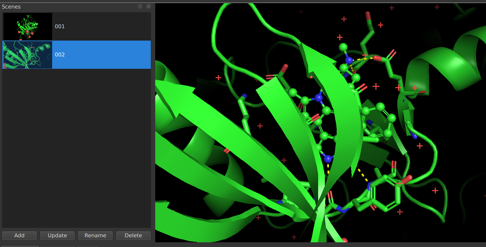
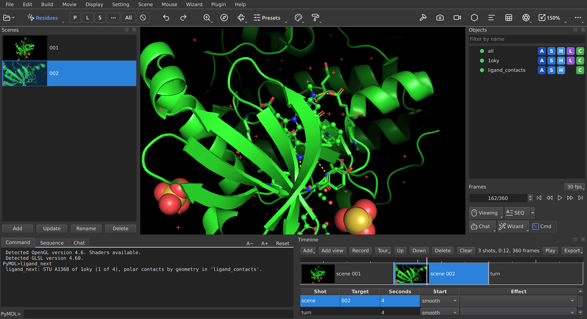
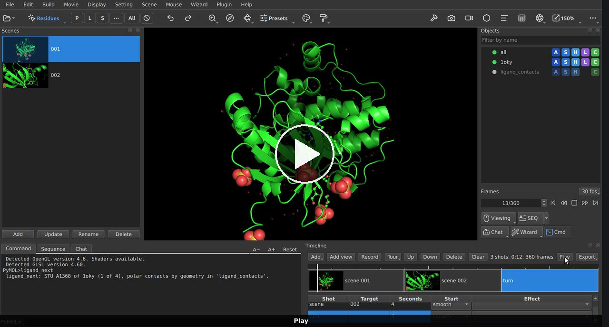

# Scenes and movies

[Docs home](README.md) · Checked with version 4.90.0.

Keep the views you want to come back to as scenes, then string scenes,
turns and zooms together into a movie and save it as a video. Scenes and
the movie editor need nothing extra. Saving a video as MP4 or GIF needs
the program ffmpeg on this computer. The example downloads one entry and
needs an internet connection.

**On this page:** [Load the example](#load-the-example) ·
[Store a scene](#store-a-scene-and-come-back-to-it) ·
[Update, rename, reorder](#update-rename-reorder-and-delete-scenes) ·
[Scene menu and keys](#the-scene-menu-and-the-keys) ·
[What a scene keeps](#what-a-scene-keeps) ·
[The scene command](#the-scene-command) ·
[States and frames](#states-and-movie-frames) ·
[Make a movie](#make-a-movie-in-the-timeline) ·
[Shots](#the-kinds-of-shots) ·
[Record and Tour](#record-views-and-make-a-tour) ·
[Edit the movie](#edit-the-movie) ·
[Save a movie](#save-a-movie) ·
[Movies in a script](#movies-in-a-script) ·
[Limits](#limits-and-common-problems)

## Load the example

1OKY is a kinase with the inhibitor staurosporine (residue name `STU`) in
its pocket.

```
fetch 1oky
```

`fetch` needs an internet connection. Offline, open a structure of your
own with File > Open...; replace `1oky` and `STU` by its names.

## Store a scene and come back to it

A *scene* saves a view and its appearance: where the camera is, what is
shown, how it is drawn and colored. Recalling a scene brings all of that
back at once.

1. Click the **Scenes** button of the toolbar. The button is an icon; its
   name shows when the mouse is over it. Scene > Scenes and Display >
   Panels > Scenes open the same panel, docked at the left.
2. Set up the first picture, for example the whole protein as cartoon.
3. Click **Add**. A row appears with a small picture of the view. Scenes
   added here are named `001`, `002` and so on.
4. Change the picture: zoom on the ligand, show its neighbors.
5. Click **Add** again.
6. Click the first row. The first picture comes back.

One click on a row or on its picture recalls the scene. So does Enter on
the row that is picked. A double click does nothing more than a click. To
pick a row without recalling it, right-click it or move with the arrow
keys.



## Update, rename, reorder and delete scenes

These act on the picked row. Right-click the row first if the view on
screen must stay as it is.

| Action | Mouse | Keyboard |
| --- | --- | --- |
| Store the view of now in the scene | **Update** | |
| Rename | **Rename**, then type and press Enter | F2 |
| Move up or down | Drag the row | Ctrl+Up, Ctrl+Down |
| Delete | **Delete** | |

A new name must not be empty, contain a space, or be the name of another
scene; otherwise the old name stays.

## The Scene menu and the keys

| Scene menu | Does | Key |
| --- | --- | --- |
| Next, Previous | Go to the next or the previous scene | PgDn, PgUp |
| Append | Store the view of now as a new scene | |
| Append... > Camera, Color, Reps, Reps + Color | Store a new scene that keeps only that part | |
| Insert Before, Insert After | Store a new scene beside the current one | |
| Update, Delete | Store again or delete the current scene | |
| Store > F1 to F12 | Store the view under the name of a function key | |
| Recall > F1 to F12 | Recall that scene | F1 to F12 |
| Clear > F1 to F12 | Delete that scene | |

PgDn, PgUp and the function keys work while the viewport has the keyboard.
A function key recalls the scene of its name, wherever that scene was
stored.

## What a scene keeps

| Kept | Not kept |
| --- | --- |
| The camera | Coordinates: atoms you moved stay moved |
| Which objects are switched on | Objects loaded or deleted since |
| What is shown of every atom, and its color | Properties of objects |
| The movie frame or state | Settings of single states |
| A message, if you gave one | Secondary structure |
| The style of presets and colorings | The text of labels |

The style is what a preset or a coloring sets besides colors and
representations: the cartoon type; the sizes and colors of sticks, spheres,
balls and sticks, lines and dashes; transparency; the kind and quality of
the surface; the light and the outline of a look; the background and the
fog of a theme and of the floor. So a scene stored in one preset comes
back in that preset, also after you chose another.

A scene also keeps the definitions of the named colors it uses. Recalling
it sets such a color for the whole session, also for atoms outside the
scene that have that color.

Scenes are saved in the session file. A *session* saves your work to
continue later (File > Save Session).

## The scene command

```
as cartoon
scene overview, store
show ball_and_stick, organic
zoom resn STU, 6
scene site, store, The inhibitor in its pocket
scene overview
scene site
```

The last two lines recall the scenes. The text after the second comma is a
message that is shown with the scene. Each action has its own form:

| Command | Does |
| --- | --- |
| `scene site, store` | Stores the view of now under that name |
| `scene new, store` | Stores it under the next free number |
| `scene site` | Recalls |
| `scene site, update` | Stores again and keeps the message |
| `scene site, rename, new_key=pocket` | Renames |
| `scene_order pocket overview` | Sets the order |
| `scene` | Goes to the next scene |
| `scene auto, previous` | Goes to the previous scene |
| `scene pocket, clear` | Deletes one scene |
| `scene *, clear` | Deletes all scenes |

To recall only a part, switch the rest off: `view=0` leaves the camera,
`color=0` the colors, `rep=0` what is shown and how. `settings=0` stores or
recalls without the style. Example: `scene overview, recall, view=0`.

A *view* is the camera alone. `view v1, store` and `view v1` keep and
recall one by name; `get_view` prints the camera as a `set_view` command
for a script.

## States and movie frames

A *state* is one set of coordinates of an object: one model of an NMR
entry, one step of a trajectory, one conformer. A *frame* is one picture
of a movie. Without a movie every state is a frame, so playing shows state
1, 2, 3 and so on. A movie has its own number of frames and says for each
frame what the camera does and which state is shown.

When there is more than one state or frame, a strip appears under the
object list. Its title is **States**, or **Frames** when there is a movie.

| Control | Does |
| --- | --- |
| First, Previous, Next, Last | Step through the states or frames |
| Play | Plays; the same button stops |
| The number box | Type a number and press Enter to jump there |
| The fps button | Playback speed: 1, 5, 10, 15, 30 or 60 per second |

The speed is the setting `movie_fps`. It is also the number of frames a
movie has per second: a shot of 4 seconds has 120 frames at 30.

## Make a movie in the Timeline

The Timeline panel shows the movie as a list of *shots*. A shot is one
step: go to a scene, turn once, hold still.

1. Click the **Movie** button of the toolbar, an icon like **Scenes**. A
   second click closes the panel. Movie > Timeline and Display > Panels >
   Timeline open it too.
2. Click **Add** > Scene and choose a scene. The first shot shows it.
3. Click **Add** > Turn 360°. The view turns once around the vertical axis.
4. Click **Add** > Scene and choose another scene. The camera flies there.
5. Click **Play**. Click it again to stop.

The strip at the top shows every shot as a block as wide as it lasts,
scenes with their picture, under a ruler of seconds. The line across it is
the moment that is shown. The table under the strip has one row per shot.
A new shot goes in after the selected row. The text beside the buttons
says how many shots, how long and how many frames the movie has.



*Here the movie has three shots: scene 001, scene 002 and a turn that was
dragged from 8 to 4 seconds.*

[](media/movie.mp4)

*Clip, 31 seconds, no sound: a click on each scene, the Movie button, Tour > Every scene, Add > Turn 360°, a drag of the right end of the turn, Play, and the Export menu. The steps are written out on this page.
[Open or download the clip](media/movie.mp4).*

## The kinds of shots

| **Add** menu | What the shot does | Seconds at first |
| --- | --- | --- |
| Scene | Recalls a scene; the camera flies to it | 4 |
| Zoom to | Flies to `all`, `organic` or one of your selections | 4 |
| View of now | Flies to the view the viewport has now | 4 |
| Turn 360° | Turns once around the vertical axis | 8 |
| Rock | Swings left and right | 8 |
| Nutate | Wobbles in a small circle | 8 |
| Play the states | Runs from the first state to the last | 6 |
| Hold | Stays as it is | 2 |

Scene is grey while there is no scene, Play the states while there is only
one state.

Each row of the table has five columns:

| Column | What you set |
| --- | --- |
| Shot | The kind; fixed |
| Target | The scene of a Scene shot or the selection of a Zoom to shot; type another name to change it |
| Seconds | How long the shot lasts; at least 0.1 |
| Start | `smooth` (slow in and out), `linear` (even speed), `cut` (no flight) |
| Effect | Nothing, or a fade |

The four effects are fade in surface, fade out surface, fade in cartoon
and fade out cartoon. A fade changes the setting `transparency` or
`cartoon_transparency` step by step over the shot, for every object that
has no value of its own. The setting stays at its last value when the
movie ends: after a fade out, the surface or cartoon stays invisible until
you set it back, for example with `set transparency, 0`.

The flight to a scene, a view or a selection takes up to 2 seconds of its
shot, and at most half of it. With `cut` the picture changes at once.

## Record views and make a tour

- **Add view** adds the view of now as a shot.
- **Record** is a switch. While it is on, every view that comes to rest
  after you moved it becomes a shot of 2 seconds. Move, wait a moment,
  move again; click **Record** again to end.
- **Tour** makes a whole movie with one click:

| **Tour** menu | The shots it adds |
| --- | --- |
| Every scene | One shot per scene, in the order of the Scenes panel |
| Every ligand | For every ligand: fly to it, then one turn |
| Every chain | For every chain of a polymer: fly to it, then one turn |
| Every selection | For every selection you named: fly to it, then one turn |

A ligand is here every residue that the selection `organic` takes,
additives such as glycerol included. With nothing to visit you read
"Nothing to visit".

## Edit the movie

| Action | Mouse | Keyboard, in the table |
| --- | --- | --- |
| Go to a moment | Click a block, or click or drag on the ruler | |
| Move a shot | Drag its block; **Up**, **Down** | Alt+Up, Alt+Down |
| Make a shot longer or shorter | Drag the right end of its block | Type the seconds |
| Delete a shot | **Delete** | Delete |
| Remove the whole movie | **Clear** | |
| Play or stop | **Play** | Space, in the strip |

Every change builds the movie again and goes back to its start. The shots
are kept in the session file and come back when the session is opened.

A movie that was made with commands has no shots. It shows as one block
and plays here. **Add** then asks before it replaces that movie with a
list of shots.

While the Timeline panel is open, the row of key frames that PyMOL draws
under the viewport is switched off.

## Save a movie

1. Click **Export** in the Timeline panel.
2. For the slow, high-quality renderer with shadows, tick **Ray traced**
   and click **Export** again. Without the tick the frames are drawn as on
   screen, which is fast.
3. Choose a size.
4. Read the estimate: the number of frames, the time and the disk space
   for the frames on the way. Click Yes.
5. Choose the file name.

| **Export** menu | Result |
| --- | --- |
| MP4 1280 x 720 | Video file |
| MP4 1920 x 1080 | Video file |
| MP4 3840 x 2160 | Video file |
| GIF 640 x 480 | Animated picture |
| More formats... | The dialog Movie Export, see below |
| Copy as script | Puts Python code that builds the same movie on the clipboard |

**What you need.** The frames are first written as PNG pictures into a
folder beside the output file, named like it with `.tmp` at the end, and
removed afterwards. A separate program then makes the video: `ffmpeg`.
For a GIF, `convert` of ImageMagick is used when ffmpeg is missing.
Neither is part of pymolish-studio; install ffmpeg and make sure it is on
the PATH. Without both, the export stops before any frame is rendered
with: `neither "ffmpeg" nor "convert" available for video encoding`.

**More formats...** and File > Export Movie As > MPEG... open the dialog
Movie Export. There you set width and height, **Draw (fast)** or **Ray
(slow)**, the encoder, the quality and the format:

| Format | Needs |
| --- | --- |
| MPEG 4, MPEG 1, MOV (QuickTime) | ffmpeg |
| GIF | ffmpeg or convert |
| PNG Images | Nothing: one numbered PNG file per frame |

File > Export Movie As > Quicktime... opens the same dialog with MOV
chosen, and PNG Images... opens it for numbered PNG files only. Formats
that the chosen encoder cannot write are grey. An encoder that is chosen
but not installed gives the warning "Encoder 'ffmpeg' is not installed."

## Movies in a script

The shots of the Timeline, written as Python. This is what **Copy as
script** gives you:

```python
from pymol import shots
shots.build([
    shots.shot("scene", "overview", 2),
    shots.shot("turn", seconds=4),
    shots.shot("scene", "site", 3),
    shots.shot("hold", seconds=1),
])
```

It needs the scenes `overview` and `site` of
[The scene command](#the-scene-command). `shots.build` replaces the movie;
at 30 frames per second this one has 300 frames. The kinds are `scene`,
`view`, `zoom`, `turn`, `rock`, `nutate`, `states` and `hold`.
`shots.tour("ligands")` returns the shots of a tour.

Write the video:

```
movie.produce pocket.mp4, mode=ray, width=1280, height=720
```

`mode=draw` is the fast renderer. A script that runs without a window
(`pymolish -c`) must use `mode=ray`: nothing is drawn there. The
extension chooses the format: `.mp4`, `.mov`, `.webm`, `.gif`, `.mpg`.

The classic movie commands of PyMOL work as before:

| Command | Does |
| --- | --- |
| `mset 1 x90` | Makes a movie of 90 frames that show state 1; `mset` alone removes the movie |
| `mview store, 45` | Keeps the camera of now as a key frame at frame 45 |
| `mview interpolate` | Fills in the camera between the key frames |
| `mplay`, `mstop` | Plays and stops |
| `frame 45` | Goes to a frame |
| `movie.add_roll(4)` | Python: adds a turn of 4 seconds to the movie |
| `movie.add_rock(4)`, `movie.add_nutate(4)` | Python: adds a rock or a nutation |
| `movie.add_scenes()` | Python: adds a visit to every scene |
| `mpng frame_, mode=2` | Writes the frames as `frame_0001.png`, ...; mode 2 ray traces |
| `movie.produce name.mp4` | Renders and encodes the movie |

A turn made by hand:

```
mset 1 x90
mview store, 1
turn y, 120
mview store, 45
turn y, 120
mview store, 90
mview interpolate
mplay
```

The Movie menu has the same tools as rows: Append adds empty seconds,
Program > State Sweep plays the states forward and back, Reset removes the
movie, and Frame Rate sets `movie_fps`.

## Limits and common problems

- **A click on a scene changed my view before I could update it:** a click
  recalls. Right-click the row to pick it, then click **Update**.
- **A scene does not bring an object back:** a scene keeps no atoms. An
  object deleted after the scene was stored stays deleted.
- **Recalling a scene changed a color elsewhere:** the scene brought back
  the definition of a named color; see
  [What a scene keeps](#what-a-scene-keeps).
- **"neither ffmpeg nor convert available":** install ffmpeg so that the
  command `ffmpeg` is found on the PATH, then start pymolish-studio again.
- **The background is opaque after an export:** the export switches the
  setting `opaque_background` on and leaves it on.
- **The shots are gone after opening a session:** the list comes back only
  if the movie still has the length the list built. A movie changed with
  commands afterwards has no list; it still plays.
- **The surface is gone after the movie:** a fade out left `transparency`
  at 1. Type `set transparency, 0`.
- **A ray-traced export takes long:** every frame is ray traced. Read the
  estimate first, or export without **Ray traced**.
- The movie that the Timeline builds is an ordinary PyMOL movie. PyMOL
  ignores the list of shots in a session from here and recalls its scenes
  without their style. [Saving](saving.md) has the session formats.

## Next

- [Saving](saving.md): sessions, pictures and what each file keeps.
- [Appearance](appearance.md): the presets, looks and themes a scene
  keeps.
- [Sequences and alignments](sequences.md): fit two structures before you
  compare them in scenes.
- [Commands](commands.md) and [Reference](reference.md).
