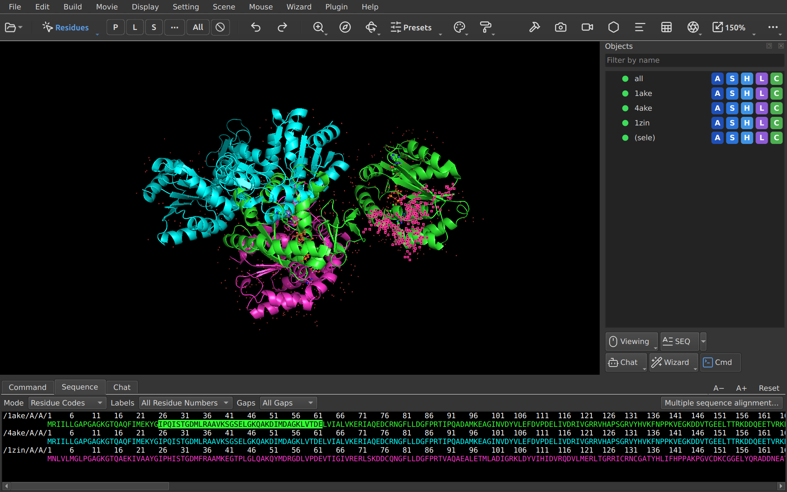
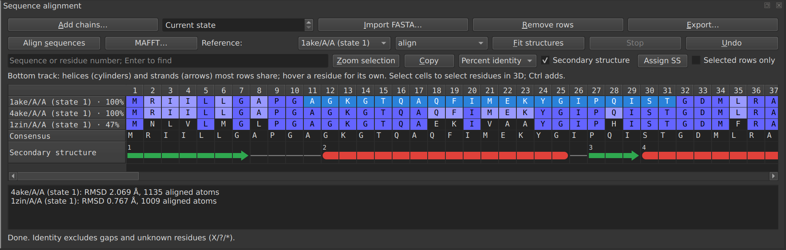
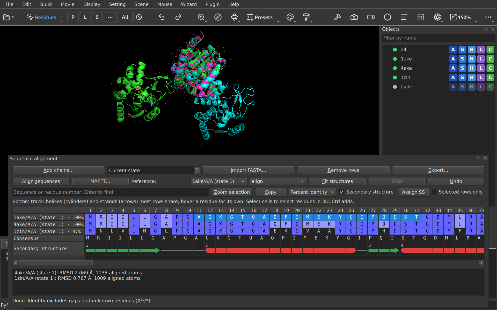
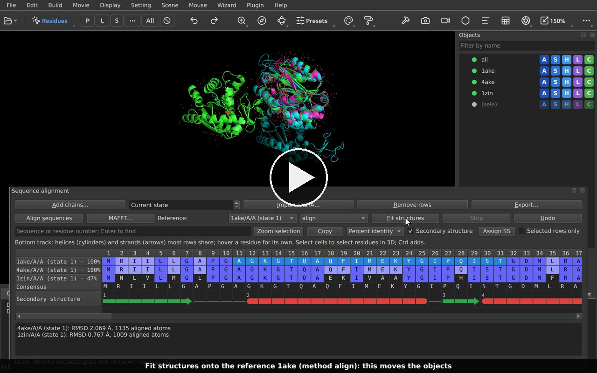

# Work with sequences and alignments

[Docs home](README.md) · Checked with version 4.90.0.

Read the sequence of the structures you loaded, select residues from it,
line up the sequences of several chains, and lay structures over one
another. The Sequence tab and the alignment window need nothing extra.
Aligning sequences needs the program MAFFT on this computer. The example
downloads three entries and needs an internet connection.

**On this page:** [Load the example](#load-the-example) ·
[Two places](#two-places-for-a-sequence) ·
[The Sequence tab](#read-and-select-in-the-sequence-tab) ·
[Open the window](#open-the-sequence-alignment-window) ·
[Add rows](#add-chains-and-fasta-files) ·
[Align sequences](#align-sequences-with-mafft) ·
[Find and select](#find-and-select-residues) ·
[Colors](#color-the-residues) ·
[Secondary structure](#see-the-secondary-structure) ·
[Fit structures](#fit-structures-onto-a-reference) ·
[Stop and Undo](#stop-and-undo) ·
[Export](#export-the-alignment-and-the-identities) ·
[Sessions](#what-a-session-keeps) ·
[Keyboard](#keyboard) ·
[Commands](#commands) ·
[Limits](#limits-and-common-problems)

## Load the example

Three structures of the enzyme adenylate kinase:

```
fetch 1ake
fetch 4ake
fetch 1zin
```

| Entry | What it is |
| --- | --- |
| `1ake` | The enzyme of *Escherichia coli*, closed around an inhibitor |
| `4ake` | The same protein with nothing bound, open |
| `1zin` | The enzyme of another bacterium, closed around the same inhibitor |

`1ake` and `4ake` have two copies of the protein each, chains A and B.
`fetch` needs an internet connection. Offline, open any two or three
related structures from files with File > Open...; every step works the
same, only the numbers differ.

## Two places for a sequence

| Place | Use it to |
| --- | --- |
| Sequence tab | Read the sequence of what is shown and select residues |
| Sequence alignment window | Compare chains: align, color, search, fit, export |

The tab shows each object on a line of its own and does not line the
objects up. The window is a table in which every column is one position of
the alignment.

## Read and select in the Sequence tab

1. Click the **Sequence** tab, between **Command** and **Chat** at the
   bottom of the window. The **SEQ** button under the object list opens the
   same tab, and so does Display > Panels > Sequence.
2. Click a residue. It is added to the selection `sele` and marked in the
   viewport. A second click takes it out again.
3. Drag over the letters, or click one residue and Shift+click another, to
   take a range.
4. Right-click a residue for its menu. Click with the middle button to
   center the view on it.

The tab lists every object that is switched on. The selected residues are
marked, also when you selected them somewhere else.



Three lists over the sequence set what you read:

| List | Items |
| --- | --- |
| **Mode** | Residue Codes, Residue Names, Chain Identifiers, Atom Names, States |
| **Labels** | All Residue Numbers, Top Sequence Only, Object Names Only, No Labels |
| **Gaps** | No Gaps, All Gaps, Single Gap |

The same choices are in Display > Sequence Mode. As commands they are the
settings `seq_view_format`, `seq_view_label_mode` and `seq_view_gap_mode`.

**A−**, **A+** and **Reset**, at the right of the tabs, change the text
size of the tab that is shown, from 6 to 40 points. Each tab keeps its own
size, also after a restart.

The sequence can also lie across the top of the viewport, where PyMOL has
it. Click the arrow of **SEQ** and choose **Show in viewport**, or choose
Display > Sequence in Viewport, or type:

```
set seq_view, 1
```

To leave one object out of both places, choose A > sequence > exclude on
its row in the Objects panel, or type `set seq_view, 0, 4ake`.

## Open the Sequence alignment window

Any of these opens it:

- the **Sequence alignment** button of the toolbar (an icon; its name
  shows when the mouse is over it);
- Display > Panels > Sequence alignment…;
- the **Multiple sequence alignment…** button in the Sequence tab;
- the arrow of **SEQ** > Sequence alignment….

It is a separate window that you can resize; it remembers its size and
place. It starts empty.

## Add chains and FASTA files

1. Click **Add chains…**.
2. Type a selection and click OK. `enabled`, the text that is already
   there, takes every chain of every object that is switched on. For the
   example type `chain A`.

Each chain becomes one row named object/segment/chain and its state, for
example `1ake/A/A (state 1)`. A chain that is already in the table is not
added twice.

A *state* is one set of coordinates of an object, for example one model of
an NMR entry. The box beside **Add chains…** says which state to read:
**Current state**, or a number.

**Import FASTA…** adds the sequences of a FASTA file as rows. Such a row
has letters only and no structure behind it: it can be aligned, but not
selected in 3D or fitted. Only the FASTA format is read.

**Remove rows** takes out the rows in which something is selected. Click a
row name at the left to select a whole row. The structures themselves are
not touched.

## Align sequences with MAFFT

1. Select cells in the rows to align. With nothing selected, all rows are
   aligned.
2. Click **Align sequences**.

Gaps (`-`) are put into the rows so that matching residues stand in the
same column. For the example the table gets 222 columns. A row
**Consensus** appears under the sequences with the most common residue of
each column, and every row name gets its identity to the reference: `100%`
for `4ake`, `47%` for `1zin`.



*The picture was taken after the fit of the next section, so the box under
the table already lists its results.*

Aligning sequences moves no atom. It only says which residues correspond.
To move the structures, see
[Fit structures](#fit-structures-onto-a-reference).

MAFFT does the alignment on this computer; no sequence is sent anywhere.
MAFFT is not part of pymolish-studio: [Install](install.md) says how to get
it. The program `mafft` on the PATH is used (`mafft.bat` on Windows). To
use another copy, click **MAFFT…** and choose the executable; the choice is
kept. Without MAFFT you read: "Install MAFFT and put it on PATH, or choose
its executable in the sequence window."

The consensus and the identities need all rows to have the same length.
After aligning only some of the rows, align all of them once more.

## Find and select residues

- **Select in the table:** click or drag over cells. The residues are
  selected in 3D as `sele`. Hold Ctrl to add to the selection that exists.
- **Select in 3D:** residues in the selection `sele` are highlighted in the
  table, wherever you selected them.
- **Search:** type letters such as `GAGKGT`, or a residue number such as
  `123`, in the box "Sequence or residue number; Enter to find" and press
  Enter. The matching cells are selected, and with them the residues in
  3D. A number with an insertion code, such as `100A`, works too.
- **Zoom selection** zooms the viewport on the selected residues.
- **Copy** puts the selected letters on the clipboard, one line per row.
  With nothing selected it copies the whole alignment as FASTA. Ctrl+C in
  the table does the same.
- **Selected rows only** hides the rows without a selected cell. Clear the
  box to see all rows again.

The search finds the first place in each row where the letters stand
exactly as typed. It does not look across gaps and knows no wildcards. For
patterns use the command `search_sequence`, below.

Hover over a residue to read its row, its name and number, and its
secondary structure.

## Color the residues

The list beside **Copy** colors the letters:

| Item | Colors |
| --- | --- |
| No color | Nothing |
| Residue type | By kind of residue: hydrophobic, aromatic, positive, negative, polar, proline and glycine, cysteine |
| Hydrophobicity | From blue (hydrophilic) to red (hydrophobic) |
| Percent identity | Residues equal to the consensus; darker when more rows share them |

The choice is kept for the next start. It colors the table only, not the
structures.

## See the secondary structure

Secondary structure is the local fold of the chain: helix, strand or coil.
One track at the bottom of the table draws it: helices as cylinders,
strands as arrows, coil as a line. Helices and strands are numbered. A
column shows what most structure rows have there. This track is the only
place where the window draws secondary structure. For a single residue,
hover over it: the tooltip says helix, sheet, coil or unassigned.

- Clear the box **Secondary structure** to hide the track.
- The track is read from the structure as it was when the chain was added.
  Rows from FASTA have none.
- **Assign SS** computes it again from the geometry for the selected
  structure rows, or for all rows when nothing is selected. As a command
  this is `dss`. It changes the structure itself, so the cartoon in the
  viewport can change too. **Undo** takes it back.

## Fit structures onto a reference

Fitting moves whole objects so that they lie over one object that stays in
place: the reference. The sequence alignment in the table is not used for
it; each method finds its own matching residues.

1. Choose the row that stays in place in the list **Reference:**. For the
   example choose `1ake/A/A (state 1)`.
2. Choose a method in the list beside it: `align`, `super` or `cealign`.
3. Click **Fit structures**. The selected rows are fitted, or all rows
   when nothing is selected.

| Method | How it matches residues | Choose it when |
| --- | --- | --- |
| `align` | By sequence first | The sequences are similar, about 30 % identity or more |
| `super` | By structure | The sequences differ and the folds are alike |
| `cealign` | By structure, alpha carbons only | The sequences have little or nothing in common |

`align` and `super` then leave out the atoms that fit badly and fit again,
up to five times.

The box under the table lists one line per moved object: the RMSD in Å
(the typical distance between matched atoms; smaller is closer) and how
many atoms were matched in the end. With `cealign` the number counts
residues, although the line says atoms. For the example, each method
started from the structures as loaded:

| Method | `4ake` onto `1ake` | `1zin` onto `1ake` |
| --- | --- | --- |
| `align` | RMSD 2.069 Å, 1135 | RMSD 0.767 Å, 1009 |
| `super` | RMSD 2.069 Å, 1135 | RMSD 0.744 Å, 1004 |
| `cealign` | RMSD 3.460 Å, 112 | RMSD 2.244 Å, 208 |

`1zin` is another protein in the same closed shape and fits closely.
`4ake` is the same protein in the open shape: only a part of it can lie on
`1ake` at a time, and the atoms that fit badly were left out of its
number.



[](media/sequence.mp4)

*Clip, 31 seconds, no sound: the Sequence alignment button, Add chains… with chain A, Align sequences, Percent identity, a drag over cells, Fit structures, Undo. The steps are written out on this page.
[Open or download the clip](media/sequence.mp4).*

What to know before you fit:

- A fit changes coordinates. It moves the whole object: every chain, the
  ligands and the water, not only the chain of the row.
- Each object can be in a fit only once. Two chains of one object give:
  "Choose one chain/state per object; a fit moves the whole object".
- Rows from FASTA cannot be fitted. If the table has such rows, select
  only structure rows before you click **Fit structures**.
- A session with more than 600,000 atoms is not fitted from this window,
  because the step could not be undone. The commands `align`, `super` and
  `cealign` still work there.

## Stop and Undo

**Stop** ends work that is running. A MAFFT run is ended at once. A fit of
one object that has started is finished first; the objects after it are not
fitted. What was already moved stays moved.

**Undo** brings back the session as it was before the last **Fit
structures** or **Assign SS**. What you did after it (a preset, a color,
a new object) is a step of its own and is undone first. Edit > Undo and
the command `undo` do the same. Opening a session clears the kept steps. Aligning sequences changes
no structure and is not a step of Undo.

## Export the alignment and the identities

1. Click **Export…**.
2. Choose the file type: **Aligned FASTA (\*.fasta)** or **Statistics
   (\*.csv)**.

The FASTA file has every row with its gaps. The CSV file has one line per
row with the columns `sequence`, `identity_to_reference` and `reference`;
the identity is a fraction, `1.0` for 100 %. Align the sequences first:
without a common length there are no identities.

How identity is counted: only columns in which both the row and the
reference have a known residue are used. Gaps and the letters `X`, `?` and
`*` are left out. Identity is the share of those columns in which the two
letters are equal. The percent in the row names and the conservation in
the tooltip of the Consensus row follow the same rule.

## What a session keeps

A *session* saves your work to continue later (File > Save Session). It
keeps the rows of the alignment window, with their gaps, and the
reference. They come back when the session is opened.

A row whose object was deleted or renamed gets "(unmapped)" in its name:
its letters stay, but it can no longer be selected in 3D or fitted. A row
is also not updated when you edit its structure. In both cases select the
row, click **Remove rows**, and add the chain again.

## Keyboard

| Key | Action in the alignment window |
| --- | --- |
| Alt+A | **Add chains…** |
| Alt+I | **Import FASTA…** |
| Alt+R | **Remove rows** |
| Alt+E | **Export…** |
| Alt+S | **Align sequences** |
| Alt+F | **Fit structures** |
| Alt+U | **Undo** |
| Alt+Z | **Zoom selection** |
| Alt+C | **Copy** |
| Ctrl+C | Copy, in the table |
| Enter | Find, in the search box |

## Commands

Align the sequences of a FASTA file with MAFFT. The first line writes the
three example chains to a file:

```
save adk.fasta, chain A
sequence_align adk.fasta, adk_aligned.fasta
```

`sequence_align filename [, output [, executable]]` returns the aligned
FASTA and writes it to `output` when you give one. `executable` is the
path of MAFFT when it is not on the PATH. No structure is moved.

Select residues by sequence:

```
search_sequence GAGKGT, ploop
search_sequence G.PG.GKGT
```

`search_sequence pattern [, name [, selection]]` selects the residues of
every protein chain that match. The pattern is a sequence in one-letter
code or a regular expression, in which `.` is any residue. Without a name
the selection is called `seq_` and the letters of the pattern. A match
does not run from one chain into the next. For the example the first line
reports 5 matches, 30 residues.

Fit structures:

```
align 1zin and chain A, 1ake and chain A
super 4ake and chain A, 1ake and chain A
cealign 1ake and chain A, 1zin and chain A
```

`align` and `super` take the object that moves first and the one that
stays second. `cealign` takes them the other way round: first the one that
stays. Add `cycles=0` to `align` or `super` to keep every matched atom.
This line compares the open and the closed shape over all 214 alpha
carbons and reports an RMSD of 7.131 Å:

```
align 4ake and chain A and name CA, 1ake and chain A and name CA, cycles=0
```

Read a sequence as text, and assign secondary structure:

```
print(cmd.get_fastastr("1zin"))
dss 1zin
```

`help align`, `help super`, `help cealign` and `help dss` list every
argument.

## Limits and common problems

- **"Install MAFFT and put it on PATH…"**: MAFFT is missing or not found.
  See [Install](install.md), or click **MAFFT…** and choose the
  executable.
- **No Consensus row, no percent in the row names:** the rows do not have
  the same length. Clear the selection and click **Align sequences**.
- **"Structure fitting needs at least two structure rows":** a FASTA row
  was among the rows to fit, or only one structure row was chosen.
- **"A structure row is no longer mapped; add its chain again":** the
  object of a row was deleted or renamed.
- **"This fit exceeds the Undo snapshot limit":** the session has more
  than 600,000 atoms. Use the commands instead.
- **The whole complex moved, not one chain:** a fit moves the whole object.
  To move one chain alone, make it an object of its own first, for example
  with `extract_chain 1ake, A` (see [Commands](commands.md)).
- **Undo took back more than the fit:** it restores the whole session as
  it was before the fit.
- **The search finds nothing in an aligned row:** a gap stands inside the
  motif in that row. Use `search_sequence`.
- Only FASTA is imported and exported. Another format, such as a Clustal
  `.aln` file, is refused with "FASTA: expected a header followed by
  sequence letters".
- The tab does not draw three things that the sequence in the viewport
  has: the dimming of unaligned residues, the frame around a drag, and the
  marks of the selection along the scroll bar.

## Next

- [Scenes and movies](scenes-movies.md): keep the fitted view and animate
  it.
- [Editing and analysis](editing-analysis.md): more about fitting,
  measuring and morphing between two shapes.
- [Saving](saving.md): sessions, structures and pictures.
- [Commands](commands.md) and [Reference](reference.md).
