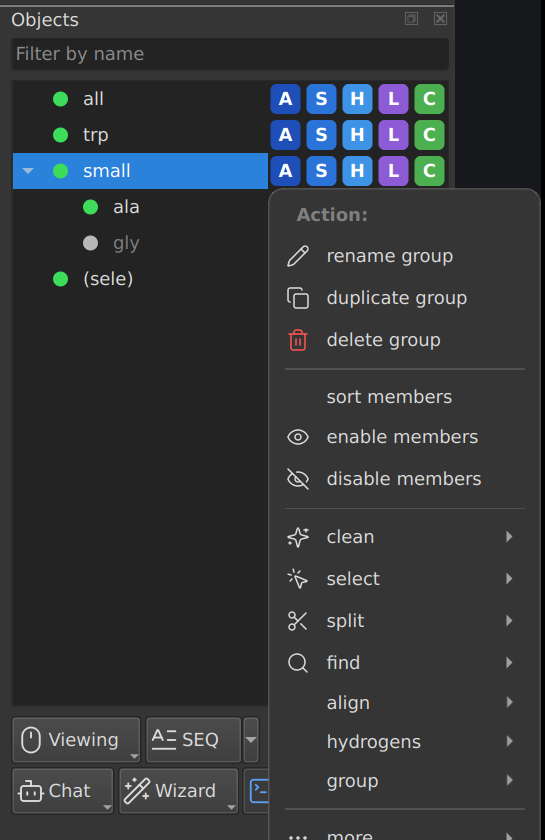

# Open and organize structures

[Docs home](README.md) · Checked with version 4.90.0.

Bring molecules into the window from files, folders, the Protein Data Bank,
UniProt or a prediction server, then name, group, select and split them.
Local files need nothing extra; every download needs an internet connection.

**On this page:** [Open a file](#open-a-file) ·
[Open a folder](#open-every-file-of-a-folder) ·
[Get a PDB entry](#get-an-entry-from-the-pdb) ·
[By UniProt](#get-all-structures-of-one-protein-uniprot) ·
[Predicted structure](#get-a-predicted-structure) ·
[Downloads](#what-a-download-contacts) ·
[Names and groups](#names-and-groups) ·
[Objects panel](#the-objects-panel) ·
[Show and hide](#show-and-hide) ·
[Select](#select-parts) ·
[Split and extract](#split-and-extract) ·
[Limits](#limits-and-common-problems)

Three words used on this page. An **object** is one loaded molecule (or map,
or measurement) with one row in the Objects panel. A **state** is one set of
coordinates of an object: one model of an NMR entry, one frame of a
trajectory. A **selection** is a named set of atoms.

## Open a file

1. Click **Open** in the toolbar (or File > Open..., or press Ctrl+O).
2. Pick one file or several.

Each file becomes an object named after the file, with a row in the Objects
panel on the right. You can also drop a file on the viewport. The arrow of
the **Open** button and File > Open Recent... list the files used before.

```
load 1oky.pdb
load 1oky.pdb, kinase
```

- The first line names the object `1oky`, the second `kinase`.
- A file loaded under a name that is in use is added to that object as a
  further state. It does not replace the object.
- A map file (`.ccp4`, `.map`) first shows a dialog for the object name and
  for what to draw from it.
- A trajectory (`.dcd`, `.xtc`, `.trr`) needs its molecule loaded first; a
  dialog asks which object receives the frames.
- A session file asks what to do with the work in progress: see
  [Save sessions, structures, pictures and exports](saving.md#save-a-session).

The file types that are read are in the table of
[file formats](saving.md#file-formats-that-are-read-and-written).

## Open every file of a folder

1. Choose File > Open Folder... (or the arrow of **Open** > Open folder...).
2. Set **Folder** (or **Browse...**) and **Format**.
3. Optional: a **Name filter** such as `model_*`, **Include subfolders**,
   and a **Group** that collects the new objects.
4. The dialog shows how many files match and the command it will run.
   Press OK.

One object per file appears, named after the file.

```
load_files poses, pdb, poses
load_files poses, pdb, pattern=model_*, recursive=1, prefix=x_
```

The first line loads every `.pdb` file of the folder `poses` into a group
`poses`. The second takes only names that start with `model_`, looks in
subfolders too and puts `x_` in front of every name.

- One format per call.
- A file that cannot be read is reported and skipped.
- No object is replaced: a name in use gets a number (`1oky01`).
- With subfolders, the folder becomes part of the name (`sub_model_c`).

## Get an entry from the PDB

1. Choose File > Get PDB... (or the arrow of **Open** > Get PDB entry...).
2. Type the four-character code under **PDB ID:**, for example `1ubq`.
3. Optional: tick **2FoFc Map** or **FoFc Map**, give a chain or an assembly.
4. Press **Download**.

The entry is loaded as an object named after the code.

```
fetch 1ubq
fetch 1okyA
fetch 1ubq, ubq_map, type=2fofc
fetch STU
```

| Code | Loads |
| --- | --- |
| four characters (`1ubq`) | the entry, as mmCIF |
| five characters (`1okyA`) | one chain of the entry |
| two or three characters (`STU`) | that chemical component: one ligand, alone |
| with `type=2fofc` or `type=fofc` | the electron density map of the entry |

- The downloaded file stays in the working directory (setting `fetch_path`).
  A file that is already there is loaded without a new download.
- `type=pdb` asks for the PDB format instead of mmCIF.

## Get all structures of one protein (UniProt)

A UniProt accession such as `P00918` names one protein. The PDB often has
many entries for it.

1. Choose File > Get by UniProt... (also under the arrow of **Open**).
2. Type the accession. Add a number after a comma to limit the download:
   `P00918, 5` loads the first five entries.
3. Press OK.

The download runs in the background and the window stays usable. The objects
are named `<accession>_<PDB id>` and collected in a group named after the
accession.

```
list_uniprot_structures P00918
fetch_by_uniprot P00918, 5
fetch_by_uniprot P00918, 5, async_=1
fetch_uniprot_ligands P00918, limit=20
```

- `list_uniprot_structures` prints the entries with method, resolution and
  chains and loads nothing. Look there first.
- **Without a limit every entry is downloaded.** A well studied protein has
  hundreds.
- `async_=1` downloads in the background, with "please wait ..." in the
  viewport; without it the command line waits. Leave it out in a script, or
  the next line runs before the download has ended.
- `fetch_uniprot_ligands` has no menu row. It loads every different small
  molecule found in the entries of the protein into the group
  `<accession>_ligands`, sorted by ligand code. Molecules lighter than
  `min_weight` (100 Da) are left out: ions, sulfate, glycerol.

**The ligands are ideal models, not binding poses.** Each one comes from the
PDB chemical component dictionary, alone and near the origin, so they lie on
top of each other. To see a ligand where it binds, load the entry with
`fetch_by_uniprot` or `fetch`.

## Get a predicted structure

1. Choose File > Get Predicted Structure... (also under the arrow of
   **Open**).
2. Type a UniProt accession (looked up in AlphaFold DB) or a protein
   sequence in one-letter code (folded by the public ESMFold server).
3. Press OK. The download runs in the background.

The model appears as `AF_<accession>_F1` (or `ESM_...`), colored by
confidence, with a small legend object `plddt_legend` beside it.

```
fetch_fold P04637
fetch_fold MKTAYIAKQRQISFVKSHFSRQLEERLGLIEVQ, peptide
color_plddt AF_P04637_F1
spectrum b, red_yellow_blue, AF_P04637_F1, minimum=0, maximum=100
```

**Predicted confidence (pLDDT)** is a number from 0 to 100 that the
prediction method gives each residue: high means the local shape is probably
right, low means that part should not be trusted. It is the method's own
estimate, not a measurement.

| Color | pLDDT |
| --- | --- |
| blue | 90 and above |
| light blue | 70 to 90 |
| yellow | 50 to 70 |
| orange | below 50 |

- The confidence is stored in the B-factor column. `color_plddt` reads it
  from there, so on an experimental structure it colors by B-factor, which
  means something else.
- `spectrum` (last line above) gives a continuous scale instead of four
  colors. `color_plddt AF_P04637_F1, legend=0` colors without the legend.
- **A sequence you type is sent to `api.esmatlas.com`.** The server takes
  about 400 residues at most.
- An accession that AlphaFold DB does not have is folded by ESMFold from its
  UniProt sequence.

## What a download contacts

| Action | Servers |
| --- | --- |
| `fetch`, File > Get PDB... | `files.rcsb.org`, then `files.wwpdb.org`; maps and the chain and assembly lists of the dialog: `www.ebi.ac.uk` |
| `list_uniprot_structures`, `fetch_by_uniprot` | `rest.uniprot.org`, then as `fetch` |
| `fetch_uniprot_ligands` | `rest.uniprot.org`, `data.rcsb.org`, `files.rcsb.org` |
| `fetch_fold` | `alphafold.ebi.ac.uk`; for a sequence `api.esmatlas.com` (and `rest.uniprot.org` to look one up) |

A UniProt or prediction request that gets no answer within two minutes ends
with an error.

## Names and groups

- **Rename:** select the row and press F2, or use **A** > rename object.
  Command: `set_name kinase, pdk1`. Characters that a name cannot have are
  replaced by `_`.
- **Group:** a folder in the Objects panel. **A** > group > new puts the
  object into a new group; the same menu lists the existing groups and
  `ungroup`. You can also drag a row onto a group with the right mouse
  button.

```
group poses, model_a model_b
ungroup model_a
```

Commands to work through a group, for example docking poses:

| Command | Does | Key or menu |
| --- | --- | --- |
| `group_next poses` | shows the next member, hides the others | Ctrl-N |
| `group_previous poses` | the same, backward | Ctrl-P |
| `group_enable poses` | shows every member | **A** > enable members |
| `group_enable poses, 10` | shows every tenth member | |
| `group_disable poses` | hides the members, the group stays on | **A** > disable members |
| `sort_group poses` | sorts the members by name | **A** > sort members |
| `copy_group poses, backup, _bak` | copies the group and its members | **A** > duplicate group |

- After the last member `group_next` starts again at the first.
- Ctrl-N and Ctrl-P need no name while there is one group, or one group with
  a visible member. Otherwise the log says "name the group to step through".
- `enable poses` shows only the group itself; `group_enable` shows its
  members.
- `copy_group` adds the suffix (`_bak`, by default `_cpy`) to every member.
  It stops with "already exists" when one of the new names is taken.

## The Objects panel

The panel on the right lists `all`, then every object and selection.
Selections stand in brackets, like `(sele)`. Members of a group are indented
under it. If the panel is closed, open it with Display > Panels > Objects.



| Mouse | Does |
| --- | --- |
| Click a name | hides or shows the object; the dot is green while it is shown |
| Double-click a name | shows the object and zooms on it |
| Click **A**, **S**, **H**, **L** or **C** | opens that menu for the row |
| Right-click a row | menu: Show as, Color, rename, duplicate, delete, then Action, Show, Hide, Label |
| Drag with the right button | moves the row; a line marks the new place, a frame the group it goes into |
| Ctrl-click or Shift-click | marks rows without hiding anything, for Ctrl+C |
| Rest the pointer on a name | type, number of atoms, number of states |

| Key (in the list) | Does |
| --- | --- |
| Space | hides or shows the current row |
| F2 | renames in place; Enter applies, Esc cancels |
| Delete | deletes the object or selection of the current row |
| Alt+Up, Alt+Down | moves the row one place |
| Alt+Left | moves the row out of its group |
| Alt+Right | moves the row into the group just above it |
| Menu key | opens the right-click menu |
| Ctrl+C | copies the marked rows as text: name, type, shown, atoms, states |

- **Delete acts at once** and Undo does not bring the object back. Only a
  group asks first: it goes with everything inside it.
- F2 refuses a name that is in use ("the name ... is taken").
- **Filter by name** above the list keeps the rows whose name contains the
  text, upper or lower case. A group stays while one of its members matches.

The five letters of a row:

| Button | Menu | For example |
| --- | --- | --- |
| **A** | Action | rename, duplicate, delete, clean, select, split, find, align, hydrogens, group |
| **S** | Show | cartoon, licorice, ball and stick, spheres, surface |
| **H** | Hide | everything, one representation, waters |
| **L** | Label | residues, atom name, clear |
| **C** | Color | by element, by chain, by ss, spectrum |

Maps, measurements and other non-molecules have fewer letters. While an
object has more than one state, step and play buttons appear under the list:
see [Scenes and movies](scenes-movies.md).

## Show and hide

There are two switches, and they are independent.

| Switch | In the window | Command |
| --- | --- | --- |
| The whole object on or off | click its name | `disable 1oky`, `enable 1oky` |
| One representation (how the atoms are drawn) | **S** and **H** menus | `show cartoon, 1oky`, `hide everything, 1oky` |

An object that is switched off keeps its representations and colors, and
comes back unchanged. Looks, presets and colors are in
[Appearance](appearance.md).

```
hide everything, 1oky
show cartoon, 1oky
show sticks, 1oky and organic
```

`organic` means the small molecules bound to the protein.

## Select parts

A click on an atom in the viewport puts atoms into the selection `sele`,
which gets the row `(sele)` in the Objects panel.

1. The selection-mode button of the toolbar shows what a click selects:
   **Residues** at the start. Its menu has Atoms, Residues, Chains,
   Segments, Objects, Molecules and C-alphas.
2. The small buttons beside it select a whole kind at once, in the objects
   that are switched on:

| Button | Selects |
| --- | --- |
| **P** | protein |
| **L** | ligands (`organic`) |
| **S** | water (`solvent`) |
| **⋯** | Nucleic acid, Ions and metals, one chain, Backbone, Side chains, Hydrogens, Near the selection, 5 Å, Invert |
| **All** | everything |
| the icon after **All** | nothing (tooltip "Select nothing") |

- Hold **Shift** to add to the selection, **Ctrl** to take away from it.
- When nothing matches, the log says so and the selection stays as it was.
- **⋯** lists up to 20 chains. For one object, **A** > select lists its
  chains and the kinds of molecule it has.

```
select lig, 1oky and organic
```

This makes a named selection `lig` that stays until you delete it.
Selection words are in [Reference](reference.md).

## Split and extract

Splitting makes new objects from parts of one. Open **A** on the row of the
object:

| Menu | Makes | The original |
| --- | --- | --- |
| **A** > split > by chain | one object per chain (`1oky_A`) in the group `1oky_chains` | is switched off, not changed |
| **A** > split > by type | `1oky_protein`, `1oky_ligand`, `1oky_ions`, `1oky_solvent` in the group `1oky_types` | is switched off, not changed |
| **A** > split > by state | one object per state (`nmr_0001`, ...) | stays |

"by state" is shown only for an object with more than one state. The kinds
are protein, nucleic, membrane (lipids), ligand, ions, solvent, and other.

```
extract_chain 1oky
split_types 1oky, group=parts
split_states nmr
extract ligand, 1oky and organic
create site, byres (1oky within 5 of ligand)
```

- `extract_chain` and `split_types` copy atoms. `extract_chain` as a
  command leaves the original switched on.
- `extract` **moves** atoms: after the fourth line `1oky` no longer has its
  ligand. `create` copies. On a selection row the same two are **A** >
  extract object and **A** > copy to object > new.
- A split stops with "already exists" when an object of that name is there,
  for example on the second try. Delete the old parts first.

## Limits and common problems

| Problem | Cause and what to do |
| --- | --- |
| Download fails | No connection, or the code does not exist. The log names the address that failed. |
| Hundreds of objects after Get by UniProt... | No limit was given. Type `P00918, 5`. |
| Ligands from `fetch_uniprot_ligands` lie on each other, far from the protein | They are ideal models at the origin, not binding poses. |
| The object is in the list but not in the viewport | Its dot is grey: click the name. Or press **Zoom**. |
| A second file became a state, not an object | It was loaded under a name in use. Give another name: `load file.pdb, name2`. |
| An object vanished after `set_name` | The command `set_name` to a name in use replaces that object. F2 in the panel refuses instead. |
| Ctrl-N does nothing | Several groups have visible members: `group_next poses`. |
| Undo did not bring back a deleted or split object | Undo does not cover delete, split, rename or loading. Save a session before large changes. |

## Next

- [Change how a structure looks](appearance.md)
- [Inspect a ligand and its pocket](ligands.md)
- [Save sessions, structures, pictures and exports](saving.md)
- [Commands](commands.md) · [Reference](reference.md) ·
  [Troubleshooting](troubleshooting.md)
